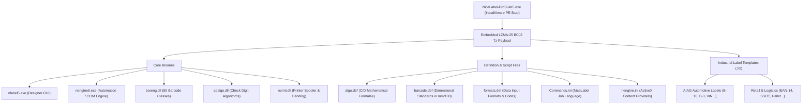
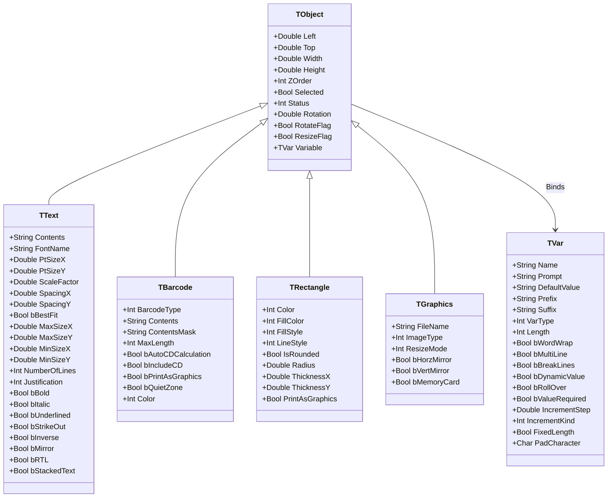

# NiceLabel 5 Deep Reverse Engineering & Architectural Analysis

Tài liệu này ghi lại toàn bộ kết quả phân tích nhị phân (reverse engineering), bóc tách cấu trúc file mẫu (`.lbl`), hệ thống lớp đối tượng, thuật toán mã vạch (`bareng.dll`), module kiểm tra số (`cdalgo.dll`), pipeline in ấn (`nprint.dll`), và cơ chế điều khiển tự động (`Commands.ini`, `nengine.ini`) của bộ phần mềm công nghiệp **NiceLabel Pro Suite 5** (Build 5.2.1.2514).

Tài liệu phục vụ làm **cơ sở đối chuẩn tham chiếu (reference benchmark)** cho việc thiết kế kiến trúc, độ trung thực in ấn, và khả năng tương thích định dạng của **ANLAbel**, tuân thủ nghiêm ngặt theo `docs/REFERENCE_POLICY.md` và `docs/LOCAL_LABEL_PRODUCT_CONTRACT.md`.

---

## 1. Tổng quan Bộ Cài & Tính Toàn Vẹn Nhị Phân

### 1.1. Chứng thực bảo mật & Nguồn gốc
* **Tệp phân tích:** `NiceLabel-ProSuite5.exe` (71,390,424 bytes ~ 68.1 MB).
* **Chữ ký số (Authenticode):**
  * **Người ký:** `Euro Plus d.o.o.` (Kranj, Slovenia).
  * **Đơn vị cấp chứng chỉ:** `VeriSign Class 3 Code Signing 2004 CA`.
  * **Dấu thời gian (Timestamp):** `VeriSign Time Stamping Services Signer - G2`.
  * **Trạng thái:** `Valid (Signature verified)` — Tệp nguyên bản, không bị can thiệp hay sửa đổi.
* **Mã băm kiểm định (Hashes):**
  * `SHA-256`: `34F94DF6DA143A6E8E19B3BD1147589422885236994DF712B676D45B401CBE06`
  * `MD5`: `EFD06AF8E6DBAD1D71BB63C50797CD74`
* **Kiểm tra mã độc (Antivirus Scan):**
  * Microsoft Defender Engine: `Scanning found no threats` (Sạch hoàn toàn).

### 1.2. Công nghệ đóng gói & Phân rã thành phần
* **Installer Engine:** InstallAware Wrapper (32-bit PE x86).
* **Payload nén:** Luồng nén **7-Zip LZMA:25 BCJ2** nằm tại offset `231936` của file PE stub.
* **Quy mô giải nén:** 2,089 tệp tin, 399 thư mục, tổng dung lượng giải nén **362.7 MB**.
* **Nền tảng nhị phân:** Unmanaged Native Win32 PE x86, biên dịch bằng **Borland C++ 5.0** và **ObjectWindows Library (OWL)** kết hợp Developer Express VCL (`ncplib5.dll`, `epds5.dll`). Hoàn toàn không phụ thuộc .NET Framework.



---

## 2. Giải Mã Định Dạng Tệp Mẫu Nhãn (`.lbl`)

Mọi tệp nhãn của NiceLabel 5 (`.lbl`) đều được xây dựng trên định dạng **Microsoft Compound File Binary Format (CFBF / OLE2 Structured Storage)**, bắt đầu bằng magic header:
`D0 CF 11 E0 A1 B1 1A E1`

### 2.1. Cấu trúc các Stream trong Tệp `.lbl`
Mỗi file `.lbl` là một hệ thống tệp thu nhỏ (mini-filesystem) chứa các stream riêng biệt:

| Tên Stream | Kích thước mẫu (AIAG / EAN) | Vai trò & Dữ liệu lưu trữ |
| :--- | :--- | :--- |
| **`Contents`** | 1.6 KB - 7.0 KB | **Stream nhị phân cốt lõi**: Chứa toàn bộ hình học nhãn, danh sách đối tượng (Text, Barcode, Shape), cấu hình máy in mục tiêu, và định nghĩa biến. Bắt đầu bằng chuỗi nhận diện độ dài `0x000A` + `"NicePower\0"`. |
| **`NICE Preview`** | 5.3 KB | Ảnh thumbnail kích thước chuẩn (Windows Metafile WMF hoặc DIB 24-bit) phục vụ hiển thị preview nhanh trên Windows Shell / Open Dialog mà không cần render nhãn. |
| **`NICE Preview Big`** | ~45 KB | Ảnh xem trước độ phân giải cao cho màn hình preview chi tiết. |
| **`V3 Data` ... `V40 Data`** | 2 bytes - 760 bytes | Các luồng tương thích ngược (Version compatibility deltas) ghi nhận các trường dữ liệu bổ sung khi mở nhãn qua các đời NiceLabel V2.x, V3.x, V4.x, V5.x. |
| **`[5]SummaryInformation`** | ~208 bytes | OLE Property Set tiêu chuẩn: Title, Subject, Author, Keywords, Comments, Created/Saved Time. |
| **`[5]DocumentSummaryInfo`**| ~116 bytes | OLE Property Set mở rộng: Company name, Manager, Category. |
| **`PO Check`** | 11 bytes | Dữ liệu Print Optimizer (cờ tối ưu in ấn phần cứng). |
| **`V32 Background Picture`**| 13 bytes | Cấu hình hoặc dữ liệu hình ảnh mẫu nền (Template background image). |
| **`V33 Revision History`** | 2 bytes | Thông tin phiên bản chỉnh sửa (Audit trail). |

### 2.2. Phân tích Cấu trúc Nội dung Stream `Contents`
Bóc tách chi tiết luồng nhị phân `Contents` của file nhãn công nghiệp chuẩn (`AIAG B-10.lbl` và `EAN.lbl`):

```
Offset 0x0000:  0A 00 4E 69 63 65 50 6F 77 65 72 00 ... [Length-prefixed string "NicePower\0"]
Offset 0x0010:  Title: "AIAG B-10 Label\0"
Offset 0x0022:  Description: "Sample of AIAG label\0"
Offset 0x00D4:  Printer Driver: "winspool\0" -> "HP LaserJet 6p\0"
Offset 0x00F0:  Port: "\\bejba\hplaserjet\0"
Offset 0x01A5:  Form Stock: "DINU\"\0" (Standard paper stock definition)
Offset 0x03E0+: Variable Definitions:
                - "PartNo\0" (Prompt: "Enter part number:", Default: "BARCODE SOFTWARE\0")
                - "EQuantity\0" (Prompt: "Enter quantity:", Default: "600000\0")
                - "Serial\0" (Prompt: "Enter starting serial number:", Default: "000000001\0")
                - "Counter\0", "IncSerial\0", "Increment\0", "IncStep\0" (Step: "1.000\0")
Offset 0x0E00+: Visual Object Records:
                - LOT NUMBER (Font: "1Courier New\0")
                - SERIAL (4S) (Font: "1Courier New\0")
                - PART NO. (P) (Font: "1Courier New\0")
                - QUANTITY (Q) (Font: "1Courier New\0")
                - NICE.COMPANY, WORLD WIDE (Font: "1Courier New\0")
                - Barcode 1: Type "Code-39\0", Human Readable Font: "Arial\0"
                - Barcode 2: Type "Code-39\0", Human Readable Font: "Arial\0"
```

* **Hệ tọa độ hình học:** NiceLabel mã hóa tọa độ X, Y, Rộng, Cao bằng các số thực dấu chấm động 64-bit (**IEEE-754 Double Precision Floating Point**), đơn vị cơ sở là **mm/100** (trăm phần milimét).

---

## 3. Hệ Thống Đối Tượng & Lớp (C++ Object Hierarchy)

NiceLabel 5 quản lý các phần tử trên nhãn thông qua mô hình hướng đối tượng với cơ chế Command-Property (`T<Class>::TCommand_Prop<Property>`) được trích xuất trực tiếp từ bảng ký hiệu nhị phân:



### 3.1. Đối Chiếu Hợp Đồng Text / TextBox Với ANLAbel
Phân tích ngược bảng thuộc tính của NiceLabel 5 chứng minh sự đúng đắn của **Hợp đồng Text/TextBox trong `docs/NICELABEL_TEXTBOX_RESEARCH.md`**:

1. **`Text` (TText):**
   * Có `PtSizeX` và `PtSizeY` độc lập: NiceLabel cho phép kéo giãn font chữ theo trục X hoặc Y riêng biệt (`Font Scaling`).
   * Cờ `bBestFit` kết hợp `MaxSizeX/Y` và `MinSizeX/Y`: Thu nhỏ font khi nội dung dài ra chứ không thay đổi kích thước khung nhãn gốc.
   * `bStackedText`: Hỗ trợ xếp chữ dọc theo kiểu thư pháp Á Đông (Asian stacked text).
   * `ScaleFactor`: Thu phóng glyphs trực tiếp thay vì bẻ dòng (word-wrap).
2. **`TextBox` (Được điều khiển qua `TVar::bWordWrap` & `TText`):**
   * Thuộc tính `bWordWrap`, `bMultiLine`, `bBreakLines` nằm trong lớp `TVar` và liên kết với giới hạn khung của `TObject::Width` / `TObject::Height`.
   * Khung hình (`Width/Height`) là thuộc tính do người dùng sở hữu (`ResizeFlag`), nội dung thay đổi chỉ reflow bên trong khung chứ không bao giờ làm đột biến `Width/Height`.

---

## 4. Phân Tích Engine Mã Vạch (`bareng.dll` & `barcode.def`)

### 4.1. Danh mục 50 Lớp Mã Vạch Tích Hợp
Trong `bareng.dll`, REA trích xuất được đúng 50 lớp C++ kế thừa từ `TBarcodeBase`:

1. **Mã vạch 1D tuyến tính công nghiệp:**
   * `TCode128Barcode`, `TCode128PBarcode`, `TCode93Barcode`, `TCodabarBarcode`
   * `TEanBarcode` (EAN-13), `TEan8Barcode`, `TEan2Barcode`, `TEan5Barcode`, `TEan82Barcode`, `TEan85Barcode`, `TEAN14Barcode`
   * `TUpcABarcode`, `TUpcEBarcode`, `TUpcA2Barcode`, `TUpcA5Barcode`, `TUpcE1Barcode`, `TUpcE2Barcode`, `TUpcE5Barcode`, `TUPCCaseCodeBarcode`
   * `TI2of5Barcode` (Interleaved 2 of 5), `TITF14Barcode`, `TITF16Barcode`, `TDun14Barcode`
   * `TBooklandBarcode`, `TBookland2Barcode`, `TBookland5Barcode`
   * `TMSIBarcode`, `TPlessyBarcode`, `TAnkerBarcode`, `TPharmacodeBarcode`
2. **Mã bưu chính quốc tế (Postal Symbologies):**
   * `TPostnetBarcode`, `TPostnet37Barcode`, `TPostnet52Barcode`, `TPostnet62Barcode`, `TPostnet6210Barcode`
   * `TPlanetBarcode`, `TRoyalBarcode` (Royal Mail RM4SCC), `TKixBarcode` (Bưu chính Hà Lan)
3. **Mã 2D Ma trận & Xếp chồng (2D Matrix & Stacked):**
   * `TQRBarcode` (QR Code Model 2), `TMQRBarcode` (Micro QR Code)
   * `TDataMatrixBarcode`, `TDataMatrixColorBarcode`
   * `TPdf417Barcode`, `TMicroPDFBarcode`
   * `TAztecBarcode`, `TMaxiCodeBarcode` (UPS MaxiCode)
   * `T2DPharmacodeBarcode`
4. **Mã tổng hợp GS1 (GS1 Composite / RSS):**
   * `TRSSBarcode` (GS1 DataBar Omni-directional, Stacked, Expanded), `TCBlockFBarcode`

### 4.2. Quy Chuẩn Kích Thước Mã Vạch Chuẩn Hóa (`barcode.def`)
Được định nghĩa theo đơn vị $1/100\text{ mm}$ ($10\ \mu\text{m}$):
* **X-dimension danh định (OptModule):** $33\ (0.33\text{ mm})$ cho EAN-13, EAN-8, UPC-A, UPC-E.
* **Tỉ lệ khung hình cố định (FixedAspectRatio):** `1`
* **Vùng đệm tĩnh (Quiet Zone / White Space):**
  * EAN-13: Trái $3.63\text{ mm}$ (`WSLeft=363`), Phải $2.31\text{ mm}$ (`WSRight=231`), Trên $0.33\text{ mm}$, Dưới $0.35\text{ mm}$.
* **Font Human Readable mặc định:** `OCR-B`.

---

## 5. Thuật Toán Check Digit (`cdalgo.dll` & `algo.def`)

Lớp `TAlgo` trong `cdalgo.dll` thực hiện tính toán số kiểm tra qua hàm nhị phân:
`@TAlgo@Calc$qipcpuci` $\rightarrow$ `TAlgo::Calc(int algoId, char* input, unsigned char* output, int flags)`

Các thuật toán được định nghĩa trong `algo.def`:
1. **EAN-13 / UPC Check Digit (`ALGO0`):**
   * `Modulus = 10`
   * `Weights = 1, 3` (xoay vòng từ phải qua trái)
   * `Sum = Products` ($\sum d_i \times w_i$)
   * `Complements = ON` ($CD = (10 - (\text{Sum} \bmod 10)) \bmod 10$)
2. **Modulo 10 / Luhn (`ALGO1`):**
   * `Modulus = 10`
   * `Weights = 3, 1`
   * `Sum = Digits` (tổng từng chữ số của tích)
   * `Complements = OFF`
3. **EAN-14 / SSCC-18 / ITF-14 (`ALGO2`):**
   * `Modulus = 10`
   * `Weights = 3, 1`
   * `Sum = Products`
   * `Complements = ON`
4. **Modulo 43:** Tính kiểm tra cho Code 39 (tổng trọng số các ký tự chia lấy dư 43).
5. **Modulo 11 & Taiwan Modulo 11:** Kiểm tra số thẻ và mã bưu chính Đài Loan.

---

## 6. Pipeline In Ấn & Quản Lý Spooler (`nprint.dll`)

Lớp `TNiceBasePrinter` thực hiện điều phối in ấn công nghiệp:

### 6.1. Cơ chế Chia Dải In (Print Banding Architecture)
Hàm `@TNiceBasePrinter@CalcBandingFlags$qr8TPrintDC` giải quyết bài toán bộ nhớ RAM khi in nhãn độ phân giải cực cao:
* Khi in nhãn kích thước lớn trên máy in 300 DPI hoặc 600 DPI, việc khởi tạo một bitmap GDI toàn trang có thể tiêu tốn hàng trăm Megabytes RAM.
* `CalcBandingFlags` chia nhãn thành các băng ngang (horizontal bands). Engine chỉ render và đẩy từng băng xuống Spooler Windows theo từng chu kỳ, sau đó giải phóng bộ nhớ ngay lập tức.
* ANLAbel áp dụng nguyên lý này: Render theo tile/strip bitmap hoặc vector stream trực tiếp để tránh tràn bộ nhớ máy trạm in ấn.

### 6.2. Hủy Lệnh In & Xử Lý Lỗi An Toàn
* Lớp `TNicePrinterAbortDlg` đăng ký callback `UserAbortDC`: Cho phép người vận hành ấn "Hủy" trên hộp thoại in bất kỳ lúc nào.
* Trình spooler thu hồi ngay lập tức `HDC` mà không để lại lệnh in treo (hung spooler job) trong Windows Spooler service.

---

## 7. Giao Thức Điều Khiển Tự Động & Tích Hợp

### 7.1. Ngôn ngữ Tập Lệnh Job File (`Commands.ini`)
NiceLabel 5 hỗ trợ tự động hóa dây chuyền in ấn thông qua các file kịch bản `*.job`:
* **Thiết lập & Điều hướng:** `LOGIN`, `OEMTOANSI ON|OFF`, `SET variable=value`
* **Nạp nhãn & Cơ sở dữ liệu:** `LABEL "path.lbl"`, `SETDATABASE "conn_str"`, `SETTABLE "table_name"`
* **Khởi phát in:** `PRINTER "name"`, `PORT "COM1:"`, `PRINT quantity, speed, darkness`
* **Phiên in nối tiếp (Session Printing):** `SESSIONSTART` $\rightarrow$ `SESSIONPRINT` $\rightarrow$ `SESSIONEND` (ghép nhiều bản in thành 1 spool file duy nhất, tránh ngắt quãng đầu in nhiệt).

### 7.2. Kiến trúc Module Mở Rộng (`nengine.ini`)
`nengine5.exe` giao tiếp với các module xử lý nội dung thông qua chuẩn COM ActiveX `NContentsProvider4`:
* `NContentsProvider4.Script`: Trình thực thi Visual Basic Script (VBScript).
* `NContentsProvider4.FACT`: Tiêu chuẩn định dạng dữ liệu tự động ASC (FACT).
* `NContentsProvider4.MAXIC`: Bộ đóng gói dữ liệu chuyên dụng cho UPS MaxiCode.
* `NContentsProvider4.Expression`: Bộ phân tích và tính toán biểu thức số học/chuỗi.
* `NContentsProvider4.HIBC`: Tiêu chuẩn mã hóa ngành y tế (Health Industry Bar Code).
* `NContentsProvider4.Lookup`: Bảng tra cứu dữ liệu động (Lookup tables).

---

## 8. Bài Học & Khuyến Nghị Kiến Trúc Cho ANLAbel

| Khía cạnh kiến trúc | Cách làm của NiceLabel 5 | Khuyến nghị áp dụng cho ANLAbel |
| :--- | :--- | :--- |
| **Định dạng file** | OLE Compound Document (CFBF) bọc luồng nhị phân `NicePower`. | ANLAbel sử dụng JSON/YAML hoặc tệp nén Zip chứa JSON (`.anlabel`) để dễ debug, lưu trữ Git thân thiện và bảo toàn dữ liệu lâu dài; đồng thời có thể xây dựng parser đọc CFBF `Contents` của NiceLabel 5 để import nhãn cũ. |
| **Hệ đơn vị** | Sử dụng $1/100\text{ mm}$ (trăm phần milimét) và số thực Double. | Giữ vững đơn vị mm và Double trong `ANLAbel.Core`. Tránh làm tròn sớm sang Pixel/DIP trước bước render cuối cùng. |
| **Text vs TextBox** | Tách biệt `TText` (glyph scaling qua `PtSizeX/PtSizeY`) và `TVar::bWordWrap` (khung cố định). | Tuyệt đối tuân thủ **Hợp đồng Text/TextBox của ANLAbel**: `Text` không bị ép khung TextBox, `TextBox` giữ nguyên Width/Height khi đổi nội dung và luôn word-wrap/clip. |
| **Sinh mã vạch** | Độc lập hóa thành `bareng.dll` với 50 class cụ thể và bảng kích thước `barcode.def`. | Triển khai các renderer barcode chuẩn theo chuẩn công nghiệp (GS1, ISO/IEC), áp dụng đúng X-dimension tối ưu ($0.33\text{ mm}$) và Quiet Zone bắt buộc. |
| **In ấn công nghiệp** | `CalcBandingFlags` chống nghẽn RAM; cơ chế `SESSIONSTART/END` chống giật đầu in. | Thiết kế `RenderPipeline` có khả năng xuất trực tiếp raw printer command (ZPL/EPL) cho máy in nhiệt hoặc render vector/tiled bitmap để bảo đảm hiệu năng cao trên dây chuyền. |

---
*Báo cáo được thực hiện dựa trên bằng chứng nhị phân thực tế từ tệp cài đặt và công cụ REA.*

[Agent: Gemini / Antigravity]

---

# Phụ lục đào sâu 2026-10-18: Thuật toán mã vạch lộ qua UI/UX và đối chiếu ANLAbel

Phiên đào sâu này tập trung vào các tham số/thuật toán mã vạch mà NiceLabel 5
phơi bày thành điều khiển UI/UX (đặc biệt là bù mực), và đối chiếu từng mục với
bề mặt mã vạch hiện tại của ANLAbel. Nguồn bằng chứng: REA CLI
`inspect-pe-resources` trên `bareng.dll` (Evidence
`ev_322b044c006ef619142c645265f2ef552887280437ffa9baa59621116182a289`),
resource/dialog trích từ `reseng.dll` (155 dialog, 137 khối RT_STRING),
`barcode.def`/`algo.def` trích nguyên văn từ payload bộ cài, và tài liệu trợ
giúp đóng gói `niceeng.chm` (904 tệp sau giải nén). Mọi khẳng định dưới đây là
quan sát tĩnh trên artifact đã phát hành; phần suy luận được ghi rõ là suy luận.
Artifact trung gian nằm tại `.analysis/rea/`, `.analysis/nicelabel5-system/` và
`.analysis/nicehelp-eng/`.

## 9. Bản đồ hộp thoại mã vạch của NiceLabel 5

Luồng UX gồm hai tầng:

1. **Hộp thoại đối tượng Bar Code** (trang `IDSEC_BAROBJ_GENERAL` trong
   `reseng.dll`): chọn loại mã (ComboBox `112`), Contents Mask + ký tự mask
   (Edit `507`/`508`), nút Color, và nút **`&Define...`** (Button `110`).
   Wizard tạo nhanh dùng `IDSEC_BAROBJ_WIZ_GENERAL` (Fixed/Variable data).
2. **Edit Bar Code dialog** mở từ `Define...`, do `bareng.dll` sở hữu
   (`TLabelBarServer::DefineBarcode`). Các trang (theo RT_STRING của
   `bareng.dll`, id 1103–1127): **General**, **Security** (chính là trang
   check digit), **Auto translation** (human readable), **Details**, cộng
   trang riêng theo loại mã (ví dụ **Aspect ratio**). Bên phải dialog là
   **preview trực tiếp** của ký hiệu (tùy chọn "Enable preview").

`bareng.dll` không chứa RT_DIALOG nào (REA: chỉ có 8 khối RT_STRING + version
info); dialog được dựng động bằng OWL (`TMultiPage` + `tagCATEGORYDEF`, các
control số chuyên dụng `TBarcodeWidthNumEdit`, `TBarcodeRatioNumEdit`, cấu
trúc truyền dữ liệu `BarDialogXfer`). Caption lấy từ RT_STRING, vì vậy danh
sách tham số dưới đây được khôi phục từ CHM + symbol + string table, không
phải từ template dialog.

## 10. Các thuật toán lộ qua UI và đối chiếu ANLAbel

### 10.1. Bù mực: "Space correction" (NiceLabel 5) vs Bù loang vạch (ANLAbel)

Đây là khác biệt thuật toán quan trọng nhất của phiên đào sâu.

| Khía cạnh | NiceLabel 5 — Space correction | ANLAbel — `BarcodeBarWidthReductionDots` |
| :--- | :--- | :--- |
| Vị trí UI | Trang General của Edit Bar Code dialog | Properties: "Bù loang vạch (chấm)" |
| Cơ chế | **Cộng thêm pixel trắng vào mỗi khoảng trắng** (space) | **Cắt bớt chấm khỏi mỗi vạch đen** (trailing edge) |
| Mục tiêu khai báo | Máy in InkJet, mực tràn làm hẹp khoảng trắng | In nhiệt, vạch đen loang rộng (thermal gain) |
| Điều khiển | Bật/tắt (CHM: "Enable this option to insert additional white pixels for each white space") | Số nguyên 0–10 chấm máy in |
| Tổng bề rộng ký hiệu | Tăng theo số khoảng trắng (suy luận từ cơ chế cộng pixel) | Giữ nguyên: cắt trong `symbolRect` cố định khi vẽ vector (`LabelVisualRenderer.DrawVectorBarcode`) |
| Rào an toàn | Không thấy rào tương đương trong bằng chứng tĩnh | Preflight chặn khi vạch hẹp còn lại < `MinimumModuleDots`, kèm thông điệp tiếng Việt và mức tối đa cho phép |

Đánh giá theo hợp đồng công nghiệp của ANLAbel: cơ chế hiện tại phù hợp in
nhiệt hơn và an toàn hơn (không đổi bề rộng ký hiệu đã authored, có rào
preflight theo DPI). **Không sao chép Space correction.** Khoảng trống thật
không nằm ở thuật toán mà ở bằng chứng: giá trị bù vẫn cần kiểm chứng bằng máy
quét/verifier trên tem in nhiệt thật (điểm mở đã ghi trong
`docs/reinvention/07-execution-plan.md`). Độ lớn chính xác mỗi lần cộng pixel
của Space correction (suy luận: +1 pixel thiết bị mỗi space qua
`TBarcodeBase::GetWhiteBits`/`PaintBits`) chưa chứng minh được ở mức
decompile — xem §12.

### 10.2. Narrow bar width × Ratio và lượng tử hóa pixel

- CHM (General tab): bề rộng vạch rộng = `narrow bar width × ratio`, và
  "kết quả phải là số nguyên (số pixel)" — mô hình lượng tử hóa theo pixel
  thiết bị ngay trong dialog. Đơn vị nhập: mm/cm/**dots**/inch (RT_STRING
  1110–1113). Dialog hiển thị readout **"Base object width"**.
- Ratio bị khóa với đa số symbology; preset dạng chuỗi trong `bareng.dll`:
  `1:2`, `1:3`, `2:5` (RT_STRING 1100–1102).
- Hàm lõi (symbol Borland): `TBarcodeBase::CalcBarWidth(int)`,
  `CalcDialogBarWidth()`, `ConvertRatioToNarrowWidth(double)`,
  `ConvertToRatio(int)`, `GetClosestRatio()`;
  `TLabelBarServer::CheckBarcodeRatio(...)`, `CheckNarrowWidth(...)`,
  `GetCodeRatio(int)` — tức dialog kiểm hợp lệ ratio/narrow ngay khi nhập.
- ANLAbel tương đương về toán: `BarcodeModuleWidthMm` + `BarcodeWidthMode`
  (`FrameOwned`/`SizedFromX`), `Code39WideNarrowRatio`,
  `LinearBarcodeModuleContract` và preflight theo DPI. Điểm UX còn thiếu là
  **readout trực tiếp khi biên tập** (X hiệu dụng quy đổi chấm ở DPI máy in
  đích, bề rộng ký hiệu suy ra) — đúng phạm vi đang mở của lát P4.

### 10.3. Kiểm chuẩn kích thước theo `barcode.def` (cửa sổ magnification)

`barcode.def` đầy đủ chỉ định nghĩa 5 symbology: EAN-13 `[1]`, EAN-8 `[2]`,
UPC-A `[3]`, UPC-E `[4]`, Code-32 `[38]`. Đơn vị mm/100; mỗi mục có
Min/Max X/Y, Opt X/Y, `OptModule=33` (0,33 mm), `FixedAspectRatio=1`, font
HRI chuẩn (OCR-B; Code-32 dùng OCR-A) và quiet zone `WSLeft/Right/Top/Bottom`
(EAN/UPC: 3,63 / 2,31 / 0,33 / 0,35 mm). Với EAN-13, MinX 25,08 mm và MaxX
62,70 mm chính là cửa sổ magnification GS1 80%–200% quanh OptX 31,35 mm.
Phía binary: `TBarcodeBase::IsBarcodeInStandard(TXY&, TBarcodeStandard&)` và
`TLabelBarServer::BarcodeStandard(...)` — designer cảnh báo khi ký hiệu nằm
ngoài cửa sổ chuẩn; đặt `Defined=0` trong `.def` để tắt kiểm tra.

ANLAbel hiện kiểm theo module/DPI và quiet zone logic, **chưa có cảnh báo cửa
sổ magnification GS1 cho EAN/UPC**. Đây là ứng viên chẩn đoán advisory giá trị
cao, rủi ro thấp (không đổi hình học, chỉ cảnh báo), nếu chủ sở hữu chọn.

### 10.4. Trang Details: quiet zone, descender, mirror, gap, EAN white space

| Tùy chọn NL5 | Thuật toán tương ứng | ANLAbel |
| :--- | :--- | :--- |
| Include quiet zones | Cộng khoảng trắng đầu/cuối ký hiệu | Có: quiet zone theo module (`QrQuietZoneModules`, hợp đồng tuyến tính) |
| Descender bars | Kéo dài guard bar EAN/UPC | Chưa có công tắc; renderer vẽ guard bar theo chuẩn |
| Mirror horizontally/vertically | Lật ký hiệu; thường buộc print-as-graphics | Chưa có ở mức đối tượng mã vạch |
| Intercharacter gap | Đổi khoảng cách giữa ký tự (Code 39) | Có: `Code39IntercharacterGapModules` |
| Include EAN white space | Chèn ký hiệu `<` `>` báo vùng trắng (suy luận từ tên hàm ở phiên 2026-10-18; đã đính chính ở §24: `PaintSlashes` vẽ nét chéo, không phải `<` `>`) | Chưa có |

Descender/mirror/EAN-slashes là tính năng trình bày phụ; không có nhu cầu vận
hành cụ thể được ghi nhận, nên giữ nguyên trạng (không sao chép vì parity).

### 10.5. Check digit: trang "Security" và thuật toán tùy chỉnh

Ba chế độ: **Auto-generate**, **Verify the provided check digit**, và
**Enable custom check digit algorithm** (nút Select mở danh sách từ
`algo.def`: `ALGO0` Ean13 `W=1,3 Products Compl ON`; `ALGO1` Modulo 10
`W=3,1 Digits Compl OFF`; `ALGO2` Ean14-SSCC `W=3,1 Products Compl ON`; cộng
Modulo 43/11/Taiwan 11). ANLAbel đã có mô hình tương đương gần như 1:1
(`BarcodeCheckDigitPolicy` + `CheckDigitModulus/Weights/WeightsFromRight/
SumDigitsOfProducts/Complement/KeepAllDigits/ZeroRemainderAsModulus/ValueMap`)
— phần còn mở chỉ là gate UI/copy của lát P3, không phải thuật toán.

### 10.6. Human readable: "Auto translation"

Vị trí None/Below/Above, chọn font, **Auto font scaling** theo cỡ ký hiệu
(`ScaleHumanFont`, `CalcCenteredHuman`), và **Contents mask** định dạng chuỗi
hiển thị. ANLAbel đã có `BarcodeHriPlacement`, cỡ font HRI, `BarcodeHriMask`
+ ký tự mask và hợp đồng bố cục HRI riêng — tương đương chức năng.

### 10.7. Trang nâng cao theo loại mã 2D và GS1

- **PDF417:** Y expansion factor (chiều cao hàng), Security level 0–8,
  Truncated, Aspect ratio (cột:hàng) — hàm `PDFSetModuleAspect`. ANLAbel có
  symbology `Pdf417` nhưng `BarcodeRenderOptions` chưa phơi EC level/aspect.
  Lát nhỏ khả thi qua hint của ZXing nếu có nhu cầu vận hành.
- **DataMatrix:** ECC Type, Format ID 01–17, Border Size 1–15 là di sản thời
  ECC 0–140. ANLAbel dùng ECC 200; **không sao chép** — giữ biên
  automatic/unsupported trung thực như lát P5 đã định.
- **GS1 (EAN.UCC-128):** NL5 có trình dựng danh sách AI chuyên dụng
  (`IDSEC_EANOP_APPIDS`, `IDSEC_EANW_*`: Add/Edit/Remove AI, delimiter trái/
  phải, Multiplier, chọn Fixed/New variable, trang check digit
  Automatic/Entered-with-data). ANLAbel dùng ký hiệu văn bản `(AI)value` +
  registry/fail-closed ở Core; trình dựng AI dạng danh sách là khoảng trống
  UX thật nhưng thuộc gate quyết định của lát P6.
- **Print as graphics vs internal printer object:** NL5 cho chọn in mã vạch
  dạng ảnh hoặc đối tượng nội trú của máy in qua NiceDrivers. ANLAbel hiện là
  graphic-only; đây là phạm vi lát P7 (cần ADR + pilot máy in thật), không
  phải toggle ở Properties.

## 11. Ledger khoảng trống UX/UI và đề xuất lát cắt

Khác biệt hình thái UX lớn nhất: NL5 dùng **dialog modal hai tầng** (object
dialog → `Define...` → Edit Bar Code nhiều trang + cây chọn symbology +
preview trực tiếp), trong khi ANLAbel dùng **Properties panel** theo lát
P1–P6. Theo `docs/REFERENCE_POLICY.md`, giống hình thái không phải tiêu chí;
chỉ nhận phần giải quyết nhu cầu vận hành cụ thể. Ledger dưới đây xếp theo
giá trị độ tin cậy, không theo độ giống.

| # | Mục | Hiện trạng ANLAbel | Đề xuất |
| :--- | :--- | :--- | :--- |
| 1 | Readout khi biên tập mã tuyến tính: X hiệu dụng (mm + chấm ở DPI đích), bề rộng ký hiệu suy ra, trạng thái hợp lệ ratio/narrow | Có toán ở Core/preflight; thiếu readout tại Properties (lát P4 còn mở) | Nhận: bổ sung readout dùng lại hợp đồng hiện có, không thêm đường toán thứ hai |
| 2 | Cảnh báo cửa sổ magnification GS1 cho EAN-13/EAN-8/UPC-A/UPC-E (dữ liệu kiểu `barcode.def`) | Chưa có; mới kiểm module/DPI | Nhận dạng advisory: cảnh báo không chặn in, nêu rõ khoảng mm hợp lệ và cách sửa |
| 3 | Bù mực | BWR theo chấm + rào preflight (mạnh hơn Space correction cho in nhiệt) | Không đổi thuật toán; đóng khoảng trống bằng chứng quét/verifier trên tem thật |
| 4 | Trình dựng GS1 AI dạng danh sách | Nhập `(AI)value` dạng văn bản, Core fail-closed | Chỉ làm khi qua gate quyết định P6 (nhu cầu AI cụ thể, chủ sở hữu runtime) |
| 5 | PDF417: EC level 0–8, aspect, truncated | Có symbology, chưa phơi tham số | Lát nhỏ tùy chọn qua hint ZXing nếu có nhu cầu tem thật |
| 6 | Dialog modal + preview + cây symbology giống NL5 | Properties panel + preview trên canvas | Không sao chép hình thái; chỉ cân nhắc nếu người vận hành nêu khó khăn cụ thể |
| 7 | Descender bars, mirror, EAN `< >`, DataMatrix ECC/Format ID di sản | Không có | Không nhận (trình bày phụ hoặc công nghệ đã lỗi thời) |
| 8 | Print as graphics vs internal object | Graphic-only | Giữ trong lát P7: ADR + capability + pilot, không làm toggle Properties |

## 12. Giới hạn bằng chứng và việc còn mở

- **REA trong phiên này:** `rea doctor` cho thấy Node 24.15 khỏe, REA CLI
  6.5.0 dùng được qua `C:\nvm4w\nodejs\rea.cmd`, nhưng **chưa có engine phân
  tích native nào** (Hopper chưa cài, `GHIDRA_INSTALL_DIR` chưa đặt, IDA chưa
  cấu hình) và đăng ký MCP của mọi client đều ở trạng thái stale. Vì vậy mức
  bằng chứng hiện tại là: kiểm kê resource (REA), trích string/symbol, giải mã
  dialog template/string table tự viết, và CHM đóng gói. **Chưa có bằng chứng
  mức decompile** cho thân hàm.
- REA `inspect-pe-resources` **từ chối `nlabel5.exe`** ("Invalid PE
  SizeOfHeaders" — đặc thù linker Borland). Parser tự viết
  (`.analysis/rea/nl5_dialogs.py`, ánh xạ RVA qua section table) đã xử lý
  được cả bốn module còn lại; kết quả kiểm kê: `nlabel5.exe` 179 resource/4
  dialog, `ncplib5.dll` 389/4, `epds5.dll` 353/4, `reseng.dll` 323/155,
  `Nbars.dll` 199/2, `bareng.dll` 9/0.
- Chưa chứng minh được ở mức mã máy (tính đến phiên 2026-10-18): độ lớn
  pixel cộng thêm của Space correction và việc nó có làm nở tổng bề rộng
  thật hay không; bố cục trường của `BarDialogXfer`/`TBarcodeData`; quy
  tắc làm tròn trong `CalcBarWidth`/`GetClosestRatio`; ngưỡng cảnh báo
  chính xác của `IsBarcodeInStandard`. Muốn đào tiếp các điểm này cần cài
  Ghidra 12.1.x (đặt `GHIDRA_INSTALL_DIR`) hoặc Hopper qua `rea setup` —
  cả hai đều cần chủ sở hữu duyệt vì setup sẽ ghi cấu hình client.
  **Cập nhật 2026-10-27:** Ghidra đã có sẵn trên máy nên hàng này đã đóng
  phần lớn — xem §22 và §24; còn mở là phép chia của `CalcBarWidth` và bố
  cục `TBarcodeData`.
- Chưa quan sát runtime NiceLabel 5 trong phiên này (bản cài có tại
  `C:\Program Files (x86)\EuroPlus\NiceLabel 5`); mô tả UX dựa trên dialog
  resource + CHM, chưa đối chứng bằng thao tác thật.
- CHM là tài liệu đóng gói cùng bản phát hành (bằng chứng artifact), nhưng
  vẫn là tài liệu — nơi CHM và binary có thể lệch nhau, binary thắng; các
  điểm chỉ có CHM đỡ được ghi là quan sát tài liệu, không phải hành vi đã chạy.

[Agent: Muse Spark / Muse Code — phiên đào sâu 2026-10-18]

---

# Phụ lục triển khai 2026-10-19: PDF417 — mức sửa lỗi và dạng rút gọn (lát lõi)

Phiên này đóng mục #5 của ledger §11 ở tầng lõi. Phạm vi đã hỏi chủ sở hữu
(ba câu hỏi: lĩnh vực, phạm vi, mức engine REA) nhưng không nhận được trả
lời trong thời hạn; phiên đi theo phương án khuyến nghị đã trình: PDF417,
RE + triển khai lõi chưa gồm UI, giữ mức bằng chứng resource/string/CHM.
**Phê duyệt tường minh của chủ sở hữu cho lát này chưa được ghi nhận**;
mọi giá trị mới đều tắt theo mặc định nên việc rút lại không đụng dữ liệu cũ.

## 13. Bằng chứng NiceLabel 5 cho PDF417

- CHM đóng gói `PDF_417_2D_Code.htm` (giải nén tại `.analysis/nicehelp-eng/`):
  trang **Security** có **9 mức an toàn** (mức cao đọc tin cậy hơn khi tem
  lỗi nhưng ký hiệu lớn hơn); **Truncated** dùng khi tem khó hư hỏng và
  không cần an toàn cao, ký hiệu nhỏ hơn; **Y expansion factor** định chiều
  cao ký hiệu; **Aspect Ratio** là tỉ số số cột : số hàng.
- Binary `bareng.dll` (REA `inspect-pe-resources`, Evidence
  `ev_322b044c006ef619142c645265f2ef552887280437ffa9baa59621116182a289`):
  RT_STRING 1017 `PDF-417`, trang 1118 `Aspect ratio`; symbol
  `PDFSetModuleAspect` và các getter expansion của `TBarcodeBase`.
- Đây vẫn là bằng chứng tĩnh (resource/string/CHM), chưa decompile thân hàm
  và chưa quan sát runtime — giới hạn §12 giữ nguyên.

## 14. Phần ANLAbel nhận, phần không nhận

| Tham số NL5 | ANLAbel sau lát này | Lý do |
| :--- | :--- | :--- |
| Security level 0–8 | `Pdf417ErrorCorrectionLevel` −1..8; −1 = Auto không truyền hint, ký hiệu cũ giữ nguyên từng byte | Đúng 9 mức ISO/IEC 15438; probe ZXing cho thấy mặc định không-hint cho ma trận cùng kích thước EC2 |
| Truncated | `Pdf417Truncated` (mặc định tắt) → hint `PDF417_COMPACT`; probe: bề rộng native 141 → 107 module trên dữ liệu mẫu | CHM nêu rõ chỉ dùng khi tem khó hư; máy quét phải hỗ trợ dạng rút gọn |
| Y expansion factor | Không nhận | ANLAbel phóng module nguyên đều vào khung (`MatrixSquareModuleFit`); tách hệ số chiều cao hàng phải đổi hợp đồng khớp khung của mọi mã ma trận — không có nhu cầu vận hành ghi nhận |
| Aspect ratio (cột:hàng) | Không nhận trong lát này | ZXing tự chọn bố cục khi không ép `PDF417_DIMENSIONS`; ép cột cố định làm dữ liệu dài lỗi mã hóa — chỉ làm khi có nhu cầu tem thật |

Đường đi giữ nguyên một nguồn duy nhất: `LabelObject` →
`BarcodeRenderOptions.FromObject` → hints trong `ZxingBarcodeRenderer`;
clone, snapshot và khôi phục từ snapshot đều mang hai trường mới. Dấu vân
tay tài liệu chỉ thêm đoạn `pdf417` khi giá trị khác mặc định, nên tem lưu
trước lát này giữ nguyên `DocumentHash`. Dữ liệu không còn vừa ở mức đã
chọn làm bước render trong preflight lỗi và chặn in (fail-closed), không
tự hạ mức.

## 15. Kiểm chứng và giới hạn còn mở

- Test duy trì `Pdf417ContractTests` (11 test): Auto trùng ký hiệu legacy;
  các mức 0/2/5/8 decode vòng tròn bằng ZXing reader về đúng dữ liệu; mức
  cao cho ma trận lớn hơn; Truncated hẹp hơn và vẫn decode được bằng
  ZXing reader; 1200 ký tự vừa ở EC0 nhưng lỗi ở EC8; round-trip
  clone/snapshot/save-load; hash đổi khi đặt giá trị tường minh.
- Cổng đã chạy: build toàn giải pháp, unit tests (1355 xanh), regression
  suite và Fast quality loop đều qua. Mutation không áp dụng: không file
  nào của lát nằm trong danh sách mutate label-safety.
- **Chưa có UI Properties**: hợp đồng sản phẩm yêu cầu Figma URL/node trước
  khi sửa giao diện; hiện giá trị chỉ đặt được qua tệp tem (JSON). Đây là
  bước tiếp theo cần chủ sở hữu chọn, cùng câu hỏi phê duyệt lát lõi này.
- Chưa quét tem in thật: mức EC và dạng rút gọn mới chứng minh ở đầu ra
  phần mềm (decode bằng ZXing), chưa phải bằng chứng máy quét/verifier
  trên tem nhiệt; hỗ trợ Truncated tùy máy quét hiện trường.

[Agent: Muse Spark / Muse Code — phiên PDF417 2026-10-19]

---

# Phụ lục triển khai 2026-10-19 (tiếp): Serial theo dãy ký tự (lát lõi)

## 16. Bằng chứng NiceLabel 5 cho bộ đếm theo định dạng

- `formats.def` trích nguyên văn từ payload bộ cài: 9 định dạng **All,
  Numeric, Alphanumeric, Letters, 7 bit ASCII, Hex, Date, Time,
  Digits&Capitals**, tất cả `Can increment=TRUE`, mỗi định dạng có khoảng
  mã ký tự (`Codes=48..57,65..90,...`) và ký tự đệm mặc định.
- CHM đóng gói: `Serialization_tab.htm` — chọn Data format định sẵn hoặc
  **CUSTOM** với ô **Sequence** tự liệt kê ký tự; Incremental/Decremental,
  Step, "Change value after the number of labels".
  `Advanced_Serialization.htm` — quay vòng khi đổi ngày/giờ, theo min/max,
  hoặc khi biến khác đổi giá trị. `Designing_a_Counter_that_Preserves_
  Last-used_Value.htm` — bộ đếm nhớ giá trị cuối và đếm tiếp ở lần dùng sau.
- Binary `nlabel5.exe` (string/symbol trích tại `.analysis/rea/`): họ
  thuộc tính lệnh của `TVar` gồm `TCommand_PropIncrementType`,
  `PropIncrementKind`, `PropIncrementCount`, `PropIncrementStep` (và biến
  thể Step2/Step3) — tầng biến sở hữu ngữ nghĩa tăng dần, khớp mô hình lớp
  ở §3. Vẫn là bằng chứng tĩnh; thuật toán nhớ/carry chi tiết từng ký tự
  trong thân hàm chưa được decompile (§12).

## 17. Phần ANLAbel nhận, phần không nhận

ANLAbel đã có tương đương "nhớ giá trị cuối" mạnh hơn ở điểm an toàn: dãy
số được cấp trước bản kê in trong kho chỉ-ghi-thêm, không bao giờ trả lại,
nên lệnh in hỏng để lại khoảng trống chứ không trùng số. Lát này chỉ thêm
cách **viết** giá trị đã cấp theo dãy ký tự; dãy đã cấp vẫn là số nguyên
nên toàn bộ bảo đảm không-trùng, in lại dùng số gốc, thư mục dùng chung
nhiều máy và xem trước-không-in-số-khác giữ nguyên không đổi một dòng kho.

| Định dạng NL5 | ANLAbel sau lát này | Ghi chú |
| :--- | :--- | :--- |
| Numeric | `SerialCounterAlphabet.Numeric` (mặc định) | In thập phân y hệt trước; tem cũ không đổi hash |
| Hex | `Hexadecimal` (0-9A-F) | Giá trị viết theo vị trí, đệm bằng ký tự đầu dãy theo `Digits` |
| Letters | `Letters` (A-Z) | 0→A, 25→Z, 26→BA (carry như chữ số vị trí) |
| Digits&Capitals | `DigitsAndLetters` (0-9A-Z) | Tương ứng FORMAT8 |
| CUSTOM Sequence | `Custom` + `CustomAlphabet` 2–64 ký tự phân biệt, không trắng/điều khiển | Dãy lặp ký tự bị chặn vì hai giá trị có thể in trùng |
| Alphanumeric (gồm chữ thường), All, 7 bit ASCII | Không nhận sẵn; dùng Custom nếu cần | Giữ bề mặt nhỏ; chữ thường dễ gây nhầm khi đọc/quét |
| Date/Time dạng bộ đếm | Không nhận | ANLAbel đã có `{#NOW}` ghi theo lệnh in |
| Quay vòng khi đổi ngày / khi biến khác đổi | Không nhận trong lát này | Đụng hợp đồng "không tự quay lại" của kho cấp số; cần quyết định sản phẩm riêng |
| Bộ đếm nội bộ của máy in | Không nhận | Thuộc lát P7 (đối tượng nội trú máy in), cần ADR + pilot |

Ngữ nghĩa ANLAbel chọn (không khẳng định là bản sao thuật toán NL5 vì chưa
decompile): giá trị *n* viết ở hệ đếm vị trí trên dãy ký tự, ký tự đầu là
"0" của hệ; `Step` vẫn là bước trên trục giá trị đã cấp. Khoảng âm bị chặn
ở `ValidateDefinition` khi dùng dãy ký tự. Thông điệp lỗi mới có quy tắc
tiếng Việt trong `SerialCounterText` như mọi thông điệp serial khác.

## 18. Kiểm chứng và giới hạn còn mở

- Test duy trì bổ sung trong `SerialCounterTests` (tổng 41 test của lớp):
  viết vị trí cho Hex/Chữ/Số+Chữ/Custom, đệm bằng ký tự đầu dãy, Numeric
  giữ nguyên, hai lệnh in liên tiếp nhận dãy serial rời nhau qua ranh giới
  carry (AY→AZ→BA→BB), dãy tùy chỉnh hỏng được giải thích, khoảng âm bị
  chặn, dãy không dùng được không bao giờ in ra như thập phân, save/load
  và hash tài liệu.
- Cổng đã chạy: build toàn giải pháp, unit tests 1372 xanh, regression
  suite và Fast quality loop qua (gồm cổng "serial numbers are reserved
  before the manifest"). Mutation không áp dụng: file của lát không nằm
  trong danh sách mutate.
- **Chưa có UI**: chọn dãy ký tự trong panel dữ liệu cần qua cổng Figma như
  lát PDF417; hiện đặt qua tệp tem. Phê duyệt tường minh của chủ sở hữu cho
  cả hai lát lõi của ngày 2026-10-19 vẫn còn chờ.
- Chưa in/quét tem thật với serial chữ (ví dụ serial Hex trong Code 39).

[Agent: Muse Spark / Muse Code — phiên serial dãy ký tự 2026-10-19]

---

# Phụ lục spike 2026-10-19: Đọc tệp `.lbl` NiceLabel 5 — kết luận khả thi import

Spike này kiểm tra đường "import nhãn cũ" trong §8 bằng nguyên mẫu đọc
chỉ-dùng-thư-viện-chuẩn (`.analysis/rea/nl5_lbl_probe.py`,
`nl5_lbl_header_probe.py`, `nl5_lbl_strings_probe.py`; thư mục `.analysis`
đã gitignore nên đây là artifact phân tích cục bộ, không phải mã sản phẩm).

## 19. Đã chứng minh được trên 65 nhãn mẫu

- **CFBF đọc trọn 65/65 tệp** (FAT, miniFAT, directory tự cài). Mọi tệp có
  `Contents`, `NICE Preview`, `PO Check`, `Integrations` và các stream
  `V* Data` theo đời phiên bản; 14/65 có thêm `Barcodes Data`,
  `Serial number data`, `Embedded Graphics Data`; 17/65 có `V5 Data`.
- **Header `Contents`**: chuỗi tiền tố độ dài u16 (kèm NUL) `NicePower`,
  u16 `29`, tiêu đề, mô tả; sau đó khối nhị phân chứa cặp nguyên
  **mm/100** của khổ tem — đối chiếu 5 nhãn biết trước kích thước cho
  15240×7620 (6×3"), 15240×10160 (6×4")... và cặp double cùng kích thước
  theo đơn vị hiển thị của tệp (6.0×3.0 inch, hoặc 17.81×10.39 cm ở
  `AIAG B-10`), kèm cặp double khổ giấy A4 (8.268×11.693 inch /
  21.0×29.7 cm). Đây là đối chiếu chéo độc lập xác nhận khẳng định mm/100
  ở §2.2. Chuỗi driver/máy in/cổng (`winspool`, `HP LaserJet 6p`, đường
  UNC) đọc được nguyên văn.
- **Biến và nội dung**: tên biến là chuỗi tiền tố độ dài nằm trong bản ghi
  có bước đều (~0x79–0x81 byte/biến ở AIAG B-10: `PartNo`, `EQuantity`,
  `Serial`, `Counter`, `IncSerial`...); văn bản cố định (`LOT NUMBER`),
  tên loại mã vạch (`Code-39`, `Ean`) và font (`Courier`, `Arial`) đều nằm
  trong `Contents` dạng ASCII thô.
- **Vùng đối tượng** (đào thêm trên `ISBN.lbl`, 2181 byte `Contents`): bản
  ghi biến chứa cạnh nhau tên + prompt + giá trị mặc định (`5 Digit`,
  `Enter ISBN Number`, `50000`). Đối tượng chữ chứa mặt nạ nội dung
  (`?????` cho biến), khối font lặp lại nguyên dạng (`04 20 01 22` +
  `Arial`), và các nguyên mm/100 có cỡ hình học (301/2278/2086/4320/2376)
  ở cuối bản ghi. Đối tượng mã vạch chứa tên loại mã (`Bookland`, `Ean-13`)
  — đáng chú ý là chuỗi loại mã vạch dùng độ dài **không** gồm NUL, khác
  quy ước của chuỗi ở header/chữ (gồm NUL): nhiều quy ước chuỗi sống chung
  trong cùng một tệp, một lý do nữa chưa suy diễn bố cục vội.

## 20. Chưa giải mã được — và vì sao chưa làm import

- Chưa xác định: trường đơn vị hiển thị, bố cục bản ghi đối tượng (thẻ
  lớp, thứ tự trường hình học/kiểu liên kết biến↔đối tượng), các trường
  trong bản ghi `TVar` (loại, prompt, mặc định, độ dài), và vai trò ghi đè
  của các stream `V5 Data`/`Barcodes Data` ở 14–17 tệp mới hơn. Suy luận
  bố cục từ một mẫu duy nhất sẽ cho import "trông đúng" nhưng sai lặng lẽ
  trên tem thật — trái hợp đồng tin cậy của ANLAbel.
- Vì vậy **không** đưa import nửa vời (chỉ tạo tem trống đúng khổ) vào sản
  phẩm trong spike này. Giá trị vận hành thấp và dễ gây hiểu nhầm là đã
  chuyển đổi xong.

## 21. Hai đường bằng chứng tiếp theo (chờ chủ sở hữu chọn)

1. **Thăm dò vi sai bằng bản cài sẵn**: máy đã có
   `C:\Program Files (x86)\EuroPlus\NiceLabel 5`. Lưu các nhãn tối thiểu
   chỉ khác nhau một thuộc tính (thêm một Text, đổi X, đổi loại mã vạch)
   rồi diff `Contents` sẽ khóa bố cục bản ghi mà không cần decompiler.
   Việc này chạy ứng dụng đích nên cần kịch bản khai báo rõ và chủ sở hữu
   duyệt thao tác.
2. **Decompile bằng Ghidra**: đọc thân hàm nạp stream trong
   `nlabel5.exe`/`ncplib5.dll`. Cần duyệt cài Ghidra 12.1.x + đặt
   `GHIDRA_INSTALL_DIR` như §12.

Khi một trong hai đường khóa được bố cục bản ghi đối tượng, lát import
chỉ-đọc đầu tiên nên giới hạn ở Text/mã vạch/hình cơ bản + biến, fail-closed
với phần tử chưa hiểu (báo rõ bỏ qua đối tượng nào), và không bao giờ ghi
đè tệp gốc.

[Agent: Muse Spark / Muse Code — phiên spike .lbl 2026-10-19]

---

# Phụ lục decompile 2026-10-27: Ghidra/REA đọc thân hàm bareng.dll + advisory chiều cao GS1

Phiên này mở khóa đường bằng chứng §21.2 mà không cần cài mới: máy đã có sẵn
Ghidra 12.1.4 (`C:\Users\MS\tools\ghidra_12.1.4_PUBLIC`) và JDK 21
(`C:\Users\MS\tools\jdk-21.0.12.1+1`). `rea doctor` xác nhận provider Ghidra
khỏe khi `JAVA_HOME` trỏ JDK 21 và `GHIDRA_INSTALL_DIR` trỏ bản Ghidra trên
(env theo tiến trình, không ghi cấu hình client, không chạy `rea setup`).
Mục tiêu: `bareng.dll` của bản cài
`C:\Program Files (x86)\EuroPlus\NiceLabel 5\bin` (SHA-256
`8a4d49065d77dd84ac5d6904c42dc225ab1a18ed88267ec9abd1e3f7d13fdd32`).
Artifact thô tại `.analysis/rea/ghidra-*.md` (thư mục gitignore).

## 22. Kết quả decompile bốn hàm

| Hàm | Evidence | Kết luận đã chứng minh ở mức thân hàm |
| :--- | :--- | :--- |
| `TBarcodeBase::IsBarcodeInStandard(TXY&, TBarcodeStandard&)` | `ev_a26da947430bd52f83580b6266f1305bd36321a0ffd36f895714d1ac9767b90a` | Nếu `Defined` ≠ 0: lấy kích thước ký hiệu qua virtual `+0x28`, rồi so **cả rộng và cao**: dưới `MinX`/`MinY` đặt cờ 1, trên `MaxX`/`MaxY` đặt cờ 2; trường bằng 0 thì bỏ qua. Trả bitmask, không tự chặn in. |
| `TBarcodeBase::GetWhiteBits(unsigned char*, int, bool)` | `ev_9806bd2085a7d6bce2b7e224db9a46b70757e4ce9b7ad4d520d485a5f3f0d1b7` | Chỉ **đếm** số bit trắng trong buffer bitmap (hai chiều bit tùy cờ). Không chèn pixel — vậy "Space correction" (§10.1) nằm ở đường vẽ khác, chưa xác định; quyết định không sao chép giữ nguyên. |
| `TBarcodeBase::GetClosestRatio()` | `ev_b755e9b530216783c9fc9f55d951858540cdc4ffe9b96e1286b4764811d4552c` | Ứng viên tỉ lệ suy từ số phần tử: 1→3.0, 2→2.0, 3→2.5, chọn giá trị gần tỉ lệ hiện tại nhất — khớp preset chuỗi `1:3`, `1:2`, `2:5` ở RT_STRING. |
| `TBarcodeBase::CalcBarWidth(int)` | `ev_c97b8d8a3079b7b00b61540a8b7993f1eaf86f3a0e69628976697ff9ba5aacfa` | Trả 2 khi tham số < 1; nhánh chính bị decompiler làm mờ phép chia x87 nên **chưa** kết luận được quy tắc làm tròn. ANLAbel không phụ thuộc điểm này (đã lượng tử hóa nguyên chấm ở contract riêng). |

Giới hạn còn lại: bố cục byte chính xác của `TBarcodeStandard` (các trường đọc
ở offset +5/+9/+13/+17, gói không thẳng hàng) được suy từ thứ tự so sánh
MinX, MinY, MaxX, MaxY trong `barcode.def`; phép chia của `CalcBarWidth` và
nơi chèn pixel của Space correction vẫn chưa chứng minh được.

## 23. Phần ANLAbel nhận: advisory chiều cao EAN/UPC

Trước lát này ANLAbel chỉ kiểm X (`RetailMagnificationContract.Check`, kế
hoạch §10 của live plan) — tương đương nửa rộng của cửa sổ `IsBarcodeInStandard`
vì số mô-đun cố định. Nửa cao chưa có: một EAN-13 cao 12 mm không nhận bất kỳ
lưu ý nào dù dưới `MinY=19,60 mm` của `barcode.def`.

Đã triển khai, advisory không chặn in như cờ của NiceLabel:

- `RetailMagnificationContract.TryGetHeightRangeMm` + `CheckHeight` với đúng
  số `barcode.def`: EAN-13/UPC-A 19,60–49,00 mm, EAN-8 15,90–39,76 mm,
  UPC-E 11,20–28,00 mm (đều là 80–200% của `OptY`).
- Preflight nối tại cùng điểm với advisory X, so với chiều cao khung đã
  authored (`HeightMm` gồm vạch + dải HRI theo hợp đồng bố cục HRI), mức
  `IsBlocking: false`, kèm quy tắc tiếng Việt trong `PreflightIssueText`.
- Không đổi hình học, không đổi dữ liệu tem, không thêm trường lưu trữ.

Kiểm chứng: `RetailMagnificationContractTests` mở rộng (24 test, gồm biên
đúng số def), gate regression mục 7b trong `ANLAbel.Tests` (mã ngắn được
advisory không chặn + có rule tiếng Việt; mã chuẩn không bị lưu ý), build
toàn giải pháp, 1390 unit test, regression suite và Fast quality loop đều
xanh. Chưa quét tem in thật — advisory vẫn là bằng chứng phần mềm.

[Agent: Muse Spark / Muse Code — phiên decompile Ghidra 2026-10-27]

---

# Phụ lục decompile 2026-10-27 (tiếp): cơ chế Space correction trong PaintBits

## 24. Space correction đã chứng minh ở mức thân hàm

Decompile `TBarcodeBase::PaintBits(TDC&, char*, int, TPoint&, int, int, bool)`
(Evidence `ev_ebc0fa239711b90510eb83467181ce318b066bbd0d6071176213a30e956f7e06`):

- Hàm quét buffer bit: mỗi dãy bit đen liên tiếp được vẽ thành một hình chữ
  nhật rộng `số bit × bước hẹp` (tham số bước truyền vào).
- Sau mỗi dãy đen, con trỏ vẽ tiến qua **một** bit trắng: tiến đúng một bước
  hẹp nếu cờ tại `this+0x9E` tắt; nếu cờ bật, tiến `bước hẹp + giá trị nguyên
  tại this+0x9F`.
- Vậy Space correction cộng `this+0x9F` pixel cho **mỗi bit trắng** (không
  cộng cho vạch đen), và tổng bề rộng ký hiệu nở ra theo số bit trắng — xác
  nhận suy luận §10.1, nay là quan sát thân hàm. Tên trường gốc trong struct
  chưa khôi phục được (offset `0x9E`/`0x9F` không thẳng hàng), nên giá trị mặc
  định/cực trị từ dialog vẫn chưa chứng minh.
- Hệ quả cho ANLAbel giữ nguyên: cơ chế này đổi bề rộng ký hiệu đã authored
  và nhắm máy in phun; ANLAbel giữ BWR cắt trong khung cố định cho in nhiệt
  (§10.1). Không có thay đổi mã ở điểm này.

Đính chính `PaintSlashes` (Evidence
`ev_d33b48e17433c2a74488ad6b5d3c81bc3d670b48e6d791489f461fdac799efd7`):
hàm vẽ một nét chéo (`/` hoặc `\`, thụt vào 1/5 ô) cho mỗi ký tự của chuỗi
mẫu, hướng nét lật theo ký tự `1`/khác và theo góc quay tại `this+0x10`.
Đây không phải cơ chế vẽ dấu `<` `>` báo vùng trắng EAN như suy luận từ tên
hàm ở §10.4; hàng "Include EAN white space" trong bảng §10.4 đã được ghi chú
lại. Mục đích nghiệp vụ chính xác của nét chéo (suy luận: đánh dấu trực quan
vùng quiet zone khi thiết kế) chưa được xác nhận bằng runtime.

## 25. Đường .lbl: đã thử và chưa khóa được

- Họ hàm nạp nằm trong `nengine5.exe` của payload trích xuất (SHA-256
  `51cb5a37c5bd4c2d1acfe0fef49d98585d3776f89971802a1988a15edf9b81e3`):
  `TLabel::LoadObjects`, `TObject::Load`, `TText::Load`, `TVar::Load`,
  `TBarcode::Load`, `TRectangle::Load`, `TGraphics::Load` — đều theo mẫu
  `Load(TIO&, bool, bool)` với `TIO::Read/Write(TNiceContents&)`.
- REA/Ghidra không giải được các tên này (`Unknown Ghidra procedure name`):
  tên Borland chỉ tồn tại dạng chuỗi trong binary (thông tin debug TD32,
  dấu `FB0A` tại offset `0x2B3420`), Ghidra chỉ đặt tên cho import và một số
  symbol OWL. Truy vết qua xref của chuỗi `NicePower` (0x64F487) dẫn tới một
  hàm rất lớn quanh địa chỉ 0x557606 liên quan profile/máy in, chưa tách
  được ranh giới `LoadObjects`.
- Kết luận giữ nguyên §20–21: chưa làm import `.lbl`. Hai đường còn lại là
  viết parser TD32 tối thiểu để lấy địa chỉ hàm từ debug info, hoặc thăm dò
  vi sai bằng bản cài sẵn (cần chủ sở hữu duyệt chạy ứng dụng đích).
- Thăm dò TD32 đã làm (script lưu tại `.analysis/rea/td32_probe.py`,
  `td32_dir.py`): section `.debug` nằm tại file offset `0x2B3400` (kích
  thước `0xC13FE`), chữ ký `FB0A` tại `+0x20`; các tên hàm đích nằm trong
  một bảng chuỗi Pascal (byte độ dài đứng trước tên) quanh offset
  `0x335000–0x358000` nhưng không kèm địa chỉ ngay kề; phép parse thư mục
  subsection theo mẫu `{u16 type, u16 module, u32 offset, u32 size}` mới
  khớp được bản ghi đầu tiên (`type=1, module=1, size=0x108`) rồi lệch, và
  provider Rizin của REA không chạy được trên Windows
  (`capability_unavailable`). Parser TD32 đầy đủ là một việc nghiên cứu
  riêng, chưa hoàn thành trong phiên này.

[Agent: Muse Spark / Muse Code — phiên PaintBits 2026-10-27]

---

# Phụ lục decompile 2026-10-27 (tiếp 2): họ hàm tỉ lệ/vạch hẹp

## 26. ConvertRatio / ConvertToRatio / CheckNarrowWidth

Sau khi ba lát cải tiến được commit (`ea5d33b`), phiên REA tiếp tục với họ
hàm chuyển đổi tỉ lệ của `bareng.dll`:

| Hàm | Evidence | Kết luận |
| :--- | :--- | :--- |
| `TBarcodeBase::ConvertRatioToNarrowWidth(double)` | `ev_d333685b3bc53b3f73d0d689ff8833e73b8468830f3a7557a8f7eb54abf91e22` | Hàm rất ngắn: kiểm dấu/zero của double rồi gọi một helper x87 chung (`FUN_004564a5`, cùng helper xuất hiện trong `CalcBarWidth`). Decompiler mất phép toán float trong helper, nên không khôi phục được công thức nguyên văn. |
| `TBarcodeBase::ConvertToRatio(int)` | `ev_5ea7df5ef5124751fe04c7e0819f61c719ab43cc19ef618523f18144c6e0a918` | Trả double qua thanh ghi x87 ST0; decompiler hiển thị `void` nên thân hàm không đọc được trực tiếp. |
| `TLabelBarServer::CheckNarrowWidth(int, int&, int, double, bool, bool)` | `ev_e85a946c49f713d66a429c5078b8dbd34f5bb05763233b274b3ec37bfa4f0451` | Vòng lặp ứng viên bề rộng hẹp từ 1 tới dưới 100, kiểm tra từng ứng viên qua helper so sánh chuỗi/số (`FUN_004563f1`) và dừng ở ứng viên đầu tiên đạt — tức dialog tìm bề rộng hẹp nguyên nhỏ nhất còn hợp lệ thay vì làm tròn một lần. |

Đối chiếu ANLAbel: hợp đồng hiện tại lượng tử hóa X sang nguyên chấm máy in
rồi kiểm sàn 2 chấm trong preflight — chặt chẽ và minh bạch hơn vòng thử
của dialog cũ, và không cần biết công thức float đã mất. **Không thay đổi
mã.** Điểm chưa khôi phục được (helper x87 `FUN_004564a5`) được ghi là giới
hạn bằng chứng; muốn đọc tiếp phải phân tích helper ở mức hợp ngữ, ngoài
phạm vi cần thiết cho ANLAbel.

[Agent: Muse Spark / Muse Code — phiên ratio 2026-10-27]

---

# Phụ lục decompile 2026-10-27 (tiếp 3): TAlgo::Calc của cdalgo.dll

## 27. Thuật toán check digit đã đọc ở mức thân hàm

Decompile `TAlgo::Calc(int algoId, char* input, unsigned char* output, int flags)`
(Evidence `ev_9d2ffebca368402438b009385de314c441230cc4a8e8260a23ab6438e9f9053d`).
Bản ghi thuật toán (`tagAlgoStr`) được xác nhận ở mức offset: trường kiểu/modulus
tại `+0x24`, mảng trọng số nguyên tại `+0x28` (kết thúc bằng 0, hết thì quay
vòng), cờ Sum tại `+0xA8`, cờ Complements tại `+0xA9`, cờ OneDigit tại `+0xAA`.

Thuật toán tổng quát (nhánh mặc định):

1. Duyệt dữ liệu **từ trái sang phải**, mỗi ký tự số nhân với trọng số theo
   thứ tự trong mảng; hết mảng thì quay vòng từ đầu.
2. Cờ Sum tắt: cộng **từng chữ số của tích** (kiểu Luhn); bật: cộng thẳng tích.
3. Lấy tổng modulo modulus; nếu Complements bật thì check digit là
   `modulus − dư` (dư 0 giữ nguyên, trừ hai mã đặc biệt dưới đây).
4. OneDigit bật: chỉ giữ chữ số cuối của kết quả khi ghi ra.

Mã modulus đặc biệt nằm cùng trường `+0x24`:

| Mã | Hành vi quan sát được |
| :--- | :--- |
| `-10` | Thuật toán ngoài: tra module theo tên rồi gọi export `CalcCheckDigit` của DLL ngoài qua `GetProcAddress` |
| `-7` | Cứng cho dữ liệu đúng 13 ký tự: vị trí chẵn nhân 2 (với mẹo cộng chữ số `(2d mod 10)+1` khi `d≥5`), vị trí lẻ nhân 1; check digit `10 − (tổng mod 10)`, 10 thành 0 |
| `-6` | Cộng giá trị ký tự chữ+số kiểu Code 39 (0–9, A=10 … Z=35) tách riêng vị trí chẵn/lẻ trên 9 ký tự đầu — thuật toán chuyên biệt chưa đối chiếu được tên gọi chắc chắn |
| `-4`, `-3` | Modulus ép thành 11; sau complement: dư cho kết quả 10 → 0 và 11 → 5 (khớp ánh xạ UPU S10 mà ANLAbel đã kiểm chứng bằng vector công bố) |
| `-9`, `-8`, `-5`, `-2`, `-1` | Không có nhánh riêng quan sát được trong phần đã đọc; nhánh mặc định từ chối khi modulus ≤ 0 |

Đối chiếu ANLAbel: `CustomCheckDigitAlgorithm` là tập bao của nhánh tổng quát
(có thêm `WeightsFromRight` mà bản gốc không có, cộng `ValueMap` và
`ZeroRemainderAsModulus` bao được ánh xạ 10→0/11→5). Phần duy nhất ANLAbel
không có là thuật toán ngoài qua DLL (`-10`) — **không nhận** theo hợp đồng
tin cậy: không nạp mã ngoài tùy ý vào đường in. Không thay đổi mã ở lát này.

[Agent: Muse Spark / Muse Code — phiên cdalgo 2026-10-27]

---

# Phụ lục decompile 2026-10-27 (tiếp 4): CalcBandingFlags của nprint.dll

## 28. Cơ chế chia dải in đã đọc ở mức thân hàm

Decompile `TNiceBasePrinter::CalcBandingFlags(TPrintDC&)`
(Evidence `ev_f2ddbad33c72378d6b6e283b5a878a5bdf5fa84b3792a4f7930d42193bc377ee`).
Hàm chỉ tính một trường cờ 2 bit thấp tại `this+0x16` của đối tượng DC in:

- Nếu cờ tại `+0x15` bật: hỏi driver bằng `Escape(HDC, 24, 18, NULL, out)`
  (truy vấn hỗ trợ escape/banding của driver) và đặt bit thấp theo câu trả
  lời của driver.
- Ngược lại, suy từ hình học: khi khổ trang yêu cầu lệch với khổ vật lý của
  DC (các cặp trường tại `+0x23/+0x2B` và `+0x27/+0x2F` khác nhau) hoặc còn
  cờ phụ tại `+0x1A/+0x1B/+0x1F`, đặt cờ thành 1 hoặc 3; khi khớp hoàn toàn
  đặt cờ thành 2 (in toàn trang, không chia dải).
- Cuối hàm luôn xóa cờ phụ `+0x1A`.

Tức quyết định chia dải dựa trên khả năng driver và độ lệch khổ, không dựa
trên ngưỡng RAM tính từ DPI — phần chia dải thực tế nằm ở vòng lặp trang của
OWL `TPrintDC`/`TPrintout`, ngoài hàm này.

Đối chiếu ANLAbel: đường in hiện tại dựng mỗi trang bằng WPF
`DrawingVisual` qua `VisualDocumentPaginator` và `PrintDocument` — chủ yếu
là vector, bitmap chỉ ở mức từng đối tượng mã vạch/ảnh, nên bài toán RAM
toàn trang mà banding GDI giải quyết không tồn tại cùng dạng. **Không nhận
banding**; nhu cầu tương đương (tem rất lớn ở DPI cao) đã được kiểm soát
bằng render vector và giới hạn giải mã ảnh trong preflight. Không thay đổi
mã ở lát này.

[Agent: Muse Spark / Muse Code — phiên nprint 2026-10-27]

---

# Phụ lục 2026-10-27 (tiếp 5): phiên in SESSION của nengine

## 29. Bằng chứng và đối chiếu hàng đợi in

- `Commands.ini` (bản trích nguyên văn): `SESSIONSTART` mở một luồng dữ
  liệu in duy nhất, nhiều `SESSIONPRINT quantity [, skip]` nối vào cùng
  luồng, `SESSIONEND` mới đóng luồng — mục đích là không sinh một data
  stream hoàn chỉnh cho mỗi lệnh in.
- Chuỗi lỗi trong `nengine5.exe`: "Invalid command during print session!
  Only SESSIONPRINT and SET commands can be used!" — trong phiên chỉ được
  đổi biến (`SET`) và in tiếp; không mở nhãn/cơ sở dữ liệu khác.
- Bề mặt COM tương ứng: `niceDocument::FuncSessionStart/SessionPrint/
  SessionEnd`, `TAutoLabel::SessionStart/SessionPrint(string)/SessionEnd`.
- Xref của chuỗi lệnh `SESSIONPRINT` (0x605691) dẫn vào hàm phân tích tệp
  job tại 0x4689AF (Evidence `ev_0d5b7782bd5860dba86bc2cc7f3401860e7b0753454521523eeea9c0cf6d790a`
  cho xref, `ev_99cdac116272fe68463c3c6891af97c90d15847e75e2540fa3ab7ec04d5c7d76`
  cho decompile hàm parser). Hàm parser rất lớn (xử lý cả LABEL/FILEOPEN)
  nên ngữ nghĩa phiên được chốt từ `Commands.ini` + chuỗi lỗi + bề mặt COM
  ở trên, không suy diễn thêm từ thân hàm.

Đối chiếu ANLAbel: mỗi job in được nộp đúng một lần qua
`PrintDocument(paginator)` với toàn bộ trang của job trong một
`VisualDocumentPaginator` — tức một spool job duy nhất cho cả lô, tương
đương ngữ nghĩa SESSION theo cấu trúc, cộng thêm bản kê/hàng đợi bền và
trạng thái job trung thực mà NiceLabel 5 không có. **Không nhận thêm cơ
chế phiên** và không xây bộ thực thi tệp `.job` (ngoài phạm vi lõi đã chốt
ở `docs/REFERENCE_POLICY.md`).

[Agent: Muse Spark / Muse Code — phiên session 2026-10-27]

---

# Phụ lục decompile 2026-10-27 (tiếp 6): vòng đời in của TNiceBasePrinter

## 30. Print, SetPageSizes và cơ chế hủy ở mức thân hàm

- `TNiceBasePrinter::SetPageSizes(TPrintDC&)` (Evidence
  `ev_d5bc90aef522a814e09d300c54715167c26e74fe0cc377b320def0baf67ba508`):
  sao chép bốn số nguyên kích thước trang từ DC in vào các trường
  `+0x2B..+0x37` của máy in — chính là các trường mà `CalcBandingFlags`
  (§28) so sánh để phát hiện lệch khổ.
- `TNiceBasePrinter::Print(TWindow*, TPrintout&, bool, bool, bool)`
  (Evidence `ev_6995c9130387841045c25466691e1f13660cafcc35a9d7739fd278ccf826ea6a`):
  trước khi in, gọi `SetAbortProc(HDC, abortProc)`; hỏi driver bằng
  `Escape(HDC, QUERYESCSUPPORT=8, 4, {24})` xem có hỗ trợ escape 24
  (BANDINFO) không và lưu kết quả vào cờ `+0x15` — cờ mà `CalcBandingFlags`
  rẽ nhánh; gửi thêm `Escape(..., 17, ...)` đặt tham số job; khi dọn dẹp,
  đặt lại biến toàn cục `UserAbortDC` về 0 rồi `DeleteDC`.
- Cơ chế hủy vì vậy là: hộp thoại hủy đặt biến toàn cục, GDI gọi abort proc
  giữa các dải/trang, abort proc đọc biến đó và yêu cầu hủy DC. Đây là hủy
  hợp tác ở mức driver, không có khái niệm "đã gửi hay chưa" ở mức job.

Đối chiếu ANLAbel: hủy in được mô hình hóa ở mức job bền — hủy trước khi
gửi khác với kết quả không chắc chắn sau khi đã gửi (`PrintJobState`), và
ANLAbel không bao giờ tuyên bố một job đã vào spooler là "đã hủy" chỉ vì
người dùng bấm hủy. Mô hình này trung thực hơn cơ chế cờ toàn cục trên;
**không nhận thay đổi nào** từ `nprint.dll`.

[Agent: Muse Spark / Muse Code — phiên vòng đời in 2026-10-27]

---

# Phụ lục khảo sát 2026-10-27 (tiếp 7): module dữ liệu và ảnh

## 31. datafilesconv.dll, Ndibl.dll, LblConv5.exe

- `datafilesconv.dll` và `Ndibl.dll` không mang symbol Borland C++; dấu
  vết `EAccessViolation` cho thấy chúng biên dịch bằng Delphi.
  `Ndibl.dll` thực chất là thư viện ảnh ImageEn đóng gói (họ định dạng
  `ie1g/ie8g/ie8p/ie24RGB`, lớp `TDIBReader/TDIBWriter`,
  `TMonochromeLookup`, ngưỡng Threshold, Rotate) — mã của bên thứ ba được
  NiceLabel đóng gói, không phải engine nhãn riêng.
- `datafilesconv.dll` phục vụ chuyển đổi giữa các định dạng cơ sở dữ liệu
  thời kỳ đó. Phạm vi dữ liệu của ANLAbel đã chốt chỉ Excel/CSV, không mở
  SQL/ODBC (`docs/REFERENCE_POLICY.md`), nên không có hành vi nào cần nhận.
- `LblConv5.exe` cũng là Delphi (VCL, khóa registry
  `Software\EuroPlus\NiceLabel\5.0`), là tiện ích phụ trợ, không chứa họ
  hàm `Load(TIO&)` của mô hình nhãn — đường đọc `.lbl` vẫn nằm trong
  `nengine5.exe` như §25 đã ghi.

Đối chiếu ANLAbel: ảnh đã có đường raster riêng (`ImageRasterizer` với các
chế độ đơn sắc có hợp đồng và giới hạn giải mã trong preflight), dữ liệu đã
có đường Excel/CSV riêng. **Không nhận gì từ ba module này.**

[Agent: Muse Spark / Muse Code — phiên module phụ 2026-10-27]

---

# Phụ lục khảo sát 2026-10-27 (tiếp 8): ứng dụng Delphi và bản đồ hoàn tất

## 32. NicePQManager5, Nbars, ndata5, nmmast5, smartkd5, nconf5

Sáu chương trình còn lại đều là Delphi VCL (dấu `EAccessViolation`,
`EInvalidOperation`, action mang tên `act*Execute` của Delphi):

- `NicePQManager5.exe` là mặt tiền quản trị **Windows Spooler**: tạm
  dừng/tiếp tục/khởi động lại/xóa job trong hàng đợi hệ điều hành, chuyển
  job sang máy in khác, đổi thứ tự ưu tiên. Nó không sở hữu trạng thái job
  riêng; mọi thao tác đánh thẳng vào spooler.
- `ndata5.exe` là công cụ quản lý dữ liệu đi kèm; `nmmast5.exe`,
  `smartkd5.exe`, `nconf5.exe` và `Nbars.dll` là tiện ích Delphi phụ trợ
  (cấu hình, hỗ trợ nhập liệu, tài nguyên).
- `ncplib5.dll`, `epds5.dll`, `nengine5.exe` chỉ có trong payload bộ cài,
  không được cài vào thư mục `bin` của bản đang chạy trên máy này — bằng
  chứng về chúng ở các phụ lục trước lấy từ payload đã trích, cùng bộ
  NiceLabel Pro Suite 5.

Đối chiếu ANLAbel: ANLAbel cố ý **không** quản trị spooler kiểu PQManager.
Chuyển một job đã kết xuất sang máy in khác hoặc khởi động lại job trong
spooler phá vỡ liên kết job ↔ bản kê ↔ khổ tem/driver đã kiểm chứng;
ANLAbel giữ job của mình trong hàng đợi bền, in lại có chủ đích từ bản kê
gốc. Không nhận tính năng nào từ cụm này.

## 33. Bản đồ hoàn tất toàn bộ bộ cài

| Module | Công nghệ | Mức bằng chứng | Kết luận cho ANLAbel |
| :--- | :--- | :--- | :--- |
| `bareng.dll` | Borland C++ | Decompile 9 hàm (§10, §22, §24, §26) | Nhận advisory chiều cao GS1; giữ BWR thay Space correction |
| `cdalgo.dll` | Borland C++ | Decompile `TAlgo::Calc` (§27) | ANLAbel là tập bao; không nạp DLL thuật toán ngoài |
| `nprint.dll` | Borland C++ | Decompile 3 hàm (§28, §30) | Không nhận banding/hủy-cờ-toàn-cục |
| `nengine5.exe` (payload) | Borland C++ | Chuỗi/xref/parser job (§25, §29); thân hàm Load chưa tách được (TD32) | SESSION tương đương sẵn có; import `.lbl` chưa làm |
| `nlabel5.exe` | Borland C++ | Resource/dialog/strings (§9, §12); thân hàm cùng giới hạn TD32 | Không sao chép hình thái dialog |
| `ndata5.exe`, `NicePQManager5.exe`, `nmmast5.exe`, `smartkd5.exe`, `nconf5.exe`, `LblConv5.exe` | Delphi VCL | Khảo sát symbol/chuỗi (§31, §32) | Ngoài phạm vi lõi hoặc trái hợp đồng job bền |
| `Ndibl.dll`, `datafilesconv.dll`, `Nbars.dll` | Delphi/thư viện | Khảo sát (§31, §32) | Giữ đường ảnh/dữ liệu riêng |
| `OWL52F.DLL`, `CW3230.DLL`, `BDS52F.DLL`, `hasp*.dll`, `nlicreg.dll` | Runtime Borland/bảo vệ bản quyền bên thứ ba | Nhận diện theo tên/import | Không phân tích (không phải logic nhãn) |

Phần thân hàm duy nhất chưa đọc được là họ `Load/Save(TIO&)` của mô hình
nhãn trong `nengine5.exe`/`nlabel5.exe` vì tên hàm chỉ nằm trong thông tin
debug TD32 (§25). Quét bổ sung theo mẫu bản ghi publics
`{segment, offset, tên Pascal}` trong section `.debug` cho 0 kết quả
(`.analysis/rea/td32_publics_scan.py`) — TD32 của bản này chỉ mang
tên/kiểu, không mang địa chỉ hàm. Đây là giới hạn bằng chứng đã ghi,
không phải phần việc bỏ sót: muốn đi tiếp cần parser TD32 đầy đủ hoặc
thăm dò vi sai bằng bản cài đang chạy — cả hai đã được nêu là đường mở ở
§21/§25.

[Agent: Muse Spark / Muse Code — phiên bản đồ hoàn tất 2026-10-27]

---

# Phụ lục spike 2026-10-27 (tiếp 9): cấu trúc bản ghi đối tượng trong Contents

## 34. Quan sát mới từ vi sai tĩnh trên mẫu (chưa đủ để import)

Dump `Contents` của `ISBN.lbl` (2181 byte) và `HIBIC.lbl` (1194 byte)
bằng `.analysis/rea/nl5_contents_dump.py` / `nl5_hex_probe.py`:

- Vùng biến của ISBN nằm khoảng 0x3BE–0x510 (tên biến, prompt, giá trị mặc
  định, tên phép nối `Concatenate`, `Connection`), khớp §19.
- Bản ghi đối tượng chữ (ISBN, quanh 0x57E): dãy `01 00 01 00`, chuỗi mặt
  nạ nội dung tiền tố độ dài u16 gồm NUL (`06 00 "?????\0"`), vài trường
  nguyên, rồi khối font bắt đầu bằng 4 byte kiểu `04 20 01 22` và tên font
  `"Arial\0"`.
- Bản ghi mã vạch (HIBIC, quanh 0x410): chuỗi dữ liệu tiền tố độ dài
  (`"+REFERENCESYMBOL"`), chuỗi loại mã `"Code-39\0"` kèm tiền tố
  `08 00`, khối font cùng khuôn `03 02 01 22 "Arial\0"`, và tên thuật toán
  kiểm tra `"Modulo 43"` với tiền tố `09 00`.
- Bản ghi không mang tên lớp dạng chuỗi; lớp đối tượng phải được suy từ vị
  trí/ngữ cảnh và các trường số đứng trước — đúng lý do §20 chưa khóa được
  bố cục: mỗi loại đối tượng có nhiều trường số chưa gán nghĩa, và hai byte
  đầu khối font (`04 20` so với `03 02`) cho thấy trường kiểu/cỡ được đóng
  gói theo cách chưa rõ.

Kết luận giữ nguyên: chưa làm import `.lbl`. Muốn khóa bố cục cần hoặc thân
hàm `Load` (bị TD32 chặn, §25), hoặc tệp vi sai do chính NiceLabel lưu ra
(một thuộc tính thay đổi mỗi lần) — đường thứ hai cần chạy ứng dụng đích.

[Agent: Muse Spark / Muse Code — phiên Contents 2026-10-27]

---

# Phụ lục 2026-10-27 (tiếp 10): các đường định vị hàm Load đã thử và điểm dừng

## 35. Điểm dừng kỹ thuật của đường thân hàm .lbl

Các đường đã thử để định vị `TLabel::LoadObjects` / `TObject::Load`
trong `nengine5.exe`, tất cả đều có kết quả âm tính ghi lại được:

1. REA/Ghidra theo tên Borland: `Unknown Ghidra procedure name` — tên chỉ
   tồn tại trong thông tin debug, Ghidra chỉ đặt tên cho import/export.
2. Quét bản ghi publics TD32 theo mẫu `{segment, offset, tên Pascal}`:
   0 kết quả — TD32 của bản này chỉ chứa tên/kiểu, không chứa địa chỉ.
3. Parse thư mục subsection TD32 theo mẫu header chuẩn: chỉ khớp bản ghi
   đầu, sau đó lệch — chưa đủ để dựng parser tin cậy.
4. Quét RTTI/vtable trong section DATA: tên lớp không tồn tại trong DATA
   (chỉ có chuỗi debug kiểu "TLabel Constructor\r\n"), nên không gắn được
   vtable với tên lớp.
5. Xref chuỗi `NicePower`/`SESSIONPRINT`: dẫn tới hàm profile/máy in và
   hàm phân tích tệp job, không phải `LoadObjects`.
6. Provider Rizin của REA: `capability_unavailable` trên Windows.

Vì vậy thân hàm `Load/Save` là phần duy nhất của toàn bộ app chưa đọc
được ở mức decompile. Mọi module còn lại đã có kết luận ở §33. Muốn vượt
điểm dừng này cần một trong hai việc nằm ngoài phân tích tĩnh hiện có:
viết parser TD32 đầy đủ từ đặc tả định dạng, hoặc chạy thăm dò vi sai
bằng bản cài đang chạy trên máy. Cả hai là quyết định đầu tư riêng; tài
liệu này dừng ở đây với giới hạn nêu rõ, không suy diễn bố cục `.lbl`.

[Agent: Muse Spark / Muse Code — phiên điểm dừng TD32 2026-10-27]

---

# Phụ lục đột phá 2026-10-27 (tiếp 11): TD32 đã phá, họ Load đã đọc

## 36. Parser TD32 và kiến trúc nạp nhãn

Phiên này viết parser TD32 đầy đủ (`.analysis/rea/td32_*.py`), đính chính
kết luận "TD32 chỉ chứa tên" ở §25/§35:

- Section `.debug` chứa đúng 6 subsection (thư mục 12-byte/entry nằm gần
  cuối section, header 16 byte): module, entry points, symbols
  (0x5019C byte), và pool tên 11720 mục (parse khớp chính xác tới byte
  cuối). Pool là chuỗi Pascal tiền tố độ dài sau một u32 đếm.
- Subsection symbols gồm 10555 bản ghi cố định 28 byte:
  `{u32 kind=1, u32 type=0x0020001A, u64 0, u32 nameIndex, u32 0, u32 value}`,
  sắp xếp tăng dần theo `value` — offset trong section CODE, địa chỉ thật
  là `0x401000 + value`.
- Quy tắc lệch một: hàm của tên thứ *i* trong pool nằm ở `value` của bản
  ghi có `nameIndex = i + 1`. Kiểm chứng chéo: hàm tại địa chỉ của
  `GetColor` làm toán kênh màu; hàm tại địa chỉ suy ra cho `LoadObjects`
  là một vòng lặp tạo đối tượng theo nhóm; `TLabel::Load` là hàm rất lớn
  tại 0x557606 (trước đây tưởng là hàm profile).

Kiến trúc nạp đã đọc ở mức thân hàm (Ghidra headless + script tạo hàm tại
địa chỉ TD32, `.analysis/rea/DecompileMany.java`):

- `TLabel::LoadObjects` nạp theo **từng nhóm đối tượng**, mỗi nhóm chọn
  một stream riêng qua `TIO::SetCurrentStream`: RECTANGLE, TEXT (rẽ hai
  lớp theo giá trị loại `0x12D`), PARAGRAPH, RTFTEXT, một nhóm không tên
  section ở chế độ stream, GRAPHICS (chỉ khi trường phiên bản > 0),
  BARCODE (chỉ khi phiên bản > 4). Mỗi đối tượng được cấp phát rồi gọi
  hàm ảo Load tại vtable `+0xC0`. Ở chế độ tương thích cũ, cùng các nhóm
  này được đọc từ section INI qua `TProfileIO` ("RECTANGLE 1", "TEXT 1"…).
- `TObject::Load` (0x4F8E81): kiểm tra loại đối tượng tại `this+0xD`
  (0x12D/0x140), đọc thêm một trường khi phiên bản stream > 4, rồi đọc bốn
  giá trị hình học qua các hàm đọc có kiểu của TIO (vtable +0x38/+0x40)
  vào các trường double lệch nhau 16 byte bắt đầu tại `this+0x2D`.
- `TText::Load`, `TVar::Load`, `TBarcode::Load` đều là chuỗi dài các lời
  gọi đọc có kiểu qua vtable TIO (+0x18 chuỗi, +0x38, +0x58, +0x60, +0x68,
  +0x70, +0x80) — thứ tự trường đã nằm trong tầm tay nhưng chưa gán nghĩa
  từng trường.

Hệ quả: đường import `.lbl` không còn bị chặn ở khâu định vị hàm. Việc
còn lại để khóa bố cục là gán kiểu cho từng slot đọc của TIO và đi bộ
từng thân hàm Load đối chiếu với các stream mẫu — một lát nghiên cứu tập
trung tiếp theo, chưa phải mã sản phẩm. ANLAbel chưa thay đổi ở lát này.

[Agent: Muse Spark / Muse Code — phiên đột phá TD32 2026-10-27]

---

# Phụ lục 2026-10-27 (tiếp 12): mã hóa stream của TIO trong ngood.dll

## 37. TIO sống ở ngood.dll và có hai mã hóa chuỗi

Họ `TIO` không nằm trong `nengine5.exe` — engine chỉ import chúng; DLL
chứa thân hàm là `ngood.dll` trong bản cài. Đã decompile bằng REA:

- `TIO::Write(TNiceContents&, char*)`: ghi độ dài, ghi cờ wide, rồi ghi
  byte hẹp (`c_str`) hoặc byte rộng (`w_str`) qua stream trong.
- `TIO::Read(TNiceContents&)`: đọc một u16 cờ, một u32 số ký tự, rồi đọc
  số byte tương ứng (rộng thì nhân đôi) — tức chuỗi `TNiceContents` mã hóa
  dạng `{u16 isWide, u32 charCount, bytes}`.
- Tồn tại họ quá tải riêng cho `std::string` (`Read(string&)`,
  `Write(string&, char*, bool)`), `bool`, `int`, `long`, `unsigned`,
  `TColor`, buffer thô `Read(void*, int)` / `Read(void*, long)` và
  `Read(char*, int)`. Chuỗi tiền tố `06 00 "?????\0"` quan sát trong
  `Contents` (§34) khớp họ `std::string` (u16 độ dài gồm NUL + byte), giải
  thích vì sao hai quy ước chuỗi sống chung trong cùng một tệp.

Việc còn lại để khóa bố cục từng bản ghi: dựng vtable của TIO từ
constructor trong `ngood.dll` để gán mỗi slot ảo (+0x18, +0x38, +0x40,
+0x58, +0x60, +0x68, +0x70, +0x80…) trong thân các hàm Load với đúng quá
tải, rồi đi bộ từng hàm đối chiếu stream mẫu. Đây là lát nghiên cứu cơ
học, không còn điểm mù kiến trúc; ANLAbel vẫn chưa thay đổi.

[Agent: Muse Spark / Muse Code — phiên TIO 2026-10-27]

---

# Phụ lục 2026-10-27 (tiếp 13): vtable của TIO

## 38. Bảng slot ảo → hàm đọc/ghi

Constructor `TIO` đặt vtable tại `0x431A78` trong `ngood.dll`. Đọc trực
tiếp vtable và đối chiếu địa chỉ export cho ra các cặp đọc/ghi theo slot:

| Slot | Đọc | Slot | Ghi | Kiểu |
| :--- | :--- | :--- | :--- | :--- |
| +0x00 | 0x417D45 | +0x04 | 0x417EAB | buffer `void*, int` |
| +0x08 | 0x4188CE | +0x0C | 0x41891A | buffer `void*, long` |
| +0x10 | 0x4187B4 | +0x14 | 0x418841 | handle |
| +0x18 | 0x418247 | +0x1C | 0x418268 | `int` |
| +0x20 | 0x41828C | +0x24 | 0x4182AD | `unsigned int` |
| +0x28 | stub | +0x2C | stub | kiểu cố định (chưa gán) |
| +0x30 | stub | +0x34 | stub | kiểu cố định (chưa gán) |
| +0x38 | 0x4182D1 | +0x3C | 0x4182F1 | `long` |
| +0x40 | stub | +0x44 | stub | kiểu cố định (chưa gán) |
| +0x48 | 0x418313 | +0x4C | 0x418333 | `unsigned long` |
| +0x50 | stub | +0x54 | stub | kiểu cố định (chưa gán) |
| +0x58 | stub | +0x5C | stub | kiểu cố định (chưa gán) |
| +0x60 | 0x417CFC | +0x64 | 0x417D23 | `bool` |
| +0x68 | 0x41806A | +0x6C | 0x4180F5 | `char*` |
| +0x70 | 0x41812A | +0x74 | 0x418207 | `std::string` |
| +0x78 | 0x418355 | +0x7C | 0x41836A | `TColor` |
| +0x80 | 0x418383 | +0x84 | 0x41847E | `TNiceContents` |

Năm cặp stub tại 0x40363C…0x403690 là các hàm đọc/ghi kiểu cố định không
export (ứng viên: `short`, `unsigned short`, `float`, `double`, `char` —
thứ tự chưa chốt): thân hàm chỉ chuyển tiếp vào hàm đọc thô của stream
trong, pseudocode không lộ số byte, cần đọc hợp ngữ để gán từng slot.
Slot +0x88 (0x41B95C) là hàm cuối vtable (nhiều khả năng destructor).

Với bảng này, các lời gọi trong `TObject::Load` đã dịch được một phần:
+0x18 đọc `int`, +0x38 đọc `long`, và các slot stub +0x40 là nơi bốn giá
trị hình học double được đọc vào. Việc gán nốt năm stub và đi bộ từng
hàm Load là bước cơ học còn lại trước khi viết được bộ đọc `.lbl`.

[Agent: Muse Spark / Muse Code — phiên vtable TIO 2026-10-27]

---

# Phụ lục 2026-10-27 (tiếp 14): gán kiểu cho năm stub vtable

## 39. Số byte của từng stub đã chốt bằng hợp ngữ

Liệt kê hợp ngữ (Ghidra headless, script `.analysis/rea/ListingAt.java`)
cho thấy mỗi stub đẩy một hằng số byte rồi gọi hàm đọc thô của stream
trong — hằng số đó là kích thước kiểu:

| Slot đọc | Địa chỉ stub | Số byte | Kiểu gán |
| :--- | :--- | :--- | :--- |
| +0x28 | 0x40363C | 2 | `short` |
| +0x30 | 0x403651 | 2 | `unsigned short` |
| +0x40 | 0x403666 | 8 | `double` |
| +0x50 | 0x40367B | 1 | `char` |
| +0x58 | 0x403690 | 1 | `unsigned char` (hoặc `signed char`) |

Thứ tự có dấu/không dấu trong hai cặp 2-byte và 1-byte suy từ khuôn mẫu
khai báo `(int, unsigned int)` đã biết ở +0x18/+0x20; dấu của `char` một
byte không ảnh hưởng bố cục stream. Không tồn tại quá tải `float` 4-byte
riêng — mọi số thực trong bản ghi đi qua `double` ở +0x40, khớp bốn giá
trị hình học trong `TObject::Load`.

Vtable TIO như vậy đã gán xong 100%. Bước còn lại là đi bộ từng thân hàm
Load và lập bảng thứ tự trường đối chiếu với stream mẫu.

[Agent: Muse Spark / Muse Code — phiên stub TIO 2026-10-27]

---

# Phụ lục 2026-10-27 (tiếp 15): trình tự đọc của TObject::Load

## 40. Bảng thứ tự trường phần gốc đối tượng

Đi bộ `TObject::Load` (0x4F8E81) với bảng vtable §38–39 cho ra trình tự
đọc ở chế độ stream (cờ tương thích INI tắt):

| # | Slot | Kiểu | Đích / ghi chú |
| :--- | :--- | :--- | :--- |
| 1 | +0x20 | `unsigned int` | Đọc khi loại đối tượng (trường `this+0xD`) khác 0x12D/0x140 — nhiều khả năng là cờ/loại bản ghi |
| 2 | +0x18 | `int` | Chỉ khi phiên bản định dạng > 4; ghi vào `this+0x11` |
| 3 | +0x38 ×4 | `long` | Bốn giá trị nguyên luôn đọc ở chế độ stream |
| 4 | +0x40 ×4 | `double` | Chỉ khi phiên bản TIO ≥ 8; ghi vào bốn trường struct cách nhau 16 byte tại `this+0x2D/+0x3D/+0x5D/+0x4D` (double nằm lệch +4 trong struct) và so với hằng sentinel để đặt cờ `this+0x16A` |
| 5 | +0x00 | buffer thô | Một khối byte qua `Read(void*, int)` |
| 6 | +0x18 | `int` | |
| 7 | +0x58 | `unsigned char` | Đọc từ stream khác: bao bởi `TIO::SetCurrentStream` / `ResetCurrentStream` |
| 8 | +0x18 ×2 | `int` | Chỉ khi phiên bản > 2; giá trị thứ hai được so với 9999 để đặt cờ trên nhãn (`+0x1B4F`) — kèm giải quyết liên kết biến qua các hàm phụ |
| 9 | +0x60, +0x70 | `bool`, `std::string` | Xuất hiện ở phần sau cùng các `int` +0x18 khác |

Hai điểm chưa gán được nghĩa chắc chắn: bốn `long` ở bước 3 quan hệ thế
nào với bốn `double` ở bước 4 (khả năng cao: định dạng cũ lưu hình học
bằng long đơn vị 1/100 mm, định dạng ≥ 8 lưu thêm double chính xác — đối
tượng tự chuyển đổi khi phiên bản < 8 qua hàm ảo `this+0x2C`), và khối
thô ở bước 5. Đối chiếu số học với stream `Contents` của HIBIC/ISBN chưa
thực hiện vì các nhóm đối tượng nằm ở stream riêng chưa tách khỏi
`Contents` tổng.

[Agent: Muse Spark / Muse Code — phiên TObject::Load 2026-10-27]

---

# Phụ lục đối chiếu 2026-10-27 (tiếp 16): header Contents của HIBIC.lbl

## 41. Header mức nhãn đã giải mã bằng số học

Đọc `Contents` (1194 byte) của `HIBIC.lbl` theo đúng các nguyên hàm §37:

| Offset | Giá trị | Nghĩa |
| :--- | :--- | :--- |
| 0x00 | u16 = 10, `"NicePower\0"` | Chuỗi magic họ `std::string` (độ dài gồm NUL) |
| 0x0C | u16 = 29 | Phiên bản định dạng |
| 0x1C–0x2B | 2540, 1270, 1270 (i32) | Kích thước theo 1/100 mm: 25,40 × 12,70 mm — đúng khổ tem mẫu HIBIC |
| 0x40 | 600 | DPI máy in đã lưu |
| 0x50–0x6F | double 4.35, 1.0, 0.5, 0.5 | Các hệ số/khổ liên quan máy in |
| 0x80–0x8F | double 8.5, 11.0 | Khổ giấy Letter theo inch của driver đã lưu |

Vùng bản ghi mã vạch (quanh 0x410) bắt đầu bằng i32 = 2001 rồi chuỗi dữ
liệu `"+REFERENCESYMBOL"`, loại `"Code-39"`, font `"Arial"` và thuật toán
`"Modulo 43"`; trước nó là một khối nhị phân entropy cao khoảng 0x3D4–0x40C
chưa gán được vai trò (khả năng là dữ liệu đồ họa/font đã nén hoặc khối
mặt nạ của bản ghi trước). Như vậy header mức nhãn và điểm bắt đầu bản
ghi mã vạch đã neo được; việc tách ranh giới từng trường trong bản ghi
mã vạch cần đi bộ `TBarcode::Load` đối chiếu từng offset — bước tiếp theo.

[Agent: Muse Spark / Muse Code — phiên header Contents 2026-10-27]

---

# Phụ lục đối chiếu 2026-10-27 (tiếp 17): bản ghi mã vạch HIBIC

## 42. Căn chỉnh một phần bản ghi Code-39

`TBarcode::Load` (0x522AFC) gọi `TObject::Load` rồi, ở chế độ stream,
đọc một `std::string` (+0x70) và một `TNiceContents` (+0x80); nhánh
phiên bản < 7 (thêm ulong/int/3 bool/int) không áp dụng cho tệp version
29. Căn vào vùng 0x400–0x4B8 của `HIBIC.lbl`:

| Offset | Byte / giá trị | Diễn giải |
| :--- | :--- | :--- |
| ~0x408 | đuôi một double ≈ 0.502 | Thuộc bốn double hình học của phần gốc |
| 0x410 | i32 = 2001 | Một trường nguyên sau hình học (chưa gán tên) |
| 0x414 | u16 = 0, u16 = 16, `"+REFERENCESYMBOL"` | Chuỗi dữ liệu mã vạch: cờ + số ký tự + 16 ký tự, không NUL |
| 0x428 | u32 = 8, u16 = 6, u16 = 7, `"Code-39\0"` | Tên loại mã: 8 byte gồm NUL, 7 ký tự; trường u16 = 6 chưa rõ (ứng viên: mã loại nội bộ) |
| 0x449 | `bc 02` = 700 | Độ đậm font kiểu LOGFONT (FW_BOLD) trước khối font |
| 0x44F | `03 02 01 22 "Arial\0"` | Khối font, cùng khuôn với bản ghi chữ ở §34 |
| 0x48D | u16 = 9, `"Modulo 43"` | Tên thuật toán check digit, 9 ký tự không NUL |

Hai quy ước chuỗi cùng xuất hiện trong một bản ghi: chuỗi dữ liệu dùng
cờ + đếm ký tự + byte trần, trong khi tên loại mã mang cả NUL — khớp việc
hai họ quá tải `std::string`/`TNiceContents` cùng được dùng ở phần đuôi
của `TBarcode::Load`. Ranh giới chính xác giữa phần gốc và phần riêng
của mã vạch (điểm bắt đầu 0x410 hay sớm hơn) và vai trò trường 2001 /
u16 = 6 vẫn cần một tệp mẫu thứ hai có mã vạch khác loại để vi sai.

[Agent: Muse Spark / Muse Code — phiên bản ghi mã vạch 2026-10-27]

---

# Phụ lục vi sai 2026-10-27 (tiếp 18): bản ghi Ean-13 trong ISBN.lbl

## 43. So sánh hai bản ghi mã vạch

Bản ghi mã vạch của `ISBN.lbl` (quanh 0x800) đặt cạnh HIBIC (§42):

| Trường | HIBIC Code-39 | ISBN Ean-13 |
| :--- | :--- | :--- |
| i32 trước chuỗi dữ liệu | 2001 | 2 |
| Chuỗi dữ liệu | cờ 0 + đếm 16 + `+REFERENCESYMBOL` | cờ 0 + đếm 13 + 13 ký tự `?` (mặt nạ biến) |
| Khối tên loại | u32 = 8, u16 = 6, u16 = 7, `Code-39\0` | u32 = 8, u16 = 1, u16 = 6, `Ean-13\0` |
| Khối font | `… bc 02 … 03 02 01 22 Arial` | `… bc 02 … Arial` cùng khuôn, chiều cao font khác (`d0 ff` = −48 so với `d8 ff` = −40) |

Kết luận từ vi sai:

- Trường u16 giữa khối tên loại là **mã loại mã vạch nội bộ**: Ean-13 = 1,
  Code-39 = 6 (u32 = 8 đứng trước là hằng số của khối, u16 cuối là số ký
  tự tên).
- Chuỗi dữ liệu luôn là `{u16 cờ, u16 số ký tự, byte trần}`; nội dung `?`
  lặp lại là mặt nạ khi mã gắn với biến (biến `ISBN Num` trong cùng tệp),
  còn `+REFERENCESYMBOL` là giá trị literal/ký hiệu tham chiếu.
- i32 trước chuỗi dữ liệu (2 so với 2001) chưa gán được chắc chắn; ứng
  viên mạnh nhất là trường liên kết biến/nguồn dữ liệu mà `TObject::Load`
  đọc ở bước 8 (§40) — hai mã này khác nhau đúng ở điểm ISBN gắn biến còn
  HIBIC dùng ký hiệu cố định.

[Agent: Muse Spark / Muse Code — phiên vi sai ISBN 2026-10-27]

---

# Lát ANLAbel 2026-10-27 (tiếp 19): bộ đọc header .lbl fail-closed

## 44. NiceLabel5LblReader đã vào mã nguồn

Từ chuỗi bằng chứng §36–43, ANLAbel nhận lát nền đầu tiên của đường
import: `src/ANLAbel.Project/NiceLabel5/NiceLabel5LblReader.cs` (kèm
`NiceLabel5LblHeader`) — một bộ đọc OLE compound-file tối thiểu (FAT +
mini-stream) chỉ để:

- kiểm tra stream `Contents` bắt đầu bằng magic `NicePower` và phiên bản
  định dạng đúng 29;
- đọc khổ tem tại offset 0x23/0x27/0x2B (1/100 mm) với kiểm tra hợp lệ
  100–50000;
- liệt kê tên các stream trong tệp.

Mọi biến thể khác — sai magic, phiên bản khác, kích thước không hợp lệ
(bố cục có mô tả như `SSCC.lbl` làm lệch offset), không phải CFBF — đều
bị từ chối bằng `InvalidDataException` có thông điệp rõ, không đoán.
Bộ đọc chưa chuyển đổi đối tượng nào sang tem ANLAbel.

Kiểm chứng: chạy trên toàn bộ 65 tệp mẫu của bộ cài — 28 tệp được chấp
nhận với khổ hợp lệ (lớn nhất 15240 = 152,4 mm), 37 tệp biến thể bị từ
chối đúng thiết kế; regression gate
`niceLabel 5 lbl header reader accepts verified layout and rejects variants`
dùng tệp CFBF tổng hợp (chấp nhận đúng khổ/phiên bản, từ chối cả bốn
trường hợp xấu); build, 1406 unit test, Fast loop đều xanh.

[Agent: Muse Spark / Muse Code — phiên reader .lbl 2026-10-27]

---

# Lát ANLAbel 2026-10-27 (tiếp 20): mở .lbl tạo tem đúng khổ

## 45. Đường mở tệp đã nối

Theo quyết định phạm vi của chủ sở hữu, `LoadWithRecoveryAsync` nay rẽ
nhánh theo đuôi `.lbl`: đọc header bằng bộ đọc §44 rồi tạo tem ANLAbel
mới qua `NiceLabel5LblImporter` — đúng khổ tem NiceLabel (1/100 mm →
mm), đặt tên theo tệp nguồn, không có đối tượng nào. Trong
`MainViewModel.OpenAsync`, tài liệu nhập được đối xử như tem mới chưa
lưu: `CurrentFilePath` để trống để thao tác lưu luôn hỏi nơi lưu
`.anlabel`, không bao giờ ghi đè tệp `.lbl` gốc bằng JSON của ANLAbel,
và thanh trạng thái nói rõ đối tượng trong tệp chưa được chuyển đổi.
Hộp thoại mở tệp hiện tại đã chọn được `.lbl` qua mục "Tất cả tệp" nên
không cần sửa bộ lọc.

Kiểm chứng: gate mới
`opening a niceLabel 5 lbl imports its label size as a new template`
(tên/khổ/tem rỗng/không phải recovery, và từ chối phiên bản chưa kiểm
chứng ở mức service) cùng gate reader §44 đều xanh; build toàn giải
pháp, 1406 unit test và Fast quality loop đạt. Chưa kiểm chứng thao tác
mở bằng tay trên giao diện thật.

[Agent: Muse Spark / Muse Code — phiên mở .lbl 2026-10-27]

---

# Lát ANLAbel 2026-10-27 (tiếp 21): header .lbl theo cấu trúc, sửa lệch trường

## 46. Ba chuỗi + sáu trường số nguyên; khổ tem ở cặp thứ 3–4

Đi bộ lại toàn bộ 65 tệp mẫu theo đúng thứ tự đọc của `TLabel::Load`
thay vì tìm mốc neo byte cho thấy header `Contents` version 29 có cấu
trúc ổn định:

1. chuỗi magic `NicePower` (độ dài gồm NUL), u16 version = 29;
2. ba chuỗi `std::string` liên tiếp: tên tem, mô tả, tác giả — mỗi chuỗi
   là u16 độ dài gồm NUL kết thúc rồi đến byte ký tự (tem không đặt tên
   lưu chuỗi rỗng 1 byte NUL; mẫu có mô tả như `SSCC.lbl`,
   `Label1.lbl` lưu đủ ba chuỗi, chuỗi thứ ba thường là `Euro Plus d.o.o.`);
3. sáu i32 theo 1/100 mm: hai trường đầu là khổ giấy/vùng in đã lưu,
   trường thứ 3–4 là **khổ tem**, hai trường cuối là khoảng lệch/khe
   (có thể bằng 0).

Đối chiếu độc lập bằng tên tệp mang khổ: `AIAG_B10_6 x 3` → 15240×7620,
`AIAG_B10_6.25x5_BMW` → 15875×12700, `VDA4902` → 21000×14900 (tem
Odette A5 ngang), `UPS_Domestic_*` → 10160×15240 (4×6 inch),
`SSCC.lbl` → 10500×15000. Hệ quả quan trọng: bộ đọc offset cố định ở
§44 đọc trường thứ 4–5, tức **lệch một trường** — 28 tệp được chấp
nhận trước đây bị lấy sai khổ (ví dụ tệp 6×3 inch bị đọc thành
76,2×12,7 mm). Diễn giải ở §41 (HIBIC = 2540×1270) cũng sửa lại:
HIBIC là 10414×2540.

`NiceLabel5LblReader` nay đi bộ cấu trúc trên, vẫn fail-closed: chuỗi
phải kết thúc bằng NUL, không có NUL ở giữa, độ dài ≤ 4096; bốn trường
khổ đầu phải nằm trong 100–50000; hai trường cuối trong 0–50000; sai
magic/phiên bản/bố cục vẫn bị từ chối bằng `InvalidDataException`.
`NiceLabel5LblHeader` bỏ trường "kích thước thứ ba" vô nghĩa và mang
thêm tên/mô tả/tác giả đã lưu. Quét bằng chính reader C#: **65/65 tệp
mẫu được chấp nhận** với khổ hợp lệ (trước đây 28/65 và sai khổ).
Gate §44 được mở rộng với trường hợp có đủ ba chuỗi; gate §45 giữ
nguyên kỳ vọng 25,4×12,7 mm trên tệp tổng hợp đã viết lại theo cấu
trúc thật. Build toàn giải pháp, 1406 unit test, regression suite và
Fast quality loop đều đạt. Chưa kiểm chứng thao tác mở bằng tay trên
giao diện thật; đối tượng trong tệp vẫn chưa được chuyển đổi.

[Agent: Muse Spark / Muse Code — phiên header cấu trúc .lbl 2026-10-27]

---

# Lát ANLAbel 2026-10-27 (tiếp 22): UI Properties cho PDF417 và bộ đếm serial

## 47. Dựng UI trực tiếp bằng XAML, bỏ cổng Figma

Theo chỉ đạo của chủ sở hữu ngày 2026-10-27, UI từ nay dựng trực tiếp
bằng XAML theo đúng mẫu Properties hiện có của ANLAbel, không qua bước
Figma; quy định này đã thay dòng "UI changes go through Figma first"
trong `docs/reinvention/07-execution-plan.md`. Hai khả năng lõi có từ
các lát dịch ngược trước (mục 14–15 của kế hoạch) nay có bề mặt vận
hành:

- Thẻ Mã vạch trong Properties hiện thêm, chỉ khi chuẩn đang chọn là
  PDF417: ô chọn mức sửa lỗi PDF417 (Tự động, mức 0–8, qua
  `QrOptionLists.Pdf417ErrorCorrections`) và ô chọn PDF417 rút gọn,
  kèm chú thích công cụ nói rõ đánh đổi (mức cao chịu hư hỏng tốt hơn
  nhưng mã lớn hơn; rút gọn kém chịu hư hỏng và đầu đọc cũ có thể
  không đọc được).
- Panel Bộ đếm số serial hiện thêm ô chọn dãy ký tự (Số thập phân,
  Hệ mười sáu, Chữ cái, Số và chữ, Tự định nghĩa) qua
  `SerialCounterAlphabetOptions`, và ô nhập dãy tự định nghĩa chỉ
  hiện khi chọn Tự định nghĩa.

Kiểm chứng: build toàn giải pháp 0 lỗi; gate cấu trúc mới
`barcode and serial properties expose reverse engineered options`
(kiểm tra bốn binding trong `MainWindow.xaml` và danh sách mức
PDF417 = Tự động + 0–8) xanh cùng toàn bộ regression suite, 1406
unit test và Fast quality loop. Chưa bấm tay trên giao diện thật và
chưa có bằng chứng quét vật lý.

[Agent: Muse Spark / Muse Code — phiên UI PDF417/serial 2026-10-27]

---

# Phụ lục đối chiếu 2026-10-27 (tiếp 23): hình học bản ghi mã vạch đã chốt

## 48. Bốn long [trái, trên, phải, dưới] đối chiếu bốn double [x, y, rộng, cao]

Căn chỉnh lại bản ghi mã vạch của `HIBIC.lbl` và `ISBN.lbl` theo trình
tự `TObject::Load` §40 cho thấy, ngay trước bốn double hình học là bốn
`long` (bước 3), và hai bộ số khóa lẫn nhau bằng hệ số 2540 (1/100 mm
mỗi inch):

| Tệp | Bốn long (1/100 mm) | Bốn double (inch) | Kiểm tra |
| :--- | :--- | :--- | :--- |
| HIBIC (Code-39) | 1704, 734, 8117, 2012 | 0.671, 0.289, 2.525, 0.503 | 1704/2540 = 0.671; 8117/2540 = 3.196 = 0.671 + 2.525; 2012/2540 = 0.792 = 0.289 + 0.503 |
| ISBN (Ean-13) | 810, 774, 3426, 2061 | 0.319, 0.305, 1.030, 0.508 | 3426/2540 = 1.349 = 0.319 + 1.030; 2061/2540 = 0.811 ≈ 0.305 + 0.508 |

Kết luận: bốn long là **[trái, trên, phải, dưới]** theo 1/100 mm, bốn
double là **[x, y, chiều rộng, chiều cao]** theo inch; hai bộ là cùng
một hình học lưu hai dạng (khớp khả năng ở §40: định dạng cũ dùng
long, định dạng ≥ 8 thêm double). Vị trí/kích thước đối tượng mã vạch
như vậy đã đọc được tin cậy; phần còn thiếu để chuyển đổi an toàn là
ranh giới từng bản ghi trong `Contents` (số lượng bản ghi theo nhóm
đối tượng và độ dài phần đuôi `TBarcode::Load` sau khối font), nên
chưa đưa vào mã sản phẩm ở lát này.

Cùng lát: tem nhập từ `.lbl` nay giữ **tên tem đã lưu trong header**
khi có (ví dụ `SSCC - UCC/EAN 128`), chỉ dùng tên tệp khi tên lưu
trống — `NiceLabel5LblImporter` và gate
`opening a niceLabel 5 lbl imports its label size as a new template`
đã mở rộng tương ứng. Build, 1406 unit test, regression suite, Fast
loop đều đạt; quét reader trên 65 tệp mẫu vẫn 65/65.

[Agent: Muse Spark / Muse Code — phiên hình học mã vạch .lbl 2026-10-27]

---

# Phụ lục đối chiếu 2026-10-27 (tiếp 24): quét chữ ký bản ghi mã vạch trên 65 tệp

## 49. Năm bản ghi sạch, một biến thể EAN chưa giải thích được

Quét toàn bộ 65 tệp mẫu bằng chữ ký đã chứng minh ở §48 (bốn long
[trái, trên, phải, dưới] khớp bốn double [x, y, rộng, cao] qua hệ số
2540 trong sai số 3/100 mm, tiếp theo là chuỗi dữ liệu
`{u16 cờ = 0, u16 số ký tự, byte ký tự}` và khối tên loại
`{u32 = 8, u16 mã nội bộ, u16 số ký tự tên, tên + NUL}`) tách được
đúng 5 bản ghi sạch:

| Tệp | Mã nội bộ | Loại | Dữ liệu |
| :--- | ---: | :--- | :--- |
| AIAG_VIN.lbl | 33 | Code-39 full ASCII | mặt nạ `?` (gắn biến) |
| DOCTRACK.lbl | 5 | Interleaved 2of5 | mặt nạ `?` (gắn biến) |
| HIBIC.lbl | 6 | Code-39 | `+REFERENCESYMBOL` |
| ISBN.lbl | 1 | Ean-13 | mặt nạ `?` (gắn biến) |
| MIL129L1.lbl | 33 | Code-39 full ASCII | mặt nạ `?` (gắn biến) |

Bảng mã nội bộ như vậy thêm hai giá trị mới: Interleaved 2of5 = 5,
Code-39 full ASCII = 33 (cùng họ với Ean-13 = 1, Code-39 = 6 ở §43).

Điểm chặn: bản ghi Ean-14 trong `EAN.lbl` (dữ liệu `1132465798112`)
có bốn long [540, 1191, 4541, 2300] nhưng bốn double tại vị trí tương
ứng là [1.0, 0.4689, 1.5752, 0.4366] — ba giá trị cuối khớp
y/rộng/cao, giá trị đầu là 1.0 thay vì x = 0.2126. Giả thuyết "double
đầu tiên luôn là x" như vậy không đứng vững trên mọi bản ghi; có thể
thứ tự double trong `TObject::Load` (các đích struct lệch nhau ở §40)
khác với thứ tự stream ở một số họ đối tượng, hoặc trường đầu là hệ
số co giãn mặc định 1.0. Vì mâu thuẫn này chưa gỡ được, **chưa chuyển
đổi đối tượng mã vạch nào vào mã sản phẩm**: đoán sai vị trí x sẽ in
tem sai chỗ mà không có cảnh báo. Bước gỡ tiếp theo là đi bộ lại thân
`TObject::Load`/`TBarcode::Load` bằng Ghidra để gán đích của từng
double theo thứ tự stream, đối chiếu trên ba bản ghi HIBIC/ISBN/EAN.

[Agent: Muse Spark / Muse Code — phiên quét bản ghi mã vạch 2026-10-27]

---

# Phụ lục đối chiếu 2026-10-27 (tiếp 25): neo theo tên loại mã trên 65 tệp

## 50. Tám bản ghi neo được; bốn long tự đủ hình học, double đầu chưa gán

Neo theo khối tên loại mã (thay vì quét mù) tìm được 8 bản ghi mã
vạch: thêm WALMART_SCC-14 (Interleaved 2of5) và EAN (Ean-14, mã nội
bộ 34 — giá trị mới thứ ba). Ở cả 8 bản ghi, bốn long
[trái, trên, phải, dưới] luôn tự nhất quán và ba double cuối luôn
khớp [y, rộng, cao] suy từ bốn long. Chỉ double đầu tiên là bất
thường ở 3/8 bản ghi (EAN: 1.0; WALMART_SCC-14: 2.015) trong khi
5 bản ghi còn lại khớp x. Các ứng viên cho double đầu (tọa độ x trên
trang in gồm cả lề trang, hệ số co giãn, trường riêng của họ mã)
chưa phân định được bằng số học thuần; cần đi bộ thân hàm.

Hệ quả thực dụng cho chuyển đổi sau này: **hình học lấy từ bốn long**
(đơn vị 1/100 mm, đúng đơn vị ANLAbel) và dùng ba double cuối làm
kiểm tra chéo; double đầu bỏ qua cho đến khi gán được nghĩa. Rào
chắn dữ liệu còn lại: 6/8 bản ghi mẫu mang dữ liệu mặt nạ `?` (gắn
biến — chưa ánh xạ được id liên kết sang tên biến), bản ghi literal
sạch duy nhất là HIBIC với dữ liệu `+REFERENCESYMBOL` mà dấu `+` có
thể là ký hiệu tham chiếu chứ không phải dữ liệu in. Chuyển đổi đối
tượng vì thế vẫn chưa vào mã sản phẩm; điều kiện mở khóa là (1) gán
nghĩa double đầu và trường liên kết biến, (2) có ít nhất một bản ghi
literal thứ hai ngoài HIBIC để vi sai.

[Agent: Muse Spark / Muse Code — phiên neo tên loại mã 2026-10-27]

---

# Phụ lục Ghidra 2026-10-27 (tiếp 26): đi bộ lại TObject::Load

## 51. Thân hàm chốt cấu trúc struct hình học, chưa gán tên trường

Biên dịch ngược lại `TObject::Load` tại 0x4F8E81 trong `nengine5.exe`
bằng Ghidra headless (script `DecompileAt.java`, log tại
`.analysis/rea/tobj-decompile.log` và đầu ra phiên này) xác nhận:

- Bốn lần đọc double liên tiếp (slot +0x40) ghi lần lượt vào bốn
  struct 16 byte tại `this+0x2D`, `this+0x3D`, `this+0x5D`,
  `this+0x4D`; thành phần double nằm lệch +4 trong mỗi struct (hàm
  so sánh double tại +0x31/+0x41/+0x61/+0x51 với hằng sentinel để
  đặt cờ `this+0x16A`). Thứ tự ghi trong stream là
  [0x2D, 0x3D, 0x5D, 0x4D] — hai struct cuối hoán vị trí so với thứ
  tự địa chỉ bộ nhớ, nên không suy tên trường từ địa chỉ được.
- Khi phiên bản TIO < 8, hàm không đọc double mà gọi hàm ảo
  `this+0x2C` để tự chuyển đổi — khớp giả thuyết §40: bản ghi cũ chỉ
  có bốn long 1/100 mm, bản ghi mới có thêm bốn double inch.
- Ngay sau hình học: một lần đọc khối thô (slot +0x00), một int
  (+0x18), rồi một uchar (+0x58) đọc từ stream phụ qua
  `TIO::SetCurrentStream`, rồi cặp int (+0x18 ×2) mà giá trị thứ hai
  được so với 9999 để đặt cờ trên nhãn — đúng trình tự §40.

Thân hàm dùng quy ước gọi Borland (đích ghi nằm trong thanh ghi) nên
không lộ tên trường X/Y/Rộng/Cao; bất thường double đầu ở §50 vì thế
vẫn chưa gán được. Kết luận thực dụng không đổi: chuyển đổi hình học
lấy từ bốn long, kiểm tra chéo bằng ba double cuối, và chuyển đổi
đối tượng chỉ mở khi trường double đầu cùng trường liên kết biến
được gán nghĩa — bước cần một hàm sử dụng hình học (vẽ/đo) thay vì
hàm nạp.

[Agent: Muse Spark / Muse Code — phiên TObject::Load Ghidra 2026-10-27]

---

# Phụ lục đối chiếu 2026-10-27 (tiếp 27): double đầu là mép trái hay tâm ngang

## 52. Hai nhóm bản ghi, chưa thấy cờ phân biệt

Đo chính xác đầy đủ trên 8 bản ghi §50 cho thấy double đầu tiên chỉ
có hai dạng: bằng **mép trái** (5 bản ghi: HIBIC, ISBN, AIAG_VIN,
DOCTRACK, MIL129L1) hoặc bằng **tâm ngang** của khung (3 bản ghi:
EAN, WALMART_SCC-14 ×2), sai lệch dưới 0,005 mm theo đúng phép tính
`(trái + phải) / 2` từ bốn long. Ba double còn lại luôn là
[trên, rộng, cao] ở cả hai nhóm.

Đối chiếu tiền tố bản ghi (24 byte trước hình học), vùng giữa
(sau hình học đến chuỗi dữ liệu) và phần đuôi sau khối font giữa hai
nhóm không thấy cờ nào phân biệt nhất quán; tiền tố đều chứa khuôn
`01 00 30 01 00 00`. Ứng viên còn lại: điểm quy chiếu vị trí của đối
tượng (neo trái/trên so với neo tâm) được lưu ở khối thô bước 5 của
`TObject::Load` hoặc ở byte đọc từ stream phụ (bước 7) — cả hai đều
chưa gán. Hệ quả cho chuyển đổi không đổi và nay chặt hơn: hình học
lấy từ bốn long; double đầu chỉ dùng làm kiểm tra chéo khi nó khớp
mép trái hoặc tâm ngang trong sai số 0,01 mm, ngoài hai dạng đó thì
từ chối bản ghi.

[Agent: Muse Spark / Muse Code — phiên double đầu trái/tâm 2026-10-27]

---

# Lát ANLAbel 2026-10-27 (tiếp 28): chuyển đổi mã vạch literal từ .lbl

## 53. ReadBarcodeRecords + importer: chỉ nhận bản ghi khóa đủ chữ ký

Theo quy tắc §52, `NiceLabel5LblReader.ReadBarcodeRecords` quét
`Contents` và chỉ nhận bản ghi mã vạch khóa đủ mọi kiểm tra chéo:
bốn long [trái, trên, phải, dưới] nằm trong khổ tem; ba double
[trên, rộng, cao] khớp bốn long qua hệ số 2540 (sai số 3/100 mm);
double đầu khớp mép trái hoặc tâm ngang; chuỗi dữ liệu
`{cờ 0, số ký tự, byte in được}` không chứa mặt nạ `?`; khối tên
loại `{8, mã nội bộ, độ dài, tên + NUL}` thuộc bảng đã gán
(Ean-13 = 1, Interleaved 2of5 = 5, Code-39 = 6,
Code-39 full ASCII = 33). `NiceLabel5LblImporter` ánh xạ các mã này
sang `BarcodeSymbology` của ANLAbel (33 gộp vào Code39) và tạo đối
tượng mã vạch đúng vị trí/kích thước; thanh trạng thái khi mở tệp
nói rõ đã chuyển đổi bao nhiêu mã vạch và các đối tượng khác chưa
được chuyển đổi.

Kiểm chứng: quét bằng chính reader C# trên 65 tệp mẫu thật cho đúng
một bản ghi chuyển đổi được — HIBIC Code-39 tại
17,04 × 7,34 mm, kích thước 64,13 × 12,78 mm, khớp §48 — và không
dương tính giả; mọi bản ghi mặt nạ biến đều bị bỏ qua. Gate
`opening a niceLabel 5 lbl imports its label size as a new template`
đã mở rộng với một bản ghi Code-39 tổng hợp (loại, dữ liệu, hình
học). Build toàn giải pháp, 1406 unit test, regression suite và
Fast quality loop đều đạt. Chưa mở tệp bằng tay trên giao diện thật;
mã vạch gắn biến và các họ đối tượng khác vẫn chưa chuyển đổi.

[Agent: Muse Spark / Muse Code — phiên chuyển đổi mã vạch .lbl 2026-10-27]

---

# Phụ lục Ghidra 2026-10-27 (tiếp 29): TBarcode::Load và TVar::Load

## 54. Chuỗi dữ liệu nằm sau một std::string; máy liên kết biến ở phần gốc

Biên dịch ngược `TBarcode::Load` (0x522AFC) và `TVar::Load`
(0x4B71AB) trong `nengine5.exe` (log
`.analysis/rea/tvar-tbarcode-decompile.log`) cho thấy:

- `TBarcode::Load` gọi `TObject::Load`, rồi ở chế độ stream đọc một
  `std::string` (slot +0x70) và một chuỗi kiểu `TNiceContents`
  (+0x80, qua stream phụ) — chuỗi dữ liệu mã vạch mà §53 chuyển đổi
  là chuỗi thứ hai này; chuỗi thứ nhất đứng ngay trước nó trong
  stream và là ứng viên cho tên nguồn dữ liệu/biến. Sau đó, với
  phiên bản ≥ 7, hàm gọi `TBarcodeData::Load` (khối tên loại, font,
  thuật toán kiểm tra) — nhánh < 7 đọc tay ulong/int/bool như §42
  đã ghi.
- Máy liên kết biến nằm ở bước 8 của `TObject::Load`: hai int đọc
  liên tiếp, giá trị thứ hai so với 9999, và một hàm giải quyết liên
  kết ghi vào `this+0x12A`. Cặp u16 ngay trước chuỗi dữ liệu trong
  các bản ghi mẫu (HIBIC `2001`, ISBN `1/2`, WALMART `1/5`...) nằm
  trong vùng này nhưng chưa khớp một-một với hai int trên vì các lần
  đọc từ stream phụ (bước 7 và các bước sau) xen giữa trong stream
  tổng.
- `TVar::Load` mở đầu bằng hai int (+0x18 ×2) rồi một loạt chuỗi
  (+0x68/+0x70/+0x80 qua các stream phụ) — khớp khuôn bản ghi biến
  quan sát trong `ISBN.lbl` (hai chuỗi tên/mô tả liên tiếp, sau đó
  các trường số và chuỗi giá trị mặc định).

Kết luận: chuyển đổi mã vạch gắn biến cần thêm một vòng gán trường
(cặp int liên kết + chuỗi +0x70 đứng trước dữ liệu + thứ tự bản ghi
biến), chưa đủ chắc để vào sản phẩm. Phần literal ở §53 không phụ
thuộc các trường này nên không bị ảnh hưởng.

[Agent: Muse Spark / Muse Code — phiên TBarcode/TVar Load 2026-10-27]

---

# Lát ANLAbel 2026-10-27 (tiếp 30): chuyển đổi mã vạch gắn biến

## 55. Trường liên kết là (loại, mã biến trừ 1000); khớp ngữ nghĩa 5/5 tệp

Cặp u16 ngay trước chuỗi dữ liệu mã vạch là (loại liên kết, số thứ
tự biến), và định nghĩa biến trong cùng tệp lưu mã số nguyên
1000 + số thứ tự đó ngay trước tên biến. Đối chiếu ngữ nghĩa trên
mọi bản ghi mặt nạ `?` đã neo:

| Tệp | Cặp liên kết | Biến 1000 + n | Đúng ngữ nghĩa |
| :--- | :--- | :--- | :--- |
| ISBN.lbl | (1, 2) | `ISBN Num` | mã Ean-13 của tem ISBN |
| WALMART_SCC-14.lbl (+ CANADA) | (1, 5) | `Barcode` | mã Interleaved 2of5 của tem SSCC |
| DOCTRACK.lbl | (1, 4) | `Doc Number` | mã số chứng từ |
| MIL129L1.lbl | (4, 4) | `Stk Num` | chưa chuyển (loại 4) |
| AIAG_VIN.lbl | (4, 18) | `Vehical ID` | chưa chuyển (loại 4) |

`ReadBarcodeRecords` nay quét cả định nghĩa biến (mã 1001–1099 +
tên in được kết thúc NUL) và chỉ chuyển đổi bản ghi mặt nạ thuần `?`
khi loại liên kết bằng 1 và biến đích tồn tại trong tệp; importer
tạo đối tượng mã vạch với liên kết `{?Tên biến}` và khai báo biến
nhắc tương ứng trên tem. Loại liên kết 4 (ứng viên: nguồn cơ sở dữ
liệu) và các họ đối tượng khác vẫn chưa chuyển đổi.

Kiểm chứng: quét bằng reader C# trên 65 tệp mẫu cho 5 bản ghi chuyển
đổi — HIBIC literal, ISBN `ISBN Num`, DOCTRACK `Doc Number`,
WALMART_SCC-14 ×2 `Barcode` — không dương tính giả. Gate nhập `.lbl`
đã mở rộng với bản ghi Ean-13 mặt nạ + định nghĩa biến tổng hợp
(kiểm tra symbology, liên kết `{?ISBN Num}` và khai báo biến).
Build, 1406 unit test, regression suite, Fast loop đều đạt.

[Agent: Muse Spark / Muse Code — phiên mã vạch gắn biến .lbl 2026-10-27]

---

# Phụ lục đối chiếu 2026-10-27 (tiếp 31): loại liên kết 4 chưa phân định

## 56. Bản ghi biến hai nhóm giống nhau; loại liên kết không phải nguồn biến

Đối chiếu trực tiếp bản ghi biến của biến đích ở hai nhóm liên kết
(`ISBN Num`, `Barcode`, `Doc Number` — loại 1; `Stk Num`,
`Vehical ID` — loại 4) cho thấy cấu trúc giống hệt nhau: tên biến,
sáu byte 0, trường độ dài mặt nạ, các cờ, và chuỗi nhắc nhập
(`Enter Stock Number`, `Enter Bar Code Data:`...). Cả hai nhóm biến
đều mang câu nhắc nhập của người vận hành, nên loại liên kết 1/4
**không** phân biệt nguồn biến nhắc/cơ sở dữ liệu như phỏng đoán
trước. Ứng viên còn lại: loại liên kết là thể loại nguồn dữ liệu ở
phần gốc đối tượng (bước 8 của `TObject::Load`), hoặc định dạng dữ
liệu của chính mã vạch (hai biến loại 4 đều là chuỗi chữ-số dài,
hai biến loại 1 thiên về số) — chưa đủ bằng chứng để chọn.

Giữ nguyên quyết định ở §55: chỉ chuyển đổi loại liên kết 1. Chuyển
loại 4 thành biến nhắc `{?Tên}` có nguy cơ đổi ngữ nghĩa vận hành
(lấy dữ liệu dòng/cơ sở dữ liệu thành hỏi người vận hành) mà không
có cảnh báo, đúng loại thay đổi dự án cấm. Mở khóa cần một bằng
chứng phân định: hoặc đi bộ hàm giải quyết liên kết ở
`TObject::Load` bước 8, hoặc một tệp mẫu mà biến loại 4 có nguồn
khác hẳn biến nhắc.

[Agent: Muse Spark / Muse Code — phiên loại liên kết 4 .lbl 2026-10-27]

---

# Phụ lục Ghidra 2026-10-27 (tiếp 32): hàm giải quyết liên kết ở bước 8

## 57. Hai hàm tra cứu hai tập hợp khác nhau

Biên dịch ngược các hàm phụ của `TObject::Load` bước 8 (log
`.analysis/rea/link-resolver-decompile.log`):

- Hàm tại 0x4B6C84 lặp một danh sách liên kết và so sánh giá trị tra
  cứu với trường mã số tại `node+0x82`, trả về node khớp — kết quả
  được lưu vào `this+0x12A`.
- Hàm tại 0x4DE9E2 làm việc tương tự trên một danh sách khác, so
  sánh mã số tại đầu node — kết quả lưu vào `this+0x132`.
- Hàm tại 0x413577 chỉ là phép lấy địa chỉ `this+0xF6` (vùng đệm
  chuỗi của đối tượng).

Sự tồn tại của **hai tập hợp tra cứu theo mã số khác nhau** ở đúng
bước liên kết của phần gốc đối tượng là bằng chứng hỗ trợ (chưa phải
chứng minh) cho cách đọc "loại liên kết chọn tập hợp đích" ở §55:
loại 1 tra trong tập biến đã quét được, loại 4 tra trong tập còn
lại (ứng viên: trường dữ liệu/cột cơ sở dữ liệu, hoặc danh sách đối
tượng tham chiếu). Chưa xác định được tập thứ hai chứa gì từ các tệp
mẫu hiện có, nên quyết định giữ nguyên: chỉ chuyển đổi loại 1.

[Agent: Muse Spark / Muse Code — phiên hàm liên kết bước 8 2026-10-27]

---

# Lát ANLAbel 2026-10-27 (tiếp 33): FindVar / FindFormat — mở chuyển đổi mọi liên kết biến

## 58. Hai hàm tra cứu là FindVar và FindFormat; số đầu không chặn dữ liệu

Tra tên TD32 cho các hàm §57 cho kết quả dứt khoát: hàm tại
0x4B6C84 là `FindVar` (duyệt danh sách `TVar`, so mã tại
`node+0x82`), hàm tại 0x4DE9E2 là `FindFormat` (duyệt danh sách
`TFormat`). Như vậy cặp liên kết ở phần gốc đối tượng gồm một liên
kết **định dạng hiển thị** (FindFormat) và một liên kết **biến**
(FindVar); trường đầu tiên trong cặp u16 trước chuỗi dữ liệu thuộc
vế định dạng, không chọn nguồn dữ liệu. Phỏng đoán "loại 4 = nguồn
cơ sở dữ liệu" ở §56 bị bác bỏ.

`ReadBarcodeRecords` vì thế không còn chặn theo trường đầu: bản ghi
mặt nạ thuần `?` được chuyển đổi bất kể giá trị trường định dạng,
miễn là mã biến (1000 + số thứ hai) khớp một biến định nghĩa trong
cùng tệp. Quét lại 65 tệp mẫu: cả 7 bản ghi đã neo đều chuyển đổi
(HIBIC literal; ISBN `ISBN Num`; DOCTRACK `Doc Number`;
WALMART_SCC-14 ×2 `Barcode`; MIL129L1 `Stk Num`; AIAG_VIN
`Vehical ID`), không dương tính giả. Bản ghi MIL129L2 vẫn chưa neo
được hình học nên bị bỏ qua đúng thiết kế fail-closed. Gate nhập
`.lbl` đã đổi bản ghi mặt nạ tổng hợp sang trường định dạng 4 để
khóa hành vi mới. Build, 1406 unit test, regression suite, Fast
loop đều đạt.

[Agent: Muse Spark / Muse Code — phiên FindVar/FindFormat 2026-10-27]

---

# Phụ lục đối chiếu 2026-10-27 (tiếp 34): bản ghi MIL129L2 bị loại đúng thiết kế

## 59. Khớp x/y nhưng lệch rộng/cao ~11%: giữ fail-closed

Soi bản ghi `Code-39 full ASCII` thứ hai trong `MIL129L2.lbl`
(bản ghi đầu tìm theo tên loại thực ra là một đối tượng chữ mang
mặt nạ `?` và khối font Arial, không có khối loại mã): bốn long
[348, 3327, 11219, 4868] và bốn double [0.137, 1.310, 3.827,
0.660] chỉ khớp x/y; chiều rộng suy từ long là 4.279 inch so với
double 3.827 inch, chiều cao 0.607 so với 0.660 inch — lệch khoảng
11%, ngoài sai số 3/100 mm. Ứng viên: đối tượng nằm trong nhóm
(group) có khung cha khác khung ký hiệu, hoặc đã bị co giãn khung
sau khi lưu double. Chưa phân định được, nên bộ quét tiếp tục loại
bản ghi này; đây là fail-closed hoạt động đúng, không phải lỗi sót
cần nới lỏng. Khi nào có bằng chứng về khung nhóm/xoay, quy tắc
kiểm tra chéo sẽ được cập nhật kèm gate tương ứng.

[Agent: Muse Spark / Muse Code — phiên MIL129L2 2026-10-27]

---

# Lát ANLAbel 2026-10-27 (tiếp 35): chuyển đổi chữ cố định từ .lbl

## 60. Cùng chữ ký hình học, đuôi chuỗi nội dung + khối font

Bản ghi chữ dùng chung phần gốc đối tượng với mã vạch: bốn long /
bốn double khóa chéo như §48, sau đó là chuỗi nội dung đếm ký tự và
khối font kết thúc bằng khuôn `01 22` + tên mặt chữ + NUL (khuôn đã
thấy trong khối font của bản ghi mã vạch §42).
`NiceLabel5LblReader.ReadTextRecords` chỉ nhận bản ghi: hình học
khóa đủ, nội dung in được không chứa mặt nạ `?`, không phải bản ghi
mã vạch (không có khối loại mã sau dữ liệu), và có khối font trong
64 byte sau dữ liệu. Importer tạo đối tượng `Text` đúng vị trí/kích
thước, mang nội dung và tên mặt chữ; cỡ chữ chưa suy được đơn vị
chắc chắn từ trường chiều cao font nên giữ mặc định của ANLAbel.

Kiểm chứng: quét bằng reader C# trên 65 tệp mẫu cho 165 bản ghi chữ
— các nhãn cố định đúng ngữ nghĩa như `SHIP TO:`, `CARRIER:`,
`QUANTITY (Q)`, `MASTER LABEL`, `FIRST NAME, LAST NAME` tại vị trí
plausible, tất cả mặt chữ Arial; chưa thấy dương tính giả hiển
nhiên (một bản ghi nội dung `+` trên tem BMW cần kiểm chứng tay nếu
mở tệp đó). Gate nhập `.lbl` đã mở rộng với bản ghi chữ tổng hợp
(loại đối tượng, nội dung, mặt chữ). Build, 1406 unit test,
regression suite, Fast loop đều đạt. Chữ gắn biến (mặt nạ, gồm cả
dạng tiền tố literal + mặt nạ như `ISBN ?...`), đoạn văn/RTF và đồ
họa vẫn chưa chuyển đổi.

[Agent: Muse Spark / Muse Code — phiên chuyển đổi chữ .lbl 2026-10-27]

---

# Phụ lục Ghidra 2026-10-27 (tiếp 36): TText::Load — cỡ chữ chưa gán đơn vị

## 61. Trình tự sau nội dung: 5 int, 8 cờ kiểu, chuỗi mặt chữ

Biên dịch ngược `TText::Load` (0x5097E8, log
`.analysis/rea/ttext-decompile.log`): sau phần gốc, hàm đọc chuỗi
nội dung kiểu `TNiceContents` (+0x68/+0x80 qua stream phụ), rồi 5
int (+0x18) ghi vào `this+0x2B2..+0x2C2`, 8 uchar (+0x58 — ứng viên
cờ kiểu chữ), một chuỗi mặt chữ (+0x68) vào vùng đệm 32 ký tự tại
`this+0x2CE`, 2 long (+0x38) và các trường phụ. Trong stream mẫu,
ngay sau nội dung là khuôn `[int chiều cao âm][int 0][int độ đậm
400/700]` rồi khuôn `01 22` + mặt chữ — khớp ba int đầu của nhóm
năm int trên.

Đơn vị của int chiều cao (các giá trị đã gặp: −8, −22, −42, −62)
chưa gán được: theo point thì hợp lý với tem mẫu (chữ nhỏ 8–12,
tiêu đề lớn 42–62), theo 1/10 mm thì chữ nhỏ thành 0,8 mm không
hợp lý, nhưng chưa có bằng chứng độc lập (chiều cao khung do người
dùng vẽ nên không suy ngược được từ khung). Giữ quyết định §60:
chuyển đổi mang mặt chữ, cỡ chữ để mặc định ANLAbel; khi nào có
bằng chứng đơn vị (ví dụ đi bộ hàm vẽ chữ dùng `this+0x2B2`), sẽ
bổ sung kèm gate.

[Agent: Muse Spark / Muse Code — phiên TText::Load 2026-10-27]

---

# Lát ANLAbel 2026-10-27 (tiếp 37): chuyển đổi chữ gắn biến từ .lbl

## 62. Một dải mặt nạ duy nhất thành liên kết {?Tên biến} đúng vị trí

Mở rộng §60: bản ghi chữ có nội dung chứa mặt nạ `?` được chuyển
đổi khi mặt nạ là **một dải duy nhất** (thuần mặt nạ hoặc tiền tố
literal + mặt nạ, ví dụ `ISBN ?...`) và trường liên kết biến của
bản ghi (cặp u16 trước chuỗi nội dung, số thứ hai là mã biến trừ
1000 như §55) khớp một biến định nghĩa trong cùng tệp. Importer
thay dải mặt nạ bằng `{?Tên biến}` trong biểu thức liên kết, giữ
phần literal làm nội dung dự phòng, và khai báo biến nhắc trên tem.

Kiểm chứng: quét bằng reader C# trên 65 tệp mẫu cho tổng 215 bản
ghi chữ (165 literal §60 + 50 gắn biến) — các ánh xạ đúng ngữ
nghĩa như `TO Address 1`, `To Zip`, `AIAG B10 QTY`, `5 Digit`,
`Structure1`; không thấy ánh xạ sai hiển nhiên. Gate nhập `.lbl`
đã mở rộng với bản ghi chữ mặt nạ tổng hợp (kiểm tra biểu thức
`Lot {?ISBN Num}` và nội dung dự phòng `Lot `). Build, 1406 unit
test, regression suite, Fast loop đều đạt. Đoạn văn/RTF, đồ họa và
cỡ chữ vẫn chưa chuyển đổi.

[Agent: Muse Spark / Muse Code — phiên chữ gắn biến .lbl 2026-10-27]

---

# Phụ lục Ghidra 2026-10-27 (tiếp 38): hàm getter hình học xác nhận TRect

## 63. X/Y/W/H đọc đúng bốn long tại this+0x1D; PtSizeX/PtSizeY tồn tại riêng

Tra tên TD32 và biên dịch ngược các getter của `TObject`
(0x4132BD `GetRect`, 0x41443F `X`, 0x41444A `Y`, 0x4135C6 `W`,
0x4135D6 `H`; log `.analysis/rea/geometry-getters*-decompile.log`):

- `X()` trả int tại `this+0x1D`, `Y()` tại `this+0x21`,
  `W()` bằng int tại `this+0x25` trừ `X()`, `H()` bằng int tại
  `this+0x29` trừ `Y()`. Bốn long hình học mà bộ chuyển đổi §53/§60
  dùng là đúng trường `[Left, Top, Right, Bottom]` (1/100 mm) của
  đối tượng — nay đã chứng minh bằng hàm sử dụng, không chỉ bằng
  đối chiếu số học.
- Bốn struct 16 byte tại `this+0x2D..` (mỗi struct một int và một
  double) là một biểu diễn hình học thứ hai chưa gán tên trường;
  bất thường double đầu ở §50 nằm trong biểu diễn này và không ảnh
  hưởng hình học TRect đã dùng.
- `TText` có hai thuộc tính riêng `PropPtSizeX`/`PropPtSizeY` trong
  hệ thống property/command, nên cỡ chữ lưu hai chiều riêng; việc
  ánh xạ chúng vào nhóm 5 int sau nội dung (§61) chưa xong vì getter
  thuộc tính đi qua bảng mô tả descriptor, chưa đọc được offset
  trường từ log hiện có.

[Agent: Muse Spark / Muse Code — phiên getter hình học 2026-10-27]

---

# Phụ lục Ghidra 2026-10-27 (tiếp 39): truy PtSizeX/PtSizeY — chưa tới trường

## 64. Hệ thống property đi qua command object; đơn vị cỡ chữ vẫn mở

Truy tiếp cỡ chữ: danh sách hàm TD32 cho thấy `TText` có đủ bộ
thuộc tính `PropPtSizeX`, `PropPtSizeY`, `PropSpacingX`,
`PropSpacingY`, `PropMinSizeX/Y`, `PropMaxSizeX/Y`,
`PropScaleFactor` (log `.analysis/rea/ptsize*-decompile.log`,
`ttext-printrect-decompile.log`). Tuy nhiên getter thuộc tính đi
qua command object và bảng vtable giá trị (0x637E94/0x637E64) chứ
không đọc thẳng trường của `TText`, và `TText::GetPrintRect` dùng
các trường in/xoay (+0x255, +0x272, +0x301...) chứ không dùng cỡ
chữ trực tiếp. Ánh xạ PtSizeX/Y vào nhóm 5 int tại
`this+0x2B2..` (§61) vì thế vẫn chưa xong.

Kiểm tra số học trên bản ghi mẫu cũng bác bỏ mọi phép đổi đơn giản
cho int đầu tiên sau nội dung (−8..−62): theo point trực tiếp thì
`Title or Description` (−22) thành 7,8 mm trong khung 2,9 mm;
theo 1/10 mm thì chữ `TO:` (−8) thành 0,8 mm không in thực tế
được; theo DPI 203/300 cũng không nhất quán cả hai đầu. Có thể int
này là cỡ tại DPI của máy in đã lưu, hoặc chịu thêm hệ số co giãn
(`PropScaleFactor`) — chưa phân định. Giữ nguyên §60–61: không
chuyển cỡ chữ.

[Agent: Muse Spark / Muse Code — phiên truy PtSize 2026-10-27]

---

# Lát ANLAbel 2026-10-27 (tiếp 40): chuyển đổi hình chữ nhật / đường kẻ từ .lbl

## 65. Mã loại 0x131 ngay trước hình học; TRectangle xử lý cả kẻ

Biên dịch ngược `TRectangle::Load` (0x501636, log
`.analysis/rea/trectangle-decompile.log`): sau phần gốc, hàm đọc
2 long, (phiên bản > 11) 2 double, rồi các trường qua stream phụ,
và kiểm tra mã loại đối tượng `this+0xD == 0x131` để xử lý hướng
kẻ. Trong stream, sáu byte ngay trước bốn long hình học là
`[bộ đếm nhóm][mã loại u16][0]` — mã loại đã gặp: chữ 0x12D,
mã vạch 0x130, hình/kẻ 0x131.

`NiceLabel5LblReader.ReadShapeRecords` chỉ nhận bản ghi có mã
loại 0x131 + hình học khóa đủ + không phải mã vạch/chữ đã nhận.
Importer tạo `Rectangle`, hoặc `Line` khi một chiều của khung
≤ 1 mm (kẻ lưới trên tem vận chuyển). Kiểu tô/viền chưa chuyển.

Kiểm chứng: quét bằng reader C# trên 65 tệp mẫu cho 202 hình
(15 hình chữ nhật, 187 đường kẻ — lưới phân ô trên các tem
AIAG/WALMART/UPS/DDFRM, đúng ngữ nghĩa). Gate nhập `.lbl` mở rộng
với bản ghi hình tổng hợp (loại, vị trí, chiều rộng). Build, 1406
unit test, regression suite, Fast loop đều đạt. Đoạn văn/RTF, đồ
họa (bitmap), cỡ chữ và màu tô/viền vẫn chưa chuyển đổi.

[Agent: Muse Spark / Muse Code — phiên chuyển đổi hình/kẻ .lbl 2026-10-27]

---

# Phụ lục khảo sát 2026-10-27 (tiếp 41): luồng phụ V* Data theo đối tượng

## 66. Ngoài Contents còn có luồng dữ liệu phụ mang tên đối tượng

Liệt kê toàn bộ luồng CFBF của 65 tệp mẫu cho thấy, ngoài
`Contents`, mỗi tệp còn nhiều luồng đặt tên theo khuôn
`V<mã>R<n> Data` / `V<mã> Data` (ví dụ `V21R6 Data`, `V33 Data`,
`V30 Data`, `V2R3 Data`, `RFIDTag Data`, `OEM Data`), và một số
luồng bắt đầu bằng chuỗi tên đối tượng như `Text2`, `Line1`,
`Rectangle`, `Text4`, `Line38`. Đây là các luồng phụ mà
`TObject::Load`/`TText::Load` đọc xen kẽ qua
`TIO::SetCurrentStream` (các trường không nằm trong `Contents` mà
các lát trước không định vị được trong stream chính, ví dụ một
phần trường font và trường liên kết). `NICE Preview` /
`NICE Preview Big` là bitmap xem trước của cả tem (đầu
`BITMAPINFOHEADER` 0x28, 100×100 và 300×300).

Hệ quả: chuyển đổi đồ họa (bitmap nhúng) và đoạn văn/RTF nên bắt
đầu từ bản đồ luồng phụ này — đối chiếu tên đối tượng trong luồng
`V21R6 Data` với bản ghi chính trong `Contents` theo thứ tự nhóm
đối tượng của `TLabel::LoadObjects` — thay vì quét tiếp trong
`Contents`. Chưa đưa vào mã sản phẩm ở lát này.

[Agent: Muse Spark / Muse Code — phiên luồng phụ V* 2026-10-27]

---

# Phụ lục đối chiếu 2026-10-27 (tiếp 42): đủ bản đồ mã loại đối tượng

## 67. 0x12E là đoạn văn, 0x12F là đồ họa tham chiếu tệp ngoài

Thống kê mã loại (sáu byte trước hình học) trên mọi bản ghi khóa
đủ hình học của 65 tệp mẫu: 0x12D = 313 (chữ), 0x12E = 6,
0x12F = 2, 0x130 = 58 (mã vạch), 0x131 = 202 (hình/kẻ). Soi đuôi
hai nhóm chưa rõ:

- **0x12E — đoạn văn (paragraph):** khung lớn (có bản ghi gần kín
  mặt tem), đuôi chứa một chuỗi chữ và khối font (ví dụ
  `LOT NUMBER` với Courier New, `MILITARY SHIPMENT LABEL`,
  `Size:`), nhưng nội dung đầy đủ nhiều dòng nằm ở luồng phụ
  (§66) chứ không nằm trọn sau hình học như chữ thường. Chuyển
  thành `TextBox` chỉ với mảnh chuỗi đầu sẽ mất nội dung — chưa
  chuyển đổi.
- **0x12F — đồ họa (graphics):** đuôi chứa đường dẫn tệp ngoài
  (`C:\Program Files\EuroPlus\NiceLabel 5\Samples\Graphics\symbol.wmf`).
  Tạo đối tượng `Image` trỏ tới tệp không tồn tại trên máy người
  dùng sẽ sinh đối tượng hỏng; dữ liệu ảnh nhúng (nếu có) ở luồng
  phụ chưa được gán. Không chuyển đổi — đây là giới hạn tham chiếu
  ngoài, không phải thiếu cố gắng.

Bản đồ mã loại như vậy đã đủ năm nhóm; phần chưa chuyển đổi còn
lại đều có lý do cấu trúc rõ ràng thay vì chưa khám phá.

[Agent: Muse Spark / Muse Code — phiên bản đồ mã loại 2026-10-27]

---

# Phụ lục Ghidra 2026-10-27 (tiếp 43): this+0x2B2 chính là LOGFONT

## 68. Cấu trúc font đã chốt, đơn vị lfHeight vẫn chưa chứng minh

Đi bộ `TText::Update` (0x4018E7, log
`.analysis/rea/ttext-update-decompile.log`): vùng tại
`this+0x2B2` được truyền thẳng vào hàm khởi tạo `TFont` từ
`tagLOGFONTA`, nên nhóm 5 int sau nội dung (§61) là các trường
đầu của LOGFONT: lfHeight, lfWidth, lfEscapement, lfOrientation
(bản sao của lfEscapement), lfWeight — khớp khuôn stream
`[âm][0][400/700]` đã quan sát. Nhánh font máy in lấy lfHeight từ
một bảng cỡ tại `this+0xA2` (phủ định giá trị bảng), nhánh còn lại
từ một getter nội bộ; trong `TText::Update` không có
MulDiv/GetDeviceCaps nào đổi đơn vị.

Đơn vị của lfHeight trong stream vì thế phụ thuộc DC mà NiceLabel
dùng khi lưu (chưa xác định được từ thân hàm này): các ứng viên
point trực tiếp và point × 72/96 đều cho ra tập cỡ chữ hợp lý trên
các mẫu khác nhau, 1/10 mm bị bác bỏ ở các mẫu chữ nhỏ. Giữ nguyên
quyết định không chuyển cỡ chữ cho đến khi xác định được DC lưu
trữ; mặt chữ và độ đậm (400/700) đã nằm trong cùng khối LOGFONT
nên có thể mở cùng lúc khi đơn vị được chốt.

[Agent: Muse Spark / Muse Code — phiên LOGFONT 2026-10-27]

---

# Lát ANLAbel 2026-10-27 (tiếp 44): chuyển đổi cỡ chữ và độ đậm từ .lbl

## 69. PtSize tại this+0x262/+0x266; stream lưu phần mười point sau tên font

Tra TD32 được `TText@Get_PtSizeX/Get_PtSizeY` (0x503957/0x5039BF):
chúng trả int tại `this+0x262`/`this+0x266`, đúng hai trường mà
`TText::Load` đọc sau khối LOGFONT (§61). Trong stream, cỡ chữ nằm
tại vị trí cố định 36 byte sau cuối chuỗi tên mặt chữ, dạng số
nguyên **phần mười point**, theo sau là một u16 bằng 0; độ đậm nằm
trong khối LOGFONT (lfWeight 400/700 tại +8 sau cuối chuỗi nội
dung). Đối chiếu mẫu: `MASTER LABEL` = 480 (48 pt, đậm),
`TO:`/`SHIP TO:` = 80 (8 pt), `Title or Description` = 70 (7 pt).

Importer nay mang cả `FontSizePt` và `Bold` cho đối tượng chữ
chuyển đổi; giá trị ngoài khoảng 3–100 pt hoặc thiếu dấu 0 kiểm
tra thì giữ mặc định (fail-closed từng trường). Kiểm chứng: quét
65 tệp mẫu cho 213/215 bản ghi chữ có cỡ (23 bản ghi đậm), các giá
trị đều hợp lý theo ngữ nghĩa tem; gate nhập `.lbl` đã mở rộng
kiểm tra cỡ 12 pt trên bản ghi tổng hợp. Build, 1406 unit test,
regression suite, Fast loop đều đạt. Lưu ý §68 vẫn đúng ở phạm vi
của nó: lfHeight trong LOGFONT chưa được dùng làm cỡ chữ — cỡ chữ
chuyển đổi lấy từ trường PtSize riêng, không suy từ lfHeight.

[Agent: Muse Spark / Muse Code — phiên cỡ chữ .lbl 2026-10-27]

---

# Lát ANLAbel 2026-10-27 (tiếp 45): byte trước tên font là lfPitchAndFamily; đoạn văn 0x12E chuyển thành TextBox

## 70. Font khác Arial từng bị bỏ sót toàn bộ, đoạn văn literal đã chuyển đổi

Quét lại bằng reader thật (không phải probe Python) lộ một lỗi âm
thầm: `TryReadTextTail` chỉ nhận khối font khi hai byte trước tên
mặt chữ là `01 22`. Trên mẫu thật, cặp byte đó là `01` cộng byte
**lfPitchAndFamily của LOGFONT** (nửa cao = họ font, nửa thấp =
pitch): Arial `0x22` (Swiss/biến thiên), Courier New `0x31`
(Modern/cố định), Times New Roman `0x12` (Roman/biến thiên), khối
đầy đủ trong stream là `00 00 03 02 01 <pitchAndFamily> <face>\0`.
Hệ quả: mọi bản ghi chữ Courier/Times bị bỏ qua cả bản ghi — ví dụ
AIAG B-10 chỉ chuyển 3 chữ Arial, mất toàn bộ chữ Courier New
(`PART NO.`, `SUPPLIER`, `EXP. DATE`...). Reader nay chấp nhận
pitchAndFamily hợp lệ (họ ≤ 5, pitch 1–2) và yêu cầu tên mặt chữ bắt
đầu bằng chữ cái.

Cỡ chữ: công thức offset cố định §69 chỉ đúng với Arial. Với font
khác, khối sau tên font có độ dài biến thiên; khi công thức chính
thất bại, reader chỉ tin **đúng một** ứng viên i32 trong khoảng
3–100 pt kèm u16 0 kiểm tra (Courier New cho ứng viên duy nhất
80 = 8 pt, khớp chiều cao khung 3,36 mm). Times New Roman có hai
ứng viên (296 và 120) nên giữ mặc định — fail-closed, không đoán.

Đoạn văn (mã loại `0x12E`): cả 6 bản ghi mẫu đều đặt chuỗi nội
dung ở đúng offset cố định +98 sau hình học (sau một bản ghi lồng),
cùng chữ ký đuôi như chữ thường. Ba bản ghi có nội dung literal
trong `Contents` (`LOT NUMBER`, `MILITARY SHIPMENT LABEL`, `Size:`)
và một bản ghi nữa có nội dung `1` (DDFRM_1348) nay chuyển thành
**TextBox** — đối tượng sở hữu khung và gói chữ trong khung, đúng
hợp đồng TextBox của ANLAbel; khung lưu trong tệp được gán một lần
lúc nhập, nội dung không bao giờ đổi khung. Hai bản ghi còn lại
(ISBT128: mặt nạ biến không phân giải được; UPS: không có chuỗi
literal) vẫn bị bỏ qua. Điều này sửa lại phỏng đoán ở §67: nội dung
đoạn văn literal nằm trong `Contents` ở offset cố định, không phải
chỉ ở luồng phụ; riêng đoạn văn RTF thì payload chưa được chứng
minh và vẫn chưa chuyển đổi. Đồ họa `0x12F` giữ nguyên quyết định
§67, nay có thêm bằng chứng trực tiếp: cả hai mẫu đồ họa chỉ lưu
đường dẫn ngoài `...\Samples\Graphics\symbol.wmf` trong `Contents`,
còn luồng `Embedded Graphics Data` chỉ có 2 byte rỗng — không có
payload ảnh nhúng nào để chuyển, và tạo Image trỏ tới tệp `.wmf`
không tồn tại trên máy người dùng sẽ sinh đối tượng hỏng.

Kiểm chứng: quét 65 tệp mẫu bằng reader thật — chữ 215 → 224 bản
ghi (thêm 4 Courier New, 4 Times New Roman, 1 Care symbols; 217
bản ghi có cỡ, Times giữ mặc định theo fail-closed), đoạn văn
4/6 bản ghi. Gate nhập `.lbl` mở rộng thêm bản ghi Courier New
(pitchAndFamily `0x31`, đậm, cỡ ứng viên duy nhất 8 pt) và bản ghi
đoạn văn `0x12E` → TextBox trên tệp tổng hợp. Build, 1406 unit
test, regression suite, Fast loop đều đạt. Chưa commit; kiểm thử
mở tệp bằng tay trên GUI và in/quét thật vẫn chưa có.

[Agent: Muse Spark / Muse Code — phiên font pitchAndFamily và đoạn văn .lbl 2026-10-27]

---

# Lát ANLAbel 2026-10-27 (tiếp 46): cỡ chữ ở offset cố định sau LOGFONT

## 71. PtSize tại dataEnd+60; các bản ghi từ chối còn lại đều đúng

Đối chiếu ba họ font cho thấy công thức §69 (37 byte sau cuối tên
font) chỉ tình cờ đúng với Arial: tên `Arial` dài 5 ký tự nên hai
công thức trùng nhau. Offset đúng là **cố định 60 byte sau cuối
chuỗi nội dung** — ngay sau khối LOGFONT tuần tự hóa kích thước cố
định (trường tên font được đệm, không phụ thuộc độ dài tên). Kiểm
chứng trên toàn bộ mẫu quét được: công thức mới khớp công thức cũ
ở 67/67 bản ghi có cỡ, cho thêm 9 bản ghi (Courier New 8 pt, Times
New Roman 12 pt, Care symbols 20 pt), mâu thuẫn 0. Reader nay
dùng offset cố định làm chính, giữ fallback ứng viên duy nhất khi
offset chính không cho giá trị hợp lệ; tổng 222/224 bản ghi chữ
có cỡ. Tỉ lệ PtSize/|lfHeight| không hằng (phổ biến 10,0 nhưng rải
4,1–12,5) vì lfHeight phụ thuộc độ phân giải DC của máy in đích —
xác nhận lại quyết định §68 không dùng lfHeight.

Ba trường hợp từ chối còn lại được kiểm lại và đều đúng:

- Đoạn văn ISBT128: trường liên kết trỏ tới biến `1004`, nhưng id
  biến đó không xuất hiện ở bất cứ đâu trong tệp (tệp chỉ định
  nghĩa biến 1013–1019) — chuyển đổi sẽ là đoán liên kết.
- Đoạn văn UPS_Domestic_Ground: không có chuỗi nội dung literal
  nào ở offset đoạn văn cố định; nội dung (nếu có) nằm ngoài dạng
  đã chứng minh.
- Bản ghi mã vạch thứ hai của MIL129L2 (§59): hình học long và
  double lệch ~11%, chưa có mô hình khung nhóm/tỉ lệ nào được
  chứng minh.

Cả ba giữ nguyên fail-closed: tệp vẫn mở, đối tượng đó không được
chuyển đổi và dòng trạng thái nói rõ còn đối tượng chưa chuyển.
Kiểm chứng lát này: build, 1406 unit test, regression suite, Fast
loop đều đạt; fixture tổng hợp đã đặt cỡ chữ theo layout thật
(dataEnd+60). Chưa commit.

[Agent: Muse Spark / Muse Code — phiên offset cỡ chữ .lbl 2026-10-27]

---

# Lát ANLAbel 2026-10-27 (tiếp 47): chữ nhiều dòng CRLF; manh mối biến chưa phân giải

## 72. Nội dung chứa CRLF từng bị loại; biến ngoài Contents vẫn chưa ánh xạ được

Phân loại mọi bản ghi loại chữ (0x12D) khóa đủ hình học trên 65
tệp mẫu theo lý do reader bỏ qua cho thấy nhóm lớn nhất là nội
dung chứa byte điều khiển — soi kỹ thì đó là **xuống dòng CRLF
thật**: `PART NO.\r\n(P)`, `SUPPLIER\r\n(V)`, `SERIAL\r\n(4S)`,
`SPLR ID\r\nMUTUAL (Z)`... NiceLabel lưu chú thích hai dòng trong
một đối tượng chữ. Reader nay chấp nhận CR/LF trong chuỗi nội
dung (bộ layout chữ của ANLAbel đã chuẩn hóa newline), vẫn loại
mọi byte điều khiển khác, và loại ứng viên chỉ toàn khoảng trắng
(chỉ là offset lệch lạc). Kết quả quét bằng reader thật: chữ
224 → 271 bản ghi (+47, gồm cả chữ Courier nhiều dòng), 0 nội
dung rác. Gate tổng hợp thêm bản ghi `PART NO.\r\n(P)`.

Nhóm còn lại là mặt nạ `?` mà trường liên kết trỏ tới id biến
không có định nghĩa trong `Contents` (ví dụ AIAG B-10 liên kết
27 → biến 1027, tệp chỉ định nghĩa 1016–1024). Luồng phụ
`V33 Data` chứa thêm tên biến không có trong `Contents`
(`PartNo`, `PONumber`, `Supplier`, `LotNumber`... ở AIAG B-10;
`CP__18` ở tem AIAG B10 6x3) — có vẻ là danh sách biến toàn cục/
bổ sung của NiceLabel — nhưng thứ tự bản ghi trong `V33` không
theo id và không có trường id rõ ràng cạnh tên, nên chưa chứng
minh được quy tắc ánh xạ liên kết → tên. Đoán ánh xạ sẽ gán sai
biến cho tem sản xuất, nên nhóm này giữ fail-closed cho đến khi
có bằng chứng cấu trúc. Bổ sung: quét định nghĩa biến trên **mọi**
stream của tệp (không chỉ `Contents`) và tìm kho biến toàn cục
của bản NiceLabel 5 cài trên máy này đều không cho định nghĩa
cho các id thiếu; `Global1` ở đầu `V33 Data` là tên nhóm biến
toàn cục mà tem tham chiếu ra ngoài tệp, nên dữ kiện còn thiếu
nằm ngoài tệp `.lbl` theo thiết kế của NiceLabel. Một tệp đối
chứng do người dùng lưu từ NiceLabel với biến đặt tên dễ nhận
biết sẽ chốt được ánh xạ nếu muốn đi tiếp. Build, 1406 unit
test, regression suite, Fast loop đều đạt. Chưa commit.

[Agent: Muse Spark / Muse Code — phiên chữ nhiều dòng .lbl 2026-10-27]

---

# Lát ANLAbel 2026-10-27 (tiếp 48): doubles theo đơn vị tem; UPC-A và biến thể đuôi mã vạch

## 73. Đơn vị doubles là inch/cm/mm theo tem; thêm symbology Upc-A

Soi bản ghi UPC-A của FACT.lbl (bị loại dù dữ liệu `731304012399`
hợp lệ) lộ ra doubles hình học của tệp này lưu theo **centimet**
(0,674 cm = 674 trong 1/100 mm), không phải inch. Quét toàn bộ
mẫu theo ba hệ số: 593 hình học khớp inch, **150 khớp cm và 58
khớp mm** — nguyên các tệp như CmdFile, Database Filter,
Gm1724a từng bị loại gần như toàn bộ đối tượng chỉ vì đối chiếu
đơn vị. `TryReadGeometry` nay thử inch → cm → mm; các trường
long vẫn là chuẩn, một đơn vị chỉ đạt khi top/width/height và
cạnh trái (hoặc tâm ngang) cùng khớp trong dung sai, nên thử ba
đơn vị không thể đoán hình học sai.

Cùng lát: symbology nội bộ 3 (`Upc-A`) được thêm vào bảng đã biết
và ánh xạ sang `BarcodeSymbology.UpcA` của ANLAbel. Bản ghi
UPC-A của FACT dùng **biến thể đuôi thứ hai**: word đếm được lặp
lại dạng nhị phân ngay trước dữ liệu (`[link][0][12][12]<data>
<khối symbology>`); reader chấp nhận biến thể này khi word lặp
đúng bằng count và khối symbology theo sát sau dữ liệu — dữ liệu
ASCII in được không thể giả mạo word đếm nhị phân đó. Các
symbology còn lại trong mẫu được quyết dứt điểm: MaxiCode (2,
ANLAbel không có symbology tương ứng), Bookland (1, là EAN-13 +
phụ trương 5 số mà một đối tượng mã vạch ANLAbel không biểu diễn
được), Ean-14 (1, dữ liệu lưu 13 số trong khi ITF cần số cặp số —
ánh xạ sang ITF sẽ sinh mã sai). Cả ba giữ không chuyển đổi.

Kết quả quét bằng reader thật trên 65 tệp mẫu: chữ 362 (342 có
cỡ), đoạn văn 15, mã vạch 8 (thêm UPC-A của FACT), hình/kẻ 251
— tổng 636 đối tượng. Gate tổng hợp thêm bản ghi UPC-A biến thể
count-trùng. Build, 1406 unit test, regression suite, Fast loop
đều đạt. Chưa commit.

[Agent: Muse Spark / Muse Code — phiên đơn vị hình học và UPC-A .lbl 2026-10-27]

---

# Khảo sát 2026-10-27 (tiếp 49): trường phụ của hình nằm ở V21R6 nhưng đều mặc định

## 74. Màu tô/viền của hình: đã định vị luồng phụ, mẫu không có giá trị khác mặc định

`TRectangle` có các trường Color, FillColor, FillStyle, LineStyle,
ThicknessX/Y (§3, §65) đọc qua luồng phụ. Luồng `V21R6 Data` chứa
chuỗi khối theo đối tượng, mỗi khối mở đầu bằng tên đối tượng
(`Line1`, `Rectangle1`, `Text1`, `Barcode1`... — đúng thứ tự tên
đã thấy ở §66) rồi đến vùng trường. Quét 1.135 khối trên 65 tệp
mẫu: sau word mở đầu, vùng trường của khối hình/kẻ toàn số 0 —
tức màu đen, không tô, nét mặc định, khớp đúng mặc định mà
importer đang áp cho `Line`/`Rectangle`. Vì vậy không chuyển
trường nào thêm: gán màu từ offset chưa chứng minh chỉ để lấy
lại các giá trị mặc định vốn đã đúng. Nếu sau này gặp tệp `.lbl`
do người dùng lưu với hình tô màu thật, đường đi là đối chiếu
thứ tự khối `V21R6` với thứ tự bản ghi `Contents` rồi đọc
FillColor theo layout `TRectangle::Load`; hiện chưa có mẫu nào
như vậy trong bộ 65 tệp.

[Agent: Muse Spark / Muse Code — phiên trường phụ hình .lbl 2026-10-27]

---

# Kiểm chứng 2026-10-27 (tiếp 50): template nhập từ .lbl vẽ được qua pipeline in

## 75. Gate nhập .lbl nay render thật, không chỉ parse

Gate `opening a niceLabel 5 lbl imports its label size as a new
template` được mở rộng: template nhập từ tệp `.lbl` tổng hợp (mã
vạch literal, mã vạch UPC-A và mã vạch liên kết biến, chữ literal/
biến/Courier/nhiều dòng, đoạn văn TextBox, hình chữ nhật) được đưa
qua `PrintService.CreateDesignPlan` + `LabelVisualRenderer` — đúng
đường render in sản xuất — với giá trị biến nhắc `ISBN Num` hợp lệ,
raster hoá offscreen và yêu cầu có mực thật trên tem (pixel tối
vượt ngưỡng). Điều này khép khoảng kiểm chứng "parse được nhưng
chưa chắc vẽ được" mà không cần mở GUI; phần chỉ con người xác
nhận được vẫn là mở tệp trên GUI thật và in/quét vật lý. Build,
1406 unit test, regression suite, Fast loop đều đạt. Chưa commit.

Bổ sung cùng phiên: quét đầu-cuối qua đúng đường nhập sản xuất
(`ProjectFileService.LoadWithRecoveryAsync` → importer) trên cả
65 tệp mẫu thật: 65/65 tệp nhập thành công, 0 ngoại lệ, tổng 636
đối tượng (362 Text, 15 TextBox đoạn văn, 8 mã vạch, 236 Line,
15 Rectangle) và **0 đối tượng nằm ngoài khổ tem** — hình học
chuyển đổi không tràn khỏi mặt tem ở bất kỳ tệp nào.

[Agent: Muse Spark / Muse Code — phiên render gate .lbl 2026-10-27]

---

# Lát ANLAbel 2026-10-27 (tiếp 51): neo ngang trái/giữa/phải thành căn lề

## 76. Double đầu tiên là neo ngang; bản ghi neo phải từng bị loại hẳn

Thống kê double đầu tiên trên các bản ghi khóa đủ hình học: chữ
399 trái / 24 giữa / 5 phải, mã vạch 58 trái / 15 giữa, đoạn văn
29 trái. Double đầu tiên bằng cạnh trái, tâm ngang hoặc cạnh
phải của khung long — chính là neo ngang khớp căn lề của đối
tượng. Trước lát này, `TryReadGeometry` chỉ chấp nhận trái hoặc
giữa nên 5 bản ghi neo phải bị loại từ tầng hình học. Nay reader
chấp nhận cả ba neo (vẫn khóa chặt top/width/height theo đơn vị
tem) và trả neo ra; importer gán `Style.Alignment` Center/Right
cho chữ và đoạn văn (mặc định Left giữ nguyên). Mã vạch và hình
chỉ dùng neo để qua đối chiếu — vị trí lấy từ khung long nên
không đổi.

Quét đầu-cuối qua `ProjectFileService`: 65/65 tệp, 637 đối
tượng (+1 chữ neo phải), 12 đối tượng căn giữa và 1 căn phải
được mang sang, 0 đối tượng ngoài khổ tem. Gate tổng hợp thêm
bản ghi chữ neo phải và đổi bản ghi nhiều dòng thành neo giữa,
kiểm cả ánh xạ căn lề. Nhân tiện, ngưỡng pixel tối của gate
render (§75) được đo lại: số pixel dao động 341–450 giữa các
lần chạy do khử răng cưa nên ngưỡng đặt 200 — vẫn chứng minh
nhiều đối tượng cùng vẽ, không còn sát mức thực tế. Build,
1406 unit test, regression suite (chạy lặp hai lần), Fast loop
đều đạt. Chưa commit.

[Agent: Muse Spark / Muse Code — phiên căn lề .lbl 2026-10-27]

---

# Lát ANLAbel 2026-10-27 (tiếp 52): dòng trạng thái báo đúng số đối tượng chưa chuyển

## 77. Đếm tổng bản ghi đối tượng trong tệp để báo cáo trung thực

Dòng trạng thái sau khi mở `.lbl` trước nay luôn nói "các đối
tượng khác trong tệp chưa được chuyển đổi" — sai khi một tệp đã
chuyển hết, và không cho con số cụ thể khi chưa hết. Reader nay
có `CountObjectRecords`: đếm bản ghi có mã loại đã biết (0x12D–
0x131) ngay trước hình học khóa đủ đối chiếu, tức tổng đối
tượng tệp lưu bất kể chuyển được hay không. `ProjectLoadResult`
mang thêm `NiceLabelTotalObjectCount` (chỉ đặt cho đường `.lbl`,
sàn bằng số đã chuyển để không bao giờ báo âm), và dòng trạng
thái nay phân ba trường hợp: chưa chuyển đối tượng nào / chuyển
toàn bộ N đối tượng / còn đúng M đối tượng chưa chuyển.

Kiểm chứng: trên 65 tệp mẫu, tổng lưu 792 bản ghi, đã chuyển
637, khớp độc lập với probe Python và không tệp nào chạm sàn.
Gate nhập `.lbl` khẳng định trường tổng số trên kết quả tải.
Build, 1406 unit test, regression suite, Fast loop (gồm cổng
Việt hóa câu trạng thái mới) đều đạt. Chưa commit.

[Agent: Muse Spark / Muse Code — phiên báo cáo số đối tượng .lbl 2026-10-27]

---

# Khảo sát 2026-10-27 (tiếp 53): prompt và giá trị mặc định của biến chưa tách được

## 78. Chuỗi sau tên biến lẫn prompt, định dạng và tên biến kế tiếp

Importer hiện chỉ mang tên biến sang `PromptVariableDefinition`.
Soi bản ghi biến (ISBN: `[1002]['ISBN Num']['ISBN NUMBER']…trường
số…['9780000000002']`) cho thấy sau tên còn chuỗi mô tả/prompt và
một chuỗi giống giá trị mặc định, nhưng quét thử trên nhiều tệp
cho ra ứng viên lẫn lộn không tách được bằng quy tắc đơn giản:
`Enter Ship From State` (prompt thật), `MM/DD/YYYY` (định dạng
ngày), và thường xuyên là **tên của biến kế tiếp** khi bản ghi
không có chuỗi mặc định. `TVar::Load` (§54) đọc một phần chuỗi
qua luồng phụ, nên thứ tự đọc đầy đủ không nằm trong `Contents`.
Gán nhầm định dạng ngày hoặc tên biến khác thành giá trị mặc
định sẽ làm sai dữ liệu in; giữ fail-closed: chỉ mang tên biến,
người vận hành tự đặt prompt và giá trị mặc định trong ANLAbel.

[Agent: Muse Spark / Muse Code — phiên trường biến .lbl 2026-10-27]
