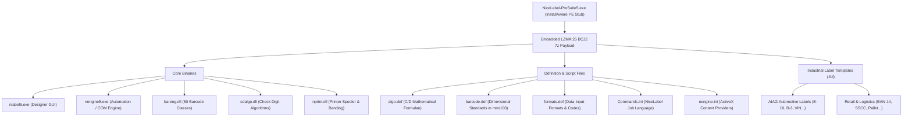
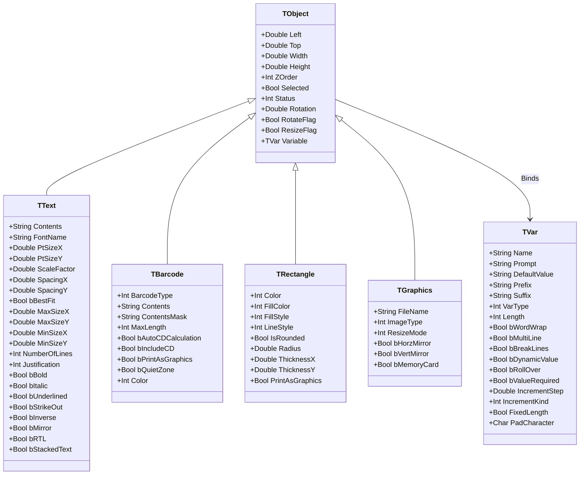

# NiceLabel 5 Deep Reverse Engineering & Architectural Analysis

Tài liệu này ghi lại toàn bộ kết quả phân tích nhị phân (reverse engineering), bóc tách cấu trúc file mẫu (`.lbl`), hệ thống lớp đối tượng, thuật toán mã vạch (`bareng.dll`), module kiểm tra số (`cdalgo.dll`), pipeline in ấn (`nprint.dll`), và cơ chế điều khiển tự động (`Commands.ini`, `nengine.ini`) của bộ phần mềm công nghiệp **NiceLabel Pro Suite 5** (Build 5.2.1.2514).

Tài liệu phục vụ làm **cơ sở đối chuẩn tham chiếu (reference benchmark)** cho việc thiết kế kiến trúc, độ trung thực in ấn, và khả năng tương thích định dạng của **ANLAbel**, tuân thủ nghiêm ngặt theo `docs/REFERENCE_POLICY.md` và `docs/LOCAL_LABEL_PRODUCT_CONTRACT.md`.

---

## 1. Tổng quan Bộ Cài & Tính Toàn Vẹn Nhị Phân

### 1.1. Chứng thực bảo mật & Nguồn gốc
* **Tệp phân tích:** `NiceLabel-ProSuite5.exe` (71,390,424 bytes ~ 68.1 MB).
* **Chữ ký số (Authenticode):**
  * **Người ký:** `Euro Plus d.o.o.` (Kranj, Slovenia).
  * **Đơn vị cấp chứng chỉ:** `VeriSign Class 3 Code Signing 2004 CA`.
  * **Dấu thời gian (Timestamp):** `VeriSign Time Stamping Services Signer - G2`.
  * **Trạng thái:** `Valid (Signature verified)` — Tệp nguyên bản, không bị can thiệp hay sửa đổi.
* **Mã băm kiểm định (Hashes):**
  * `SHA-256`: `34F94DF6DA143A6E8E19B3BD1147589422885236994DF712B676D45B401CBE06`
  * `MD5`: `EFD06AF8E6DBAD1D71BB63C50797CD74`
* **Kiểm tra mã độc (Antivirus Scan):**
  * Microsoft Defender Engine: `Scanning found no threats` (Sạch hoàn toàn).

### 1.2. Công nghệ đóng gói & Phân rã thành phần
* **Installer Engine:** InstallAware Wrapper (32-bit PE x86).
* **Payload nén:** Luồng nén **7-Zip LZMA:25 BCJ2** nằm tại offset `231936` của file PE stub.
* **Quy mô giải nén:** 2,089 tệp tin, 399 thư mục, tổng dung lượng giải nén **362.7 MB**.
* **Nền tảng nhị phân:** Unmanaged Native Win32 PE x86, biên dịch bằng **Borland C++ 5.0** và **ObjectWindows Library (OWL)** kết hợp Developer Express VCL (`ncplib5.dll`, `epds5.dll`). Hoàn toàn không phụ thuộc .NET Framework.



---

## 2. Giải Mã Định Dạng Tệp Mẫu Nhãn (`.lbl`)

Mọi tệp nhãn của NiceLabel 5 (`.lbl`) đều được xây dựng trên định dạng **Microsoft Compound File Binary Format (CFBF / OLE2 Structured Storage)**, bắt đầu bằng magic header:
`D0 CF 11 E0 A1 B1 1A E1`

### 2.1. Cấu trúc các Stream trong Tệp `.lbl`
Mỗi file `.lbl` là một hệ thống tệp thu nhỏ (mini-filesystem) chứa các stream riêng biệt:

| Tên Stream | Kích thước mẫu (AIAG / EAN) | Vai trò & Dữ liệu lưu trữ |
| :--- | :--- | :--- |
| **`Contents`** | 1.6 KB - 7.0 KB | **Stream nhị phân cốt lõi**: Chứa toàn bộ hình học nhãn, danh sách đối tượng (Text, Barcode, Shape), cấu hình máy in mục tiêu, và định nghĩa biến. Bắt đầu bằng chuỗi nhận diện độ dài `0x000A` + `"NicePower\0"`. |
| **`NICE Preview`** | 5.3 KB | Ảnh thumbnail kích thước chuẩn (Windows Metafile WMF hoặc DIB 24-bit) phục vụ hiển thị preview nhanh trên Windows Shell / Open Dialog mà không cần render nhãn. |
| **`NICE Preview Big`** | ~45 KB | Ảnh xem trước độ phân giải cao cho màn hình preview chi tiết. |
| **`V3 Data` ... `V40 Data`** | 2 bytes - 760 bytes | Các luồng tương thích ngược (Version compatibility deltas) ghi nhận các trường dữ liệu bổ sung khi mở nhãn qua các đời NiceLabel V2.x, V3.x, V4.x, V5.x. |
| **`[5]SummaryInformation`** | ~208 bytes | OLE Property Set tiêu chuẩn: Title, Subject, Author, Keywords, Comments, Created/Saved Time. |
| **`[5]DocumentSummaryInfo`**| ~116 bytes | OLE Property Set mở rộng: Company name, Manager, Category. |
| **`PO Check`** | 11 bytes | Dữ liệu Print Optimizer (cờ tối ưu in ấn phần cứng). |
| **`V32 Background Picture`**| 13 bytes | Cấu hình hoặc dữ liệu hình ảnh mẫu nền (Template background image). |
| **`V33 Revision History`** | 2 bytes | Thông tin phiên bản chỉnh sửa (Audit trail). |

### 2.2. Phân tích Cấu trúc Nội dung Stream `Contents`
Bóc tách chi tiết luồng nhị phân `Contents` của file nhãn công nghiệp chuẩn (`AIAG B-10.lbl` và `EAN.lbl`):

```
Offset 0x0000:  0A 00 4E 69 63 65 50 6F 77 65 72 00 ... [Length-prefixed string "NicePower\0"]
Offset 0x0010:  Title: "AIAG B-10 Label\0"
Offset 0x0022:  Description: "Sample of AIAG label\0"
Offset 0x00D4:  Printer Driver: "winspool\0" -> "HP LaserJet 6p\0"
Offset 0x00F0:  Port: "\\bejba\hplaserjet\0"
Offset 0x01A5:  Form Stock: "DINU\"\0" (Standard paper stock definition)
Offset 0x03E0+: Variable Definitions:
                - "PartNo\0" (Prompt: "Enter part number:", Default: "BARCODE SOFTWARE\0")
                - "EQuantity\0" (Prompt: "Enter quantity:", Default: "600000\0")
                - "Serial\0" (Prompt: "Enter starting serial number:", Default: "000000001\0")
                - "Counter\0", "IncSerial\0", "Increment\0", "IncStep\0" (Step: "1.000\0")
Offset 0x0E00+: Visual Object Records:
                - LOT NUMBER (Font: "1Courier New\0")
                - SERIAL (4S) (Font: "1Courier New\0")
                - PART NO. (P) (Font: "1Courier New\0")
                - QUANTITY (Q) (Font: "1Courier New\0")
                - NICE.COMPANY, WORLD WIDE (Font: "1Courier New\0")
                - Barcode 1: Type "Code-39\0", Human Readable Font: "Arial\0"
                - Barcode 2: Type "Code-39\0", Human Readable Font: "Arial\0"
```

* **Hệ tọa độ hình học:** NiceLabel mã hóa tọa độ X, Y, Rộng, Cao bằng các số thực dấu chấm động 64-bit (**IEEE-754 Double Precision Floating Point**), đơn vị cơ sở là **mm/100** (trăm phần milimét).

---

## 3. Hệ Thống Đối Tượng & Lớp (C++ Object Hierarchy)

NiceLabel 5 quản lý các phần tử trên nhãn thông qua mô hình hướng đối tượng với cơ chế Command-Property (`T<Class>::TCommand_Prop<Property>`) được trích xuất trực tiếp từ bảng ký hiệu nhị phân:



### 3.1. Đối Chiếu Hợp Đồng Text / TextBox Với ANLAbel
Phân tích ngược bảng thuộc tính của NiceLabel 5 chứng minh sự đúng đắn của **Hợp đồng Text/TextBox trong `docs/NICELABEL_TEXTBOX_RESEARCH.md`**:

1. **`Text` (TText):**
   * Có `PtSizeX` và `PtSizeY` độc lập: NiceLabel cho phép kéo giãn font chữ theo trục X hoặc Y riêng biệt (`Font Scaling`).
   * Cờ `bBestFit` kết hợp `MaxSizeX/Y` và `MinSizeX/Y`: Thu nhỏ font khi nội dung dài ra chứ không thay đổi kích thước khung nhãn gốc.
   * `bStackedText`: Hỗ trợ xếp chữ dọc theo kiểu thư pháp Á Đông (Asian stacked text).
   * `ScaleFactor`: Thu phóng glyphs trực tiếp thay vì bẻ dòng (word-wrap).
2. **`TextBox` (Được điều khiển qua `TVar::bWordWrap` & `TText`):**
   * Thuộc tính `bWordWrap`, `bMultiLine`, `bBreakLines` nằm trong lớp `TVar` và liên kết với giới hạn khung của `TObject::Width` / `TObject::Height`.
   * Khung hình (`Width/Height`) là thuộc tính do người dùng sở hữu (`ResizeFlag`), nội dung thay đổi chỉ reflow bên trong khung chứ không bao giờ làm đột biến `Width/Height`.

---

## 4. Phân Tích Engine Mã Vạch (`bareng.dll` & `barcode.def`)

### 4.1. Danh mục 50 Lớp Mã Vạch Tích Hợp
Trong `bareng.dll`, REA trích xuất được đúng 50 lớp C++ kế thừa từ `TBarcodeBase`:

1. **Mã vạch 1D tuyến tính công nghiệp:**
   * `TCode128Barcode`, `TCode128PBarcode`, `TCode93Barcode`, `TCodabarBarcode`
   * `TEanBarcode` (EAN-13), `TEan8Barcode`, `TEan2Barcode`, `TEan5Barcode`, `TEan82Barcode`, `TEan85Barcode`, `TEAN14Barcode`
   * `TUpcABarcode`, `TUpcEBarcode`, `TUpcA2Barcode`, `TUpcA5Barcode`, `TUpcE1Barcode`, `TUpcE2Barcode`, `TUpcE5Barcode`, `TUPCCaseCodeBarcode`
   * `TI2of5Barcode` (Interleaved 2 of 5), `TITF14Barcode`, `TITF16Barcode`, `TDun14Barcode`
   * `TBooklandBarcode`, `TBookland2Barcode`, `TBookland5Barcode`
   * `TMSIBarcode`, `TPlessyBarcode`, `TAnkerBarcode`, `TPharmacodeBarcode`
2. **Mã bưu chính quốc tế (Postal Symbologies):**
   * `TPostnetBarcode`, `TPostnet37Barcode`, `TPostnet52Barcode`, `TPostnet62Barcode`, `TPostnet6210Barcode`
   * `TPlanetBarcode`, `TRoyalBarcode` (Royal Mail RM4SCC), `TKixBarcode` (Bưu chính Hà Lan)
3. **Mã 2D Ma trận & Xếp chồng (2D Matrix & Stacked):**
   * `TQRBarcode` (QR Code Model 2), `TMQRBarcode` (Micro QR Code)
   * `TDataMatrixBarcode`, `TDataMatrixColorBarcode`
   * `TPdf417Barcode`, `TMicroPDFBarcode`
   * `TAztecBarcode`, `TMaxiCodeBarcode` (UPS MaxiCode)
   * `T2DPharmacodeBarcode`
4. **Mã tổng hợp GS1 (GS1 Composite / RSS):**
   * `TRSSBarcode` (GS1 DataBar Omni-directional, Stacked, Expanded), `TCBlockFBarcode`

### 4.2. Quy Chuẩn Kích Thước Mã Vạch Chuẩn Hóa (`barcode.def`)
Được định nghĩa theo đơn vị $1/100\text{ mm}$ ($10\ \mu\text{m}$):
* **X-dimension danh định (OptModule):** $33\ (0.33\text{ mm})$ cho EAN-13, EAN-8, UPC-A, UPC-E.
* **Tỉ lệ khung hình cố định (FixedAspectRatio):** `1`
* **Vùng đệm tĩnh (Quiet Zone / White Space):**
  * EAN-13: Trái $3.63\text{ mm}$ (`WSLeft=363`), Phải $2.31\text{ mm}$ (`WSRight=231`), Trên $0.33\text{ mm}$, Dưới $0.35\text{ mm}$.
* **Font Human Readable mặc định:** `OCR-B`.

---

## 5. Thuật Toán Check Digit (`cdalgo.dll` & `algo.def`)

Lớp `TAlgo` trong `cdalgo.dll` thực hiện tính toán số kiểm tra qua hàm nhị phân:
`@TAlgo@Calc$qipcpuci` $\rightarrow$ `TAlgo::Calc(int algoId, char* input, unsigned char* output, int flags)`

Các thuật toán được định nghĩa trong `algo.def`:
1. **EAN-13 / UPC Check Digit (`ALGO0`):**
   * `Modulus = 10`
   * `Weights = 1, 3` (xoay vòng từ phải qua trái)
   * `Sum = Products` ($\sum d_i \times w_i$)
   * `Complements = ON` ($CD = (10 - (\text{Sum} \bmod 10)) \bmod 10$)
2. **Modulo 10 / Luhn (`ALGO1`):**
   * `Modulus = 10`
   * `Weights = 3, 1`
   * `Sum = Digits` (tổng từng chữ số của tích)
   * `Complements = OFF`
3. **EAN-14 / SSCC-18 / ITF-14 (`ALGO2`):**
   * `Modulus = 10`
   * `Weights = 3, 1`
   * `Sum = Products`
   * `Complements = ON`
4. **Modulo 43:** Tính kiểm tra cho Code 39 (tổng trọng số các ký tự chia lấy dư 43).
5. **Modulo 11 & Taiwan Modulo 11:** Kiểm tra số thẻ và mã bưu chính Đài Loan.

---

## 6. Pipeline In Ấn & Quản Lý Spooler (`nprint.dll`)

Lớp `TNiceBasePrinter` thực hiện điều phối in ấn công nghiệp:

### 6.1. Cơ chế Chia Dải In (Print Banding Architecture)
Hàm `@TNiceBasePrinter@CalcBandingFlags$qr8TPrintDC` giải quyết bài toán bộ nhớ RAM khi in nhãn độ phân giải cực cao:
* Khi in nhãn kích thước lớn trên máy in 300 DPI hoặc 600 DPI, việc khởi tạo một bitmap GDI toàn trang có thể tiêu tốn hàng trăm Megabytes RAM.
* `CalcBandingFlags` chia nhãn thành các băng ngang (horizontal bands). Engine chỉ render và đẩy từng băng xuống Spooler Windows theo từng chu kỳ, sau đó giải phóng bộ nhớ ngay lập tức.
* ANLAbel áp dụng nguyên lý này: Render theo tile/strip bitmap hoặc vector stream trực tiếp để tránh tràn bộ nhớ máy trạm in ấn.

### 6.2. Hủy Lệnh In & Xử Lý Lỗi An Toàn
* Lớp `TNicePrinterAbortDlg` đăng ký callback `UserAbortDC`: Cho phép người vận hành ấn "Hủy" trên hộp thoại in bất kỳ lúc nào.
* Trình spooler thu hồi ngay lập tức `HDC` mà không để lại lệnh in treo (hung spooler job) trong Windows Spooler service.

---

## 7. Giao Thức Điều Khiển Tự Động & Tích Hợp

### 7.1. Ngôn ngữ Tập Lệnh Job File (`Commands.ini`)
NiceLabel 5 hỗ trợ tự động hóa dây chuyền in ấn thông qua các file kịch bản `*.job`:
* **Thiết lập & Điều hướng:** `LOGIN`, `OEMTOANSI ON|OFF`, `SET variable=value`
* **Nạp nhãn & Cơ sở dữ liệu:** `LABEL "path.lbl"`, `SETDATABASE "conn_str"`, `SETTABLE "table_name"`
* **Khởi phát in:** `PRINTER "name"`, `PORT "COM1:"`, `PRINT quantity, speed, darkness`
* **Phiên in nối tiếp (Session Printing):** `SESSIONSTART` $\rightarrow$ `SESSIONPRINT` $\rightarrow$ `SESSIONEND` (ghép nhiều bản in thành 1 spool file duy nhất, tránh ngắt quãng đầu in nhiệt).

### 7.2. Kiến trúc Module Mở Rộng (`nengine.ini`)
`nengine5.exe` giao tiếp với các module xử lý nội dung thông qua chuẩn COM ActiveX `NContentsProvider4`:
* `NContentsProvider4.Script`: Trình thực thi Visual Basic Script (VBScript).
* `NContentsProvider4.FACT`: Tiêu chuẩn định dạng dữ liệu tự động ASC (FACT).
* `NContentsProvider4.MAXIC`: Bộ đóng gói dữ liệu chuyên dụng cho UPS MaxiCode.
* `NContentsProvider4.Expression`: Bộ phân tích và tính toán biểu thức số học/chuỗi.
* `NContentsProvider4.HIBC`: Tiêu chuẩn mã hóa ngành y tế (Health Industry Bar Code).
* `NContentsProvider4.Lookup`: Bảng tra cứu dữ liệu động (Lookup tables).

---

## 8. Bài Học & Khuyến Nghị Kiến Trúc Cho ANLAbel

| Khía cạnh kiến trúc | Cách làm của NiceLabel 5 | Khuyến nghị áp dụng cho ANLAbel |
| :--- | :--- | :--- |
| **Định dạng file** | OLE Compound Document (CFBF) bọc luồng nhị phân `NicePower`. | ANLAbel sử dụng JSON/YAML hoặc tệp nén Zip chứa JSON (`.anlabel`) để dễ debug, lưu trữ Git thân thiện và bảo toàn dữ liệu lâu dài; đồng thời có thể xây dựng parser đọc CFBF `Contents` của NiceLabel 5 để import nhãn cũ. |
| **Hệ đơn vị** | Sử dụng $1/100\text{ mm}$ (trăm phần milimét) và số thực Double. | Giữ vững đơn vị mm và Double trong `ANLAbel.Core`. Tránh làm tròn sớm sang Pixel/DIP trước bước render cuối cùng. |
| **Text vs TextBox** | Tách biệt `TText` (glyph scaling qua `PtSizeX/PtSizeY`) và `TVar::bWordWrap` (khung cố định). | Tuyệt đối tuân thủ **Hợp đồng Text/TextBox của ANLAbel**: `Text` không bị ép khung TextBox, `TextBox` giữ nguyên Width/Height khi đổi nội dung và luôn word-wrap/clip. |
| **Sinh mã vạch** | Độc lập hóa thành `bareng.dll` với 50 class cụ thể và bảng kích thước `barcode.def`. | Triển khai các renderer barcode chuẩn theo chuẩn công nghiệp (GS1, ISO/IEC), áp dụng đúng X-dimension tối ưu ($0.33\text{ mm}$) và Quiet Zone bắt buộc. |
| **In ấn công nghiệp** | `CalcBandingFlags` chống nghẽn RAM; cơ chế `SESSIONSTART/END` chống giật đầu in. | Thiết kế `RenderPipeline` có khả năng xuất trực tiếp raw printer command (ZPL/EPL) cho máy in nhiệt hoặc render vector/tiled bitmap để bảo đảm hiệu năng cao trên dây chuyền. |

---
*Báo cáo được thực hiện dựa trên bằng chứng nhị phân thực tế từ tệp cài đặt và công cụ REA.*

[Agent: Gemini / Antigravity]

---

# Phụ lục đào sâu 2026-10-18: Thuật toán mã vạch lộ qua UI/UX và đối chiếu ANLAbel

Phiên đào sâu này tập trung vào các tham số/thuật toán mã vạch mà NiceLabel 5
phơi bày thành điều khiển UI/UX (đặc biệt là bù mực), và đối chiếu từng mục với
bề mặt mã vạch hiện tại của ANLAbel. Nguồn bằng chứng: REA CLI
`inspect-pe-resources` trên `bareng.dll` (Evidence
`ev_322b044c006ef619142c645265f2ef552887280437ffa9baa59621116182a289`),
resource/dialog trích từ `reseng.dll` (155 dialog, 137 khối RT_STRING),
`barcode.def`/`algo.def` trích nguyên văn từ payload bộ cài, và tài liệu trợ
giúp đóng gói `niceeng.chm` (904 tệp sau giải nén). Mọi khẳng định dưới đây là
quan sát tĩnh trên artifact đã phát hành; phần suy luận được ghi rõ là suy luận.
Artifact trung gian nằm tại `.analysis/rea/`, `.analysis/nicelabel5-system/` và
`.analysis/nicehelp-eng/`.

## 9. Bản đồ hộp thoại mã vạch của NiceLabel 5

Luồng UX gồm hai tầng:

1. **Hộp thoại đối tượng Bar Code** (trang `IDSEC_BAROBJ_GENERAL` trong
   `reseng.dll`): chọn loại mã (ComboBox `112`), Contents Mask + ký tự mask
   (Edit `507`/`508`), nút Color, và nút **`&Define...`** (Button `110`).
   Wizard tạo nhanh dùng `IDSEC_BAROBJ_WIZ_GENERAL` (Fixed/Variable data).
2. **Edit Bar Code dialog** mở từ `Define...`, do `bareng.dll` sở hữu
   (`TLabelBarServer::DefineBarcode`). Các trang (theo RT_STRING của
   `bareng.dll`, id 1103–1127): **General**, **Security** (chính là trang
   check digit), **Auto translation** (human readable), **Details**, cộng
   trang riêng theo loại mã (ví dụ **Aspect ratio**). Bên phải dialog là
   **preview trực tiếp** của ký hiệu (tùy chọn "Enable preview").

`bareng.dll` không chứa RT_DIALOG nào (REA: chỉ có 8 khối RT_STRING + version
info); dialog được dựng động bằng OWL (`TMultiPage` + `tagCATEGORYDEF`, các
control số chuyên dụng `TBarcodeWidthNumEdit`, `TBarcodeRatioNumEdit`, cấu
trúc truyền dữ liệu `BarDialogXfer`). Caption lấy từ RT_STRING, vì vậy danh
sách tham số dưới đây được khôi phục từ CHM + symbol + string table, không
phải từ template dialog.

## 10. Các thuật toán lộ qua UI và đối chiếu ANLAbel

### 10.1. Bù mực: "Space correction" (NiceLabel 5) vs Bù loang vạch (ANLAbel)

Đây là khác biệt thuật toán quan trọng nhất của phiên đào sâu.

| Khía cạnh | NiceLabel 5 — Space correction | ANLAbel — `BarcodeBarWidthReductionDots` |
| :--- | :--- | :--- |
| Vị trí UI | Trang General của Edit Bar Code dialog | Properties: "Bù loang vạch (chấm)" |
| Cơ chế | **Cộng thêm pixel trắng vào mỗi khoảng trắng** (space) | **Cắt bớt chấm khỏi mỗi vạch đen** (trailing edge) |
| Mục tiêu khai báo | Máy in InkJet, mực tràn làm hẹp khoảng trắng | In nhiệt, vạch đen loang rộng (thermal gain) |
| Điều khiển | Bật/tắt (CHM: "Enable this option to insert additional white pixels for each white space") | Số nguyên 0–10 chấm máy in |
| Tổng bề rộng ký hiệu | Tăng theo số khoảng trắng (suy luận từ cơ chế cộng pixel) | Giữ nguyên: cắt trong `symbolRect` cố định khi vẽ vector (`LabelVisualRenderer.DrawVectorBarcode`) |
| Rào an toàn | Không thấy rào tương đương trong bằng chứng tĩnh | Preflight chặn khi vạch hẹp còn lại < `MinimumModuleDots`, kèm thông điệp tiếng Việt và mức tối đa cho phép |

Đánh giá theo hợp đồng công nghiệp của ANLAbel: cơ chế hiện tại phù hợp in
nhiệt hơn và an toàn hơn (không đổi bề rộng ký hiệu đã authored, có rào
preflight theo DPI). **Không sao chép Space correction.** Khoảng trống thật
không nằm ở thuật toán mà ở bằng chứng: giá trị bù vẫn cần kiểm chứng bằng máy
quét/verifier trên tem in nhiệt thật (điểm mở đã ghi trong
`docs/reinvention/07-execution-plan.md`). Độ lớn chính xác mỗi lần cộng pixel
của Space correction (suy luận: +1 pixel thiết bị mỗi space qua
`TBarcodeBase::GetWhiteBits`/`PaintBits`) chưa chứng minh được ở mức
decompile — xem §12.

### 10.2. Narrow bar width × Ratio và lượng tử hóa pixel

- CHM (General tab): bề rộng vạch rộng = `narrow bar width × ratio`, và
  "kết quả phải là số nguyên (số pixel)" — mô hình lượng tử hóa theo pixel
  thiết bị ngay trong dialog. Đơn vị nhập: mm/cm/**dots**/inch (RT_STRING
  1110–1113). Dialog hiển thị readout **"Base object width"**.
- Ratio bị khóa với đa số symbology; preset dạng chuỗi trong `bareng.dll`:
  `1:2`, `1:3`, `2:5` (RT_STRING 1100–1102).
- Hàm lõi (symbol Borland): `TBarcodeBase::CalcBarWidth(int)`,
  `CalcDialogBarWidth()`, `ConvertRatioToNarrowWidth(double)`,
  `ConvertToRatio(int)`, `GetClosestRatio()`;
  `TLabelBarServer::CheckBarcodeRatio(...)`, `CheckNarrowWidth(...)`,
  `GetCodeRatio(int)` — tức dialog kiểm hợp lệ ratio/narrow ngay khi nhập.
- ANLAbel tương đương về toán: `BarcodeModuleWidthMm` + `BarcodeWidthMode`
  (`FrameOwned`/`SizedFromX`), `Code39WideNarrowRatio`,
  `LinearBarcodeModuleContract` và preflight theo DPI. Điểm UX còn thiếu là
  **readout trực tiếp khi biên tập** (X hiệu dụng quy đổi chấm ở DPI máy in
  đích, bề rộng ký hiệu suy ra) — đúng phạm vi đang mở của lát P4.

### 10.3. Kiểm chuẩn kích thước theo `barcode.def` (cửa sổ magnification)

`barcode.def` đầy đủ chỉ định nghĩa 5 symbology: EAN-13 `[1]`, EAN-8 `[2]`,
UPC-A `[3]`, UPC-E `[4]`, Code-32 `[38]`. Đơn vị mm/100; mỗi mục có
Min/Max X/Y, Opt X/Y, `OptModule=33` (0,33 mm), `FixedAspectRatio=1`, font
HRI chuẩn (OCR-B; Code-32 dùng OCR-A) và quiet zone `WSLeft/Right/Top/Bottom`
(EAN/UPC: 3,63 / 2,31 / 0,33 / 0,35 mm). Với EAN-13, MinX 25,08 mm và MaxX
62,70 mm chính là cửa sổ magnification GS1 80%–200% quanh OptX 31,35 mm.
Phía binary: `TBarcodeBase::IsBarcodeInStandard(TXY&, TBarcodeStandard&)` và
`TLabelBarServer::BarcodeStandard(...)` — designer cảnh báo khi ký hiệu nằm
ngoài cửa sổ chuẩn; đặt `Defined=0` trong `.def` để tắt kiểm tra.

ANLAbel hiện kiểm theo module/DPI và quiet zone logic, **chưa có cảnh báo cửa
sổ magnification GS1 cho EAN/UPC**. Đây là ứng viên chẩn đoán advisory giá trị
cao, rủi ro thấp (không đổi hình học, chỉ cảnh báo), nếu chủ sở hữu chọn.

### 10.4. Trang Details: quiet zone, descender, mirror, gap, EAN white space

| Tùy chọn NL5 | Thuật toán tương ứng | ANLAbel |
| :--- | :--- | :--- |
| Include quiet zones | Cộng khoảng trắng đầu/cuối ký hiệu | Có: quiet zone theo module (`QrQuietZoneModules`, hợp đồng tuyến tính) |
| Descender bars | Kéo dài guard bar EAN/UPC | Chưa có công tắc; renderer vẽ guard bar theo chuẩn |
| Mirror horizontally/vertically | Lật ký hiệu; thường buộc print-as-graphics | Chưa có ở mức đối tượng mã vạch |
| Intercharacter gap | Đổi khoảng cách giữa ký tự (Code 39) | Có: `Code39IntercharacterGapModules` |
| Include EAN white space | Chèn ký hiệu `<` `>` báo vùng trắng (suy luận từ tên hàm ở phiên 2026-10-18; đã đính chính ở §24: `PaintSlashes` vẽ nét chéo, không phải `<` `>`) | Chưa có |

Descender/mirror/EAN-slashes là tính năng trình bày phụ; không có nhu cầu vận
hành cụ thể được ghi nhận, nên giữ nguyên trạng (không sao chép vì parity).

### 10.5. Check digit: trang "Security" và thuật toán tùy chỉnh

Ba chế độ: **Auto-generate**, **Verify the provided check digit**, và
**Enable custom check digit algorithm** (nút Select mở danh sách từ
`algo.def`: `ALGO0` Ean13 `W=1,3 Products Compl ON`; `ALGO1` Modulo 10
`W=3,1 Digits Compl OFF`; `ALGO2` Ean14-SSCC `W=3,1 Products Compl ON`; cộng
Modulo 43/11/Taiwan 11). ANLAbel đã có mô hình tương đương gần như 1:1
(`BarcodeCheckDigitPolicy` + `CheckDigitModulus/Weights/WeightsFromRight/
SumDigitsOfProducts/Complement/KeepAllDigits/ZeroRemainderAsModulus/ValueMap`)
— phần còn mở chỉ là gate UI/copy của lát P3, không phải thuật toán.

### 10.6. Human readable: "Auto translation"

Vị trí None/Below/Above, chọn font, **Auto font scaling** theo cỡ ký hiệu
(`ScaleHumanFont`, `CalcCenteredHuman`), và **Contents mask** định dạng chuỗi
hiển thị. ANLAbel đã có `BarcodeHriPlacement`, cỡ font HRI, `BarcodeHriMask`
+ ký tự mask và hợp đồng bố cục HRI riêng — tương đương chức năng.

### 10.7. Trang nâng cao theo loại mã 2D và GS1

- **PDF417:** Y expansion factor (chiều cao hàng), Security level 0–8,
  Truncated, Aspect ratio (cột:hàng) — hàm `PDFSetModuleAspect`. ANLAbel có
  symbology `Pdf417` nhưng `BarcodeRenderOptions` chưa phơi EC level/aspect.
  Lát nhỏ khả thi qua hint của ZXing nếu có nhu cầu vận hành.
- **DataMatrix:** ECC Type, Format ID 01–17, Border Size 1–15 là di sản thời
  ECC 0–140. ANLAbel dùng ECC 200; **không sao chép** — giữ biên
  automatic/unsupported trung thực như lát P5 đã định.
- **GS1 (EAN.UCC-128):** NL5 có trình dựng danh sách AI chuyên dụng
  (`IDSEC_EANOP_APPIDS`, `IDSEC_EANW_*`: Add/Edit/Remove AI, delimiter trái/
  phải, Multiplier, chọn Fixed/New variable, trang check digit
  Automatic/Entered-with-data). ANLAbel dùng ký hiệu văn bản `(AI)value` +
  registry/fail-closed ở Core; trình dựng AI dạng danh sách là khoảng trống
  UX thật nhưng thuộc gate quyết định của lát P6.
- **Print as graphics vs internal printer object:** NL5 cho chọn in mã vạch
  dạng ảnh hoặc đối tượng nội trú của máy in qua NiceDrivers. ANLAbel hiện là
  graphic-only; đây là phạm vi lát P7 (cần ADR + pilot máy in thật), không
  phải toggle ở Properties.

## 11. Ledger khoảng trống UX/UI và đề xuất lát cắt

Khác biệt hình thái UX lớn nhất: NL5 dùng **dialog modal hai tầng** (object
dialog → `Define...` → Edit Bar Code nhiều trang + cây chọn symbology +
preview trực tiếp), trong khi ANLAbel dùng **Properties panel** theo lát
P1–P6. Theo `docs/REFERENCE_POLICY.md`, giống hình thái không phải tiêu chí;
chỉ nhận phần giải quyết nhu cầu vận hành cụ thể. Ledger dưới đây xếp theo
giá trị độ tin cậy, không theo độ giống.

| # | Mục | Hiện trạng ANLAbel | Đề xuất |
| :--- | :--- | :--- | :--- |
| 1 | Readout khi biên tập mã tuyến tính: X hiệu dụng (mm + chấm ở DPI đích), bề rộng ký hiệu suy ra, trạng thái hợp lệ ratio/narrow | Có toán ở Core/preflight; thiếu readout tại Properties (lát P4 còn mở) | Nhận: bổ sung readout dùng lại hợp đồng hiện có, không thêm đường toán thứ hai |
| 2 | Cảnh báo cửa sổ magnification GS1 cho EAN-13/EAN-8/UPC-A/UPC-E (dữ liệu kiểu `barcode.def`) | Chưa có; mới kiểm module/DPI | Nhận dạng advisory: cảnh báo không chặn in, nêu rõ khoảng mm hợp lệ và cách sửa |
| 3 | Bù mực | BWR theo chấm + rào preflight (mạnh hơn Space correction cho in nhiệt) | Không đổi thuật toán; đóng khoảng trống bằng chứng quét/verifier trên tem thật |
| 4 | Trình dựng GS1 AI dạng danh sách | Nhập `(AI)value` dạng văn bản, Core fail-closed | Chỉ làm khi qua gate quyết định P6 (nhu cầu AI cụ thể, chủ sở hữu runtime) |
| 5 | PDF417: EC level 0–8, aspect, truncated | Có symbology, chưa phơi tham số | Lát nhỏ tùy chọn qua hint ZXing nếu có nhu cầu tem thật |
| 6 | Dialog modal + preview + cây symbology giống NL5 | Properties panel + preview trên canvas | Không sao chép hình thái; chỉ cân nhắc nếu người vận hành nêu khó khăn cụ thể |
| 7 | Descender bars, mirror, EAN `< >`, DataMatrix ECC/Format ID di sản | Không có | Không nhận (trình bày phụ hoặc công nghệ đã lỗi thời) |
| 8 | Print as graphics vs internal object | Graphic-only | Giữ trong lát P7: ADR + capability + pilot, không làm toggle Properties |

## 12. Giới hạn bằng chứng và việc còn mở

- **REA trong phiên này:** `rea doctor` cho thấy Node 24.15 khỏe, REA CLI
  6.5.0 dùng được qua `C:\nvm4w\nodejs\rea.cmd`, nhưng **chưa có engine phân
  tích native nào** (Hopper chưa cài, `GHIDRA_INSTALL_DIR` chưa đặt, IDA chưa
  cấu hình) và đăng ký MCP của mọi client đều ở trạng thái stale. Vì vậy mức
  bằng chứng hiện tại là: kiểm kê resource (REA), trích string/symbol, giải mã
  dialog template/string table tự viết, và CHM đóng gói. **Chưa có bằng chứng
  mức decompile** cho thân hàm.
- REA `inspect-pe-resources` **từ chối `nlabel5.exe`** ("Invalid PE
  SizeOfHeaders" — đặc thù linker Borland). Parser tự viết
  (`.analysis/rea/nl5_dialogs.py`, ánh xạ RVA qua section table) đã xử lý
  được cả bốn module còn lại; kết quả kiểm kê: `nlabel5.exe` 179 resource/4
  dialog, `ncplib5.dll` 389/4, `epds5.dll` 353/4, `reseng.dll` 323/155,
  `Nbars.dll` 199/2, `bareng.dll` 9/0.
- Chưa chứng minh được ở mức mã máy (tính đến phiên 2026-10-18): độ lớn
  pixel cộng thêm của Space correction và việc nó có làm nở tổng bề rộng
  thật hay không; bố cục trường của `BarDialogXfer`/`TBarcodeData`; quy
  tắc làm tròn trong `CalcBarWidth`/`GetClosestRatio`; ngưỡng cảnh báo
  chính xác của `IsBarcodeInStandard`. Muốn đào tiếp các điểm này cần cài
  Ghidra 12.1.x (đặt `GHIDRA_INSTALL_DIR`) hoặc Hopper qua `rea setup` —
  cả hai đều cần chủ sở hữu duyệt vì setup sẽ ghi cấu hình client.
  **Cập nhật 2026-10-27:** Ghidra đã có sẵn trên máy nên hàng này đã đóng
  phần lớn — xem §22 và §24; còn mở là phép chia của `CalcBarWidth` và bố
  cục `TBarcodeData`.
- Chưa quan sát runtime NiceLabel 5 trong phiên này (bản cài có tại
  `C:\Program Files (x86)\EuroPlus\NiceLabel 5`); mô tả UX dựa trên dialog
  resource + CHM, chưa đối chứng bằng thao tác thật.
- CHM là tài liệu đóng gói cùng bản phát hành (bằng chứng artifact), nhưng
  vẫn là tài liệu — nơi CHM và binary có thể lệch nhau, binary thắng; các
  điểm chỉ có CHM đỡ được ghi là quan sát tài liệu, không phải hành vi đã chạy.

[Agent: Muse Spark / Muse Code — phiên đào sâu 2026-10-18]

---

# Phụ lục triển khai 2026-10-19: PDF417 — mức sửa lỗi và dạng rút gọn (lát lõi)

Phiên này đóng mục #5 của ledger §11 ở tầng lõi. Phạm vi đã hỏi chủ sở hữu
(ba câu hỏi: lĩnh vực, phạm vi, mức engine REA) nhưng không nhận được trả
lời trong thời hạn; phiên đi theo phương án khuyến nghị đã trình: PDF417,
RE + triển khai lõi chưa gồm UI, giữ mức bằng chứng resource/string/CHM.
**Phê duyệt tường minh của chủ sở hữu cho lát này chưa được ghi nhận**;
mọi giá trị mới đều tắt theo mặc định nên việc rút lại không đụng dữ liệu cũ.

## 13. Bằng chứng NiceLabel 5 cho PDF417

- CHM đóng gói `PDF_417_2D_Code.htm` (giải nén tại `.analysis/nicehelp-eng/`):
  trang **Security** có **9 mức an toàn** (mức cao đọc tin cậy hơn khi tem
  lỗi nhưng ký hiệu lớn hơn); **Truncated** dùng khi tem khó hư hỏng và
  không cần an toàn cao, ký hiệu nhỏ hơn; **Y expansion factor** định chiều
  cao ký hiệu; **Aspect Ratio** là tỉ số số cột : số hàng.
- Binary `bareng.dll` (REA `inspect-pe-resources`, Evidence
  `ev_322b044c006ef619142c645265f2ef552887280437ffa9baa59621116182a289`):
  RT_STRING 1017 `PDF-417`, trang 1118 `Aspect ratio`; symbol
  `PDFSetModuleAspect` và các getter expansion của `TBarcodeBase`.
- Đây vẫn là bằng chứng tĩnh (resource/string/CHM), chưa decompile thân hàm
  và chưa quan sát runtime — giới hạn §12 giữ nguyên.

## 14. Phần ANLAbel nhận, phần không nhận

| Tham số NL5 | ANLAbel sau lát này | Lý do |
| :--- | :--- | :--- |
| Security level 0–8 | `Pdf417ErrorCorrectionLevel` −1..8; −1 = Auto không truyền hint, ký hiệu cũ giữ nguyên từng byte | Đúng 9 mức ISO/IEC 15438; probe ZXing cho thấy mặc định không-hint cho ma trận cùng kích thước EC2 |
| Truncated | `Pdf417Truncated` (mặc định tắt) → hint `PDF417_COMPACT`; probe: bề rộng native 141 → 107 module trên dữ liệu mẫu | CHM nêu rõ chỉ dùng khi tem khó hư; máy quét phải hỗ trợ dạng rút gọn |
| Y expansion factor | Không nhận | ANLAbel phóng module nguyên đều vào khung (`MatrixSquareModuleFit`); tách hệ số chiều cao hàng phải đổi hợp đồng khớp khung của mọi mã ma trận — không có nhu cầu vận hành ghi nhận |
| Aspect ratio (cột:hàng) | Không nhận trong lát này | ZXing tự chọn bố cục khi không ép `PDF417_DIMENSIONS`; ép cột cố định làm dữ liệu dài lỗi mã hóa — chỉ làm khi có nhu cầu tem thật |

Đường đi giữ nguyên một nguồn duy nhất: `LabelObject` →
`BarcodeRenderOptions.FromObject` → hints trong `ZxingBarcodeRenderer`;
clone, snapshot và khôi phục từ snapshot đều mang hai trường mới. Dấu vân
tay tài liệu chỉ thêm đoạn `pdf417` khi giá trị khác mặc định, nên tem lưu
trước lát này giữ nguyên `DocumentHash`. Dữ liệu không còn vừa ở mức đã
chọn làm bước render trong preflight lỗi và chặn in (fail-closed), không
tự hạ mức.

## 15. Kiểm chứng và giới hạn còn mở

- Test duy trì `Pdf417ContractTests` (11 test): Auto trùng ký hiệu legacy;
  các mức 0/2/5/8 decode vòng tròn bằng ZXing reader về đúng dữ liệu; mức
  cao cho ma trận lớn hơn; Truncated hẹp hơn và vẫn decode được bằng
  ZXing reader; 1200 ký tự vừa ở EC0 nhưng lỗi ở EC8; round-trip
  clone/snapshot/save-load; hash đổi khi đặt giá trị tường minh.
- Cổng đã chạy: build toàn giải pháp, unit tests (1355 xanh), regression
  suite và Fast quality loop đều qua. Mutation không áp dụng: không file
  nào của lát nằm trong danh sách mutate label-safety.
- **Chưa có UI Properties**: hợp đồng sản phẩm yêu cầu Figma URL/node trước
  khi sửa giao diện; hiện giá trị chỉ đặt được qua tệp tem (JSON). Đây là
  bước tiếp theo cần chủ sở hữu chọn, cùng câu hỏi phê duyệt lát lõi này.
- Chưa quét tem in thật: mức EC và dạng rút gọn mới chứng minh ở đầu ra
  phần mềm (decode bằng ZXing), chưa phải bằng chứng máy quét/verifier
  trên tem nhiệt; hỗ trợ Truncated tùy máy quét hiện trường.

[Agent: Muse Spark / Muse Code — phiên PDF417 2026-10-19]

---

# Phụ lục triển khai 2026-10-19 (tiếp): Serial theo dãy ký tự (lát lõi)

## 16. Bằng chứng NiceLabel 5 cho bộ đếm theo định dạng

- `formats.def` trích nguyên văn từ payload bộ cài: 9 định dạng **All,
  Numeric, Alphanumeric, Letters, 7 bit ASCII, Hex, Date, Time,
  Digits&Capitals**, tất cả `Can increment=TRUE`, mỗi định dạng có khoảng
  mã ký tự (`Codes=48..57,65..90,...`) và ký tự đệm mặc định.
- CHM đóng gói: `Serialization_tab.htm` — chọn Data format định sẵn hoặc
  **CUSTOM** với ô **Sequence** tự liệt kê ký tự; Incremental/Decremental,
  Step, "Change value after the number of labels".
  `Advanced_Serialization.htm` — quay vòng khi đổi ngày/giờ, theo min/max,
  hoặc khi biến khác đổi giá trị. `Designing_a_Counter_that_Preserves_
  Last-used_Value.htm` — bộ đếm nhớ giá trị cuối và đếm tiếp ở lần dùng sau.
- Binary `nlabel5.exe` (string/symbol trích tại `.analysis/rea/`): họ
  thuộc tính lệnh của `TVar` gồm `TCommand_PropIncrementType`,
  `PropIncrementKind`, `PropIncrementCount`, `PropIncrementStep` (và biến
  thể Step2/Step3) — tầng biến sở hữu ngữ nghĩa tăng dần, khớp mô hình lớp
  ở §3. Vẫn là bằng chứng tĩnh; thuật toán nhớ/carry chi tiết từng ký tự
  trong thân hàm chưa được decompile (§12).

## 17. Phần ANLAbel nhận, phần không nhận

ANLAbel đã có tương đương "nhớ giá trị cuối" mạnh hơn ở điểm an toàn: dãy
số được cấp trước bản kê in trong kho chỉ-ghi-thêm, không bao giờ trả lại,
nên lệnh in hỏng để lại khoảng trống chứ không trùng số. Lát này chỉ thêm
cách **viết** giá trị đã cấp theo dãy ký tự; dãy đã cấp vẫn là số nguyên
nên toàn bộ bảo đảm không-trùng, in lại dùng số gốc, thư mục dùng chung
nhiều máy và xem trước-không-in-số-khác giữ nguyên không đổi một dòng kho.

| Định dạng NL5 | ANLAbel sau lát này | Ghi chú |
| :--- | :--- | :--- |
| Numeric | `SerialCounterAlphabet.Numeric` (mặc định) | In thập phân y hệt trước; tem cũ không đổi hash |
| Hex | `Hexadecimal` (0-9A-F) | Giá trị viết theo vị trí, đệm bằng ký tự đầu dãy theo `Digits` |
| Letters | `Letters` (A-Z) | 0→A, 25→Z, 26→BA (carry như chữ số vị trí) |
| Digits&Capitals | `DigitsAndLetters` (0-9A-Z) | Tương ứng FORMAT8 |
| CUSTOM Sequence | `Custom` + `CustomAlphabet` 2–64 ký tự phân biệt, không trắng/điều khiển | Dãy lặp ký tự bị chặn vì hai giá trị có thể in trùng |
| Alphanumeric (gồm chữ thường), All, 7 bit ASCII | Không nhận sẵn; dùng Custom nếu cần | Giữ bề mặt nhỏ; chữ thường dễ gây nhầm khi đọc/quét |
| Date/Time dạng bộ đếm | Không nhận | ANLAbel đã có `{#NOW}` ghi theo lệnh in |
| Quay vòng khi đổi ngày / khi biến khác đổi | Không nhận trong lát này | Đụng hợp đồng "không tự quay lại" của kho cấp số; cần quyết định sản phẩm riêng |
| Bộ đếm nội bộ của máy in | Không nhận | Thuộc lát P7 (đối tượng nội trú máy in), cần ADR + pilot |

Ngữ nghĩa ANLAbel chọn (không khẳng định là bản sao thuật toán NL5 vì chưa
decompile): giá trị *n* viết ở hệ đếm vị trí trên dãy ký tự, ký tự đầu là
"0" của hệ; `Step` vẫn là bước trên trục giá trị đã cấp. Khoảng âm bị chặn
ở `ValidateDefinition` khi dùng dãy ký tự. Thông điệp lỗi mới có quy tắc
tiếng Việt trong `SerialCounterText` như mọi thông điệp serial khác.

## 18. Kiểm chứng và giới hạn còn mở

- Test duy trì bổ sung trong `SerialCounterTests` (tổng 41 test của lớp):
  viết vị trí cho Hex/Chữ/Số+Chữ/Custom, đệm bằng ký tự đầu dãy, Numeric
  giữ nguyên, hai lệnh in liên tiếp nhận dãy serial rời nhau qua ranh giới
  carry (AY→AZ→BA→BB), dãy tùy chỉnh hỏng được giải thích, khoảng âm bị
  chặn, dãy không dùng được không bao giờ in ra như thập phân, save/load
  và hash tài liệu.
- Cổng đã chạy: build toàn giải pháp, unit tests 1372 xanh, regression
  suite và Fast quality loop qua (gồm cổng "serial numbers are reserved
  before the manifest"). Mutation không áp dụng: file của lát không nằm
  trong danh sách mutate.
- **Chưa có UI**: chọn dãy ký tự trong panel dữ liệu cần qua cổng Figma như
  lát PDF417; hiện đặt qua tệp tem. Phê duyệt tường minh của chủ sở hữu cho
  cả hai lát lõi của ngày 2026-10-19 vẫn còn chờ.
- Chưa in/quét tem thật với serial chữ (ví dụ serial Hex trong Code 39).

[Agent: Muse Spark / Muse Code — phiên serial dãy ký tự 2026-10-19]

---

# Phụ lục spike 2026-10-19: Đọc tệp `.lbl` NiceLabel 5 — kết luận khả thi import

Spike này kiểm tra đường "import nhãn cũ" trong §8 bằng nguyên mẫu đọc
chỉ-dùng-thư-viện-chuẩn (`.analysis/rea/nl5_lbl_probe.py`,
`nl5_lbl_header_probe.py`, `nl5_lbl_strings_probe.py`; thư mục `.analysis`
đã gitignore nên đây là artifact phân tích cục bộ, không phải mã sản phẩm).

## 19. Đã chứng minh được trên 65 nhãn mẫu

- **CFBF đọc trọn 65/65 tệp** (FAT, miniFAT, directory tự cài). Mọi tệp có
  `Contents`, `NICE Preview`, `PO Check`, `Integrations` và các stream
  `V* Data` theo đời phiên bản; 14/65 có thêm `Barcodes Data`,
  `Serial number data`, `Embedded Graphics Data`; 17/65 có `V5 Data`.
- **Header `Contents`**: chuỗi tiền tố độ dài u16 (kèm NUL) `NicePower`,
  u16 `29`, tiêu đề, mô tả; sau đó khối nhị phân chứa cặp nguyên
  **mm/100** của khổ tem — đối chiếu 5 nhãn biết trước kích thước cho
  15240×7620 (6×3"), 15240×10160 (6×4")... và cặp double cùng kích thước
  theo đơn vị hiển thị của tệp (6.0×3.0 inch, hoặc 17.81×10.39 cm ở
  `AIAG B-10`), kèm cặp double khổ giấy A4 (8.268×11.693 inch /
  21.0×29.7 cm). Đây là đối chiếu chéo độc lập xác nhận khẳng định mm/100
  ở §2.2. Chuỗi driver/máy in/cổng (`winspool`, `HP LaserJet 6p`, đường
  UNC) đọc được nguyên văn.
- **Biến và nội dung**: tên biến là chuỗi tiền tố độ dài nằm trong bản ghi
  có bước đều (~0x79–0x81 byte/biến ở AIAG B-10: `PartNo`, `EQuantity`,
  `Serial`, `Counter`, `IncSerial`...); văn bản cố định (`LOT NUMBER`),
  tên loại mã vạch (`Code-39`, `Ean`) và font (`Courier`, `Arial`) đều nằm
  trong `Contents` dạng ASCII thô.
- **Vùng đối tượng** (đào thêm trên `ISBN.lbl`, 2181 byte `Contents`): bản
  ghi biến chứa cạnh nhau tên + prompt + giá trị mặc định (`5 Digit`,
  `Enter ISBN Number`, `50000`). Đối tượng chữ chứa mặt nạ nội dung
  (`?????` cho biến), khối font lặp lại nguyên dạng (`04 20 01 22` +
  `Arial`), và các nguyên mm/100 có cỡ hình học (301/2278/2086/4320/2376)
  ở cuối bản ghi. Đối tượng mã vạch chứa tên loại mã (`Bookland`, `Ean-13`)
  — đáng chú ý là chuỗi loại mã vạch dùng độ dài **không** gồm NUL, khác
  quy ước của chuỗi ở header/chữ (gồm NUL): nhiều quy ước chuỗi sống chung
  trong cùng một tệp, một lý do nữa chưa suy diễn bố cục vội.

## 20. Chưa giải mã được — và vì sao chưa làm import

- Chưa xác định: trường đơn vị hiển thị, bố cục bản ghi đối tượng (thẻ
  lớp, thứ tự trường hình học/kiểu liên kết biến↔đối tượng), các trường
  trong bản ghi `TVar` (loại, prompt, mặc định, độ dài), và vai trò ghi đè
  của các stream `V5 Data`/`Barcodes Data` ở 14–17 tệp mới hơn. Suy luận
  bố cục từ một mẫu duy nhất sẽ cho import "trông đúng" nhưng sai lặng lẽ
  trên tem thật — trái hợp đồng tin cậy của ANLAbel.
- Vì vậy **không** đưa import nửa vời (chỉ tạo tem trống đúng khổ) vào sản
  phẩm trong spike này. Giá trị vận hành thấp và dễ gây hiểu nhầm là đã
  chuyển đổi xong.

## 21. Hai đường bằng chứng tiếp theo (chờ chủ sở hữu chọn)

1. **Thăm dò vi sai bằng bản cài sẵn**: máy đã có
   `C:\Program Files (x86)\EuroPlus\NiceLabel 5`. Lưu các nhãn tối thiểu
   chỉ khác nhau một thuộc tính (thêm một Text, đổi X, đổi loại mã vạch)
   rồi diff `Contents` sẽ khóa bố cục bản ghi mà không cần decompiler.
   Việc này chạy ứng dụng đích nên cần kịch bản khai báo rõ và chủ sở hữu
   duyệt thao tác.
2. **Decompile bằng Ghidra**: đọc thân hàm nạp stream trong
   `nlabel5.exe`/`ncplib5.dll`. Cần duyệt cài Ghidra 12.1.x + đặt
   `GHIDRA_INSTALL_DIR` như §12.

Khi một trong hai đường khóa được bố cục bản ghi đối tượng, lát import
chỉ-đọc đầu tiên nên giới hạn ở Text/mã vạch/hình cơ bản + biến, fail-closed
với phần tử chưa hiểu (báo rõ bỏ qua đối tượng nào), và không bao giờ ghi
đè tệp gốc.

[Agent: Muse Spark / Muse Code — phiên spike .lbl 2026-10-19]

---

# Phụ lục decompile 2026-10-27: Ghidra/REA đọc thân hàm bareng.dll + advisory chiều cao GS1

Phiên này mở khóa đường bằng chứng §21.2 mà không cần cài mới: máy đã có sẵn
Ghidra 12.1.4 (`C:\Users\MS\tools\ghidra_12.1.4_PUBLIC`) và JDK 21
(`C:\Users\MS\tools\jdk-21.0.12.1+1`). `rea doctor` xác nhận provider Ghidra
khỏe khi `JAVA_HOME` trỏ JDK 21 và `GHIDRA_INSTALL_DIR` trỏ bản Ghidra trên
(env theo tiến trình, không ghi cấu hình client, không chạy `rea setup`).
Mục tiêu: `bareng.dll` của bản cài
`C:\Program Files (x86)\EuroPlus\NiceLabel 5\bin` (SHA-256
`8a4d49065d77dd84ac5d6904c42dc225ab1a18ed88267ec9abd1e3f7d13fdd32`).
Artifact thô tại `.analysis/rea/ghidra-*.md` (thư mục gitignore).

## 22. Kết quả decompile bốn hàm

| Hàm | Evidence | Kết luận đã chứng minh ở mức thân hàm |
| :--- | :--- | :--- |
| `TBarcodeBase::IsBarcodeInStandard(TXY&, TBarcodeStandard&)` | `ev_a26da947430bd52f83580b6266f1305bd36321a0ffd36f895714d1ac9767b90a` | Nếu `Defined` ≠ 0: lấy kích thước ký hiệu qua virtual `+0x28`, rồi so **cả rộng và cao**: dưới `MinX`/`MinY` đặt cờ 1, trên `MaxX`/`MaxY` đặt cờ 2; trường bằng 0 thì bỏ qua. Trả bitmask, không tự chặn in. |
| `TBarcodeBase::GetWhiteBits(unsigned char*, int, bool)` | `ev_9806bd2085a7d6bce2b7e224db9a46b70757e4ce9b7ad4d520d485a5f3f0d1b7` | Chỉ **đếm** số bit trắng trong buffer bitmap (hai chiều bit tùy cờ). Không chèn pixel — vậy "Space correction" (§10.1) nằm ở đường vẽ khác, chưa xác định; quyết định không sao chép giữ nguyên. |
| `TBarcodeBase::GetClosestRatio()` | `ev_b755e9b530216783c9fc9f55d951858540cdc4ffe9b96e1286b4764811d4552c` | Ứng viên tỉ lệ suy từ số phần tử: 1→3.0, 2→2.0, 3→2.5, chọn giá trị gần tỉ lệ hiện tại nhất — khớp preset chuỗi `1:3`, `1:2`, `2:5` ở RT_STRING. |
| `TBarcodeBase::CalcBarWidth(int)` | `ev_c97b8d8a3079b7b00b61540a8b7993f1eaf86f3a0e69628976697ff9ba5aacfa` | Trả 2 khi tham số < 1; nhánh chính bị decompiler làm mờ phép chia x87 nên **chưa** kết luận được quy tắc làm tròn. ANLAbel không phụ thuộc điểm này (đã lượng tử hóa nguyên chấm ở contract riêng). |

Giới hạn còn lại: bố cục byte chính xác của `TBarcodeStandard` (các trường đọc
ở offset +5/+9/+13/+17, gói không thẳng hàng) được suy từ thứ tự so sánh
MinX, MinY, MaxX, MaxY trong `barcode.def`; phép chia của `CalcBarWidth` và
nơi chèn pixel của Space correction vẫn chưa chứng minh được.

## 23. Phần ANLAbel nhận: advisory chiều cao EAN/UPC

Trước lát này ANLAbel chỉ kiểm X (`RetailMagnificationContract.Check`, kế
hoạch §10 của live plan) — tương đương nửa rộng của cửa sổ `IsBarcodeInStandard`
vì số mô-đun cố định. Nửa cao chưa có: một EAN-13 cao 12 mm không nhận bất kỳ
lưu ý nào dù dưới `MinY=19,60 mm` của `barcode.def`.

Đã triển khai, advisory không chặn in như cờ của NiceLabel:

- `RetailMagnificationContract.TryGetHeightRangeMm` + `CheckHeight` với đúng
  số `barcode.def`: EAN-13/UPC-A 19,60–49,00 mm, EAN-8 15,90–39,76 mm,
  UPC-E 11,20–28,00 mm (đều là 80–200% của `OptY`).
- Preflight nối tại cùng điểm với advisory X, so với chiều cao khung đã
  authored (`HeightMm` gồm vạch + dải HRI theo hợp đồng bố cục HRI), mức
  `IsBlocking: false`, kèm quy tắc tiếng Việt trong `PreflightIssueText`.
- Không đổi hình học, không đổi dữ liệu tem, không thêm trường lưu trữ.

Kiểm chứng: `RetailMagnificationContractTests` mở rộng (24 test, gồm biên
đúng số def), gate regression mục 7b trong `ANLAbel.Tests` (mã ngắn được
advisory không chặn + có rule tiếng Việt; mã chuẩn không bị lưu ý), build
toàn giải pháp, 1390 unit test, regression suite và Fast quality loop đều
xanh. Chưa quét tem in thật — advisory vẫn là bằng chứng phần mềm.

[Agent: Muse Spark / Muse Code — phiên decompile Ghidra 2026-10-27]

---

# Phụ lục decompile 2026-10-27 (tiếp): cơ chế Space correction trong PaintBits

## 24. Space correction đã chứng minh ở mức thân hàm

Decompile `TBarcodeBase::PaintBits(TDC&, char*, int, TPoint&, int, int, bool)`
(Evidence `ev_ebc0fa239711b90510eb83467181ce318b066bbd0d6071176213a30e956f7e06`):

- Hàm quét buffer bit: mỗi dãy bit đen liên tiếp được vẽ thành một hình chữ
  nhật rộng `số bit × bước hẹp` (tham số bước truyền vào).
- Sau mỗi dãy đen, con trỏ vẽ tiến qua **một** bit trắng: tiến đúng một bước
  hẹp nếu cờ tại `this+0x9E` tắt; nếu cờ bật, tiến `bước hẹp + giá trị nguyên
  tại this+0x9F`.
- Vậy Space correction cộng `this+0x9F` pixel cho **mỗi bit trắng** (không
  cộng cho vạch đen), và tổng bề rộng ký hiệu nở ra theo số bit trắng — xác
  nhận suy luận §10.1, nay là quan sát thân hàm. Tên trường gốc trong struct
  chưa khôi phục được (offset `0x9E`/`0x9F` không thẳng hàng), nên giá trị mặc
  định/cực trị từ dialog vẫn chưa chứng minh.
- Hệ quả cho ANLAbel giữ nguyên: cơ chế này đổi bề rộng ký hiệu đã authored
  và nhắm máy in phun; ANLAbel giữ BWR cắt trong khung cố định cho in nhiệt
  (§10.1). Không có thay đổi mã ở điểm này.

Đính chính `PaintSlashes` (Evidence
`ev_d33b48e17433c2a74488ad6b5d3c81bc3d670b48e6d791489f461fdac799efd7`):
hàm vẽ một nét chéo (`/` hoặc `\`, thụt vào 1/5 ô) cho mỗi ký tự của chuỗi
mẫu, hướng nét lật theo ký tự `1`/khác và theo góc quay tại `this+0x10`.
Đây không phải cơ chế vẽ dấu `<` `>` báo vùng trắng EAN như suy luận từ tên
hàm ở §10.4; hàng "Include EAN white space" trong bảng §10.4 đã được ghi chú
lại. Mục đích nghiệp vụ chính xác của nét chéo (suy luận: đánh dấu trực quan
vùng quiet zone khi thiết kế) chưa được xác nhận bằng runtime.

## 25. Đường .lbl: đã thử và chưa khóa được

- Họ hàm nạp nằm trong `nengine5.exe` của payload trích xuất (SHA-256
  `51cb5a37c5bd4c2d1acfe0fef49d98585d3776f89971802a1988a15edf9b81e3`):
  `TLabel::LoadObjects`, `TObject::Load`, `TText::Load`, `TVar::Load`,
  `TBarcode::Load`, `TRectangle::Load`, `TGraphics::Load` — đều theo mẫu
  `Load(TIO&, bool, bool)` với `TIO::Read/Write(TNiceContents&)`.
- REA/Ghidra không giải được các tên này (`Unknown Ghidra procedure name`):
  tên Borland chỉ tồn tại dạng chuỗi trong binary (thông tin debug TD32,
  dấu `FB0A` tại offset `0x2B3420`), Ghidra chỉ đặt tên cho import và một số
  symbol OWL. Truy vết qua xref của chuỗi `NicePower` (0x64F487) dẫn tới một
  hàm rất lớn quanh địa chỉ 0x557606 liên quan profile/máy in, chưa tách
  được ranh giới `LoadObjects`.
- Kết luận giữ nguyên §20–21: chưa làm import `.lbl`. Hai đường còn lại là
  viết parser TD32 tối thiểu để lấy địa chỉ hàm từ debug info, hoặc thăm dò
  vi sai bằng bản cài sẵn (cần chủ sở hữu duyệt chạy ứng dụng đích).
- Thăm dò TD32 đã làm (script lưu tại `.analysis/rea/td32_probe.py`,
  `td32_dir.py`): section `.debug` nằm tại file offset `0x2B3400` (kích
  thước `0xC13FE`), chữ ký `FB0A` tại `+0x20`; các tên hàm đích nằm trong
  một bảng chuỗi Pascal (byte độ dài đứng trước tên) quanh offset
  `0x335000–0x358000` nhưng không kèm địa chỉ ngay kề; phép parse thư mục
  subsection theo mẫu `{u16 type, u16 module, u32 offset, u32 size}` mới
  khớp được bản ghi đầu tiên (`type=1, module=1, size=0x108`) rồi lệch, và
  provider Rizin của REA không chạy được trên Windows
  (`capability_unavailable`). Parser TD32 đầy đủ là một việc nghiên cứu
  riêng, chưa hoàn thành trong phiên này.

[Agent: Muse Spark / Muse Code — phiên PaintBits 2026-10-27]

---

# Phụ lục decompile 2026-10-27 (tiếp 2): họ hàm tỉ lệ/vạch hẹp

## 26. ConvertRatio / ConvertToRatio / CheckNarrowWidth

Sau khi ba lát cải tiến được commit (`ea5d33b`), phiên REA tiếp tục với họ
hàm chuyển đổi tỉ lệ của `bareng.dll`:

| Hàm | Evidence | Kết luận |
| :--- | :--- | :--- |
| `TBarcodeBase::ConvertRatioToNarrowWidth(double)` | `ev_d333685b3bc53b3f73d0d689ff8833e73b8468830f3a7557a8f7eb54abf91e22` | Hàm rất ngắn: kiểm dấu/zero của double rồi gọi một helper x87 chung (`FUN_004564a5`, cùng helper xuất hiện trong `CalcBarWidth`). Decompiler mất phép toán float trong helper, nên không khôi phục được công thức nguyên văn. |
| `TBarcodeBase::ConvertToRatio(int)` | `ev_5ea7df5ef5124751fe04c7e0819f61c719ab43cc19ef618523f18144c6e0a918` | Trả double qua thanh ghi x87 ST0; decompiler hiển thị `void` nên thân hàm không đọc được trực tiếp. |
| `TLabelBarServer::CheckNarrowWidth(int, int&, int, double, bool, bool)` | `ev_e85a946c49f713d66a429c5078b8dbd34f5bb05763233b274b3ec37bfa4f0451` | Vòng lặp ứng viên bề rộng hẹp từ 1 tới dưới 100, kiểm tra từng ứng viên qua helper so sánh chuỗi/số (`FUN_004563f1`) và dừng ở ứng viên đầu tiên đạt — tức dialog tìm bề rộng hẹp nguyên nhỏ nhất còn hợp lệ thay vì làm tròn một lần. |

Đối chiếu ANLAbel: hợp đồng hiện tại lượng tử hóa X sang nguyên chấm máy in
rồi kiểm sàn 2 chấm trong preflight — chặt chẽ và minh bạch hơn vòng thử
của dialog cũ, và không cần biết công thức float đã mất. **Không thay đổi
mã.** Điểm chưa khôi phục được (helper x87 `FUN_004564a5`) được ghi là giới
hạn bằng chứng; muốn đọc tiếp phải phân tích helper ở mức hợp ngữ, ngoài
phạm vi cần thiết cho ANLAbel.

[Agent: Muse Spark / Muse Code — phiên ratio 2026-10-27]

---

# Phụ lục decompile 2026-10-27 (tiếp 3): TAlgo::Calc của cdalgo.dll

## 27. Thuật toán check digit đã đọc ở mức thân hàm

Decompile `TAlgo::Calc(int algoId, char* input, unsigned char* output, int flags)`
(Evidence `ev_9d2ffebca368402438b009385de314c441230cc4a8e8260a23ab6438e9f9053d`).
Bản ghi thuật toán (`tagAlgoStr`) được xác nhận ở mức offset: trường kiểu/modulus
tại `+0x24`, mảng trọng số nguyên tại `+0x28` (kết thúc bằng 0, hết thì quay
vòng), cờ Sum tại `+0xA8`, cờ Complements tại `+0xA9`, cờ OneDigit tại `+0xAA`.

Thuật toán tổng quát (nhánh mặc định):

1. Duyệt dữ liệu **từ trái sang phải**, mỗi ký tự số nhân với trọng số theo
   thứ tự trong mảng; hết mảng thì quay vòng từ đầu.
2. Cờ Sum tắt: cộng **từng chữ số của tích** (kiểu Luhn); bật: cộng thẳng tích.
3. Lấy tổng modulo modulus; nếu Complements bật thì check digit là
   `modulus − dư` (dư 0 giữ nguyên, trừ hai mã đặc biệt dưới đây).
4. OneDigit bật: chỉ giữ chữ số cuối của kết quả khi ghi ra.

Mã modulus đặc biệt nằm cùng trường `+0x24`:

| Mã | Hành vi quan sát được |
| :--- | :--- |
| `-10` | Thuật toán ngoài: tra module theo tên rồi gọi export `CalcCheckDigit` của DLL ngoài qua `GetProcAddress` |
| `-7` | Cứng cho dữ liệu đúng 13 ký tự: vị trí chẵn nhân 2 (với mẹo cộng chữ số `(2d mod 10)+1` khi `d≥5`), vị trí lẻ nhân 1; check digit `10 − (tổng mod 10)`, 10 thành 0 |
| `-6` | Cộng giá trị ký tự chữ+số kiểu Code 39 (0–9, A=10 … Z=35) tách riêng vị trí chẵn/lẻ trên 9 ký tự đầu — thuật toán chuyên biệt chưa đối chiếu được tên gọi chắc chắn |
| `-4`, `-3` | Modulus ép thành 11; sau complement: dư cho kết quả 10 → 0 và 11 → 5 (khớp ánh xạ UPU S10 mà ANLAbel đã kiểm chứng bằng vector công bố) |
| `-9`, `-8`, `-5`, `-2`, `-1` | Không có nhánh riêng quan sát được trong phần đã đọc; nhánh mặc định từ chối khi modulus ≤ 0 |

Đối chiếu ANLAbel: `CustomCheckDigitAlgorithm` là tập bao của nhánh tổng quát
(có thêm `WeightsFromRight` mà bản gốc không có, cộng `ValueMap` và
`ZeroRemainderAsModulus` bao được ánh xạ 10→0/11→5). Phần duy nhất ANLAbel
không có là thuật toán ngoài qua DLL (`-10`) — **không nhận** theo hợp đồng
tin cậy: không nạp mã ngoài tùy ý vào đường in. Không thay đổi mã ở lát này.

[Agent: Muse Spark / Muse Code — phiên cdalgo 2026-10-27]
