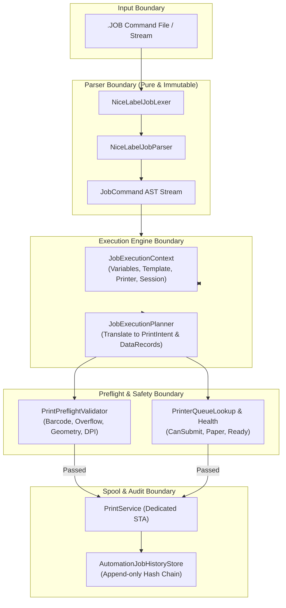

# Kiến trúc thực thi NiceLabel JOB Command File trong ANLAbel

> Reference status (2026-09-15): competitor research, not a full implementation
> requirement or parity backlog. Apply [reference policy](REFERENCE_POLICY.md)
> and [core standard](CORE_SOFTWARE_STANDARD.md) to select ANLAbel core behavior.

> Phạm vi được chốt lại ngày 2026-09-14 trong [bộ quy chuẩn lõi](CORE_SOFTWARE_STANDARD.md): tài liệu JOB là nghiên cứu tham khảo, không phải yêu cầu sao chép toàn bộ automation NiceLabel. Ưu tiên Designer và Excel/CSV. Các mô tả `IGNOREERROR` bên dưới không cho phép bỏ qua preflight dữ liệu, barcode, queue hoặc media; mọi đường in hiện hữu phải dùng cùng safety contract. Các phase mở rộng bên dưới không tự trở thành backlog.

**Ngày nghiên cứu:** 2026-09-14  
**Tài liệu nguồn:** `ug-NiceLabel_2019_PowerForms_User_Guide-en.md`, chương 9.1 `Command Files` (đặc biệt mục 9.1.1 `JOB Command File`), chương 7.6.2 `Available Actions` và chương 9.7 `Session Printing`.  
**Phạm vi:** Nghiên cứu kiến trúc phân tích (parsing), quản lý ngữ cảnh biến (variable context), preflight, session aggregation và thực thi in tự động không cần người vận hành (unattended batch printing) cho các kịch bản lệnh `.job` chuẩn công nghiệp NiceLabel.

---

## 1. Bối cảnh & Mục tiêu

Trong các môi trường sản xuất công nghiệp, dây chuyền đóng gói và kho vận (ERP/MES/WMS như SAP, Oracle WMS, Infor), việc in nhãn thường không thông qua thao tác bấm nút thủ công trên giao diện máy tính. Thay vào đó, hệ thống thượng tầng xuất ra một file kịch bản lệnh văn bản (thường có phần mở rộng `.job`) gửi vào thư mục chia sẻ (file drop) hoặc cổng kết nối:

```text
ERP / WMS
  → xuất file batch.job
  → rơi vào Watch Directory (File Drop)
  → Engine đọc & phân tích từng lệnh
  → gán biến, chọn máy in, thiết lập thông số
  → preflight kiểm tra an toàn dữ liệu & barcode
  → dispatch lệnh in tới Windows Spooler
  → ghi nhận log lịch sử trung thực
```

NiceLabel định nghĩa cú pháp này trong **Chương 9.1.1 (JOB Command File)**. Để đạt được sự tương thích công nghiệp cao và cho phép nhà máy thay thế hoặc tích hợp song song với hệ thống NiceLabel Automation sẵn có, ANLAbel cần một bộ phân tích và thực thi kịch bản lệnh JOB độc lập, an toàn và có khả năng kiểm soát lỗi nghiêm ngặt (*fail-closed*).

---

## 2. Đặc tả tập lệnh NiceLabel JOB Command File

NiceLabel thực thi các dòng lệnh trong file `.job` tuần tự từ trên xuống dưới. Các lệnh không phân biệt hoa thường (*case-insensitive*), tham số có khoảng trắng hoặc dấu phẩy phải được bọc trong dấu ngoặc kép `""`, ký tự escape `\r\n` dùng cho chuỗi nhiều dòng.

### Bảng tổng hợp tập lệnh

| Lệnh | Cú pháp | Ý nghĩa công nghiệp & Xử lý trong ANLAbel |
| :--- | :--- | :--- |
| **`;` (COMMENT)** | `; <nội dung>` | Chú thích kịch bản. Bỏ qua khi parse, không ảnh hưởng trạng thái. |
| **`LABEL`** | `LABEL <file_name> [, <printer_name>]` | Mở mẫu nhãn (`.nlbl` hoặc `.anlabel`). Tham số `printer_name` tùy chọn cho phép override máy in đã lưu trong mẫu. |
| **`PRINTER`** | `PRINTER <printer_name>` | Ghi đè máy in đích cho các lệnh in tiếp theo. Phải khớp với tên queue thực tế trong Windows Spooler. |
| **`SET`** | `SET <name> = <value> [, <step> [, <reps>]]` | Gán giá trị chuỗi cho biến nhãn. Hỗ trợ bước nhảy (`step`) và chu kỳ lặp (`reps`) cho biến đếm (counter). Hỗ trợ `\r\n` cho text nhiều dòng. |
| **`CLEARVARIABLEVALUES`** | `CLEARVARIABLEVALUES` | Xóa trắng hoặc trả giá trị các biến về mặc định ban đầu của mẫu tem. |
| **`PRINT`** | `PRINT <qty> [, <skip> [, <copies> [, <sets>]]]` | Kích hoạt in: `qty` (số lượng nhãn), `skip` (số slot bỏ qua trên trang đầu), `copies` (bản in giống nhau trên mỗi nhãn), `sets` (số lần lặp lại cả quy trình). |
| **`PRINTJOBNAME`** | `PRINTJOBNAME <job_name>` | Đặt tên cho Print Job xuất hiện trong Windows Spooler / Print Queue Console. |
| **`SETPRINTPARAM`** | `SETPRINTPARAM <param> = <value>` | Tinh chỉnh thông số in. Trong ANLAbel **chỉ** `PRINTOFFSETX` và `PRINTOFFSETY` được áp dụng (và chỉ với giá trị số hữu hạn) vì đây là các key duy nhất có sink thực trong print stack. Mọi key khác (`PRINTSPEED`, `PRINTDARKNESS`, `PAPERBIN`, `PRINTERSETTINGS`, …) đều **fail-closed** kèm chẩn đoán, không âm thầm bỏ qua. |
| **`PORT`** | `PORT <path> [, APPEND]` | Điều hướng luồng in xuất ra file vật lý. **Không được hỗ trợ** trong ANLAbel: nếu một action có `PORT`, runner từ chối và **fail-closed toàn bộ lần chạy** (không in ra máy in vật lý) thay vì âm thầm bỏ qua redirection. |
| **`SESSIONSTART`** | `SESSIONSTART` | Bắt đầu một phiên in gom (session print stream). Toàn bộ các nhãn tiếp theo được gom vào 1 spool job duy nhất. |
| **`SESSIONPRINT`** | `SESSIONPRINT <qty> [, <skip>]` | Thêm nhãn hiện tại vào phiên in gom đang mở. |
| **`SESSIONEND`** | `SESSIONEND` | Đóng phiên in gom và giải phóng luồng in ra máy in. |
| **`IGNOREERROR`** | `IGNOREERROR <on\|off>` | Cho phép bỏ qua lỗi (biến không tồn tại, máy in tạm thời lỗi) mà không dừng toàn bộ kịch bản. |
| **`CREATEFILE`** | `CREATEFILE <path> [, <content>]` | Tạo file tín hiệu bắt đầu/kết thúc (inter-process handshake cho hệ thống MES). |
| **`DELETEFILE`** | `DELETEFILE <path>` | Xóa file cờ hiệu hoặc file trung gian. |
| **`TEXTQUALIFIER`** | `TEXTQUALIFIER <char>` | Đổi ký tự bọc chuỗi (mặc định là `"`). |

---

## 3. Kiến trúc Đích & Luồng Xử lý trong ANLAbel

### Sơ đồ kiến trúc Module



### Nguyên tắc Bất biến & An toàn Công nghiệp

1. **Bảo vệ Hợp đồng Text / TextBox:**
   * Việc thực thi JOB chỉ gán dữ liệu biến vào `LabelObject.Content` hoặc các binding source; tuyệt đối không thay đổi ownership, sizing, padding, clipping hay frame geometry của Text/TextBox theo quy định trong `AGENTS.md`.
2. **Deterministic & Immutable AST:**
   * File `.job` được đọc và chuyển đổi thành danh sách các command record bất biến (`IJobCommand`).
   * Không thực thi trực tiếp khi parse; việc lập kế hoạch (*planning*) và kiểm định (*preflight*) phải diễn ra trước khi phát lệnh in ra spooler.
3. **Fail-Closed Preflight:**
   * Nếu biến bị thiếu mà template bắt buộc (`RequiredBoundFieldMissing`), barcode vi phạm module size (`BarcodeModuleTooSmall`), hoặc queue máy in bị Offline/Paused (`QueueBlocked`), quá trình in phải dừng lại ngay lập tức và ghi nhận lỗi rõ ràng. Đây là các guard an toàn **luôn luôn fail-closed**: `IGNOREERROR` KHÔNG thể bỏ qua chúng. Trong `NiceLabelJobRunner`, mọi thất bại an toàn — preflight, thiếu template/máy in, queue chưa sẵn sàng (`CanSubmit == false`), spooler từ chối, hay lỗi dispatch — đều dừng cả lần chạy bất kể `IGNOREERROR` on/off ("Safety takes priority over IGNOREERROR"), nhất quán với ghi chú ở dòng 3 phần đầu tài liệu.
4. **Session Aggregation Minh bạch:**
   * Khối lệnh giữa `SESSIONSTART` và `SESSIONEND` được tổng hợp thành một `PrintIntent` duy nhất với sequence liên tục, không gửi các lệnh in rời rạc làm ngắt quãng cuộn nhãn của máy in nhiệt.

---

## 4. Kế hoạch Triển khai Code (Phased Execution Plan)

> **Trạng thái: ĐÃ TRIỂN KHAI.** Tất cả các phase dưới đây đã được hiện thực trong mã nguồn. Parser và AST nằm trong `src/ANLAbel.Core/Automation/Job/` (namespace `ANLAbel.Core.Automation.Job`); runner thực thi là `src/ANLAbel.App/Automation/NiceLabelJobRunner.cs` (namespace `ANLAbel.App.Automation`), không phải `ANLAbel.Printing.Automation`. Các mô tả phase giữ lại làm tài liệu thiết kế cho các thành phần đã tồn tại.

### Phase 1 — Pure AST Contracts & Streaming Lexer/Parser (`ANLAbel.Core.Automation.Job`)
* **Mục tiêu:** Xây dựng mô hình dữ liệu lệnh bất biến và bộ phân tích cú pháp không phụ thuộc runtime/UI.
* **Các thành phần code:**
  1. `JobCommand.cs`: Hệ thống record kế thừa `IJobCommand`:
     * `LabelOpenCommand(string TemplatePath, string? OverridePrinterName)`
     * `PrinterOverrideCommand(string PrinterName)`
     * `SetVariableCommand(string Name, string Value, int Step, int Repetitions)`
     * `ClearVariablesCommand()`
     * `PrintCommand(int Quantity, int SkipFirstSlots, int IdenticalCopies, int NumberOfSets)`
     * `PrintJobNameCommand(string JobName)`
     * `SetPrintParamCommand(string ParamName, string Value)`
     * `SessionControlCommand(SessionAction Action, int Quantity, int SkipFirstSlots)`
     * `IgnoreErrorCommand(bool Enabled)`
     * `FileOperationCommand(FileAction Action, string Path, string? Content)`
     * `CommentCommand(string CommentText)`
  2. `NiceLabelJobParser.cs`:
     * Hỗ trợ đọc từ `string` hoặc `TextReader` (stream).
     * Xử lý dấu ngoặc kép `""`, ký tự escape `\r\n`, dấu `;` chú thích.
     * Trả về kết quả `JobParseResult(IReadOnlyList<IJobCommand> Commands, IReadOnlyList<JobParseDiagnostic> Diagnostics)`.
* **Kiểm chứng Phase 1:**
  * Bộ unit test `NiceLabelJobParserTests` bao phủ 100% cú pháp mẫu trong tài liệu NiceLabel (kể cả escape, khoảng trắng, thiếu tham số, số lượng nhãn hợp lệ).

---

### Phase 2 — Ngữ cảnh Thực thi & Trình Lập Kế hoạch In (`ANLAbel.Core.Automation.Job`)
* **Mục tiêu:** Chuyển đổi chuỗi lệnh AST thành ngữ cảnh in và danh sách các batch in cụ thể.
* **Các thành phần code:**
  1. `JobExecutionContext.cs`:
     * Lưu giữ trạng thái hiện hành: `CurrentTemplatePath`, `ActivePrinterQueue`, `ActiveJobName`, bảng biến `Variables` (`Dictionary<string, string>`), cờ `IgnoreErrors`, trạng thái phiên `InSession`.
     * Xử lý bước nhảy counter (`Step` / `Repetitions`).
  2. `JobExecutionBatch.cs`:
     * Mỗi lệnh `PRINT` hoặc khối `SESSIONSTART...SESSIONEND` tạo ra một `JobExecutionBatch` chứa:
       - Template cần dùng.
       - Tên máy in hiệu dụng.
       - Dữ liệu dòng (`DataRecord`) được gán từ lệnh `SET`.
       - Kế hoạch số lượng `QuantityPlan` (số bản in, số copies).
       - Tên PrintJob trong spooler.
       - Thông số in mở rộng (Speed, Darkness, Offset nếu có).

---

### Phase 3 — Pipeline Thực thi & Tích hợp Preflight/Print (`ANLAbel.App.Automation`)
* **Mục tiêu:** Kết nối batch lệnh với pipeline in thật của ANLAbel trên luồng STA an toàn.
* **Các thành phần code:**
  1. `NiceLabelJobRunner.cs`:
     * Nhận vào `IJobCommand` stream hoặc đường dẫn file `.job`.
     * Tương tác với `IProjectFileService` để nạp template `.anlabel` (hoặc `.nlbl` nếu có converter).
     * Xác thực máy in qua `IPrinterQueueLookup` (bảo đảm `CanSubmit == true`).
     * Chạy preflight thông qua `PrintPreflightValidator`.
     * Dispatch lệnh in qua `PrintService` (sử dụng dedicated STA thread, immutable `PrintIntent` và `PrintJobManifest`).
  2. `JobExecutionResult.cs`:
     * Báo cáo chi tiết: Số lệnh đã chạy, số nhãn đã dispatch, mã hash manifest, danh sách issue nếu có.

---

### Phase 4 — Automation File-Drop Watcher & Durable Audit Store (`ANLAbel.Data / ANLAbel.App`)
* **Mục tiêu:** Tích hợp file `.job` vào tính năng tự động quét thư mục (File-Drop Watcher).
* **Các thành phần code:**
  1. Cập nhật `FileDropTriggerConfiguration.cs`: Bổ sung pattern nhận diện file `.job`.
  2. `JobFileDropExecutionCoordinator.cs`:
     * Khi file `.job` rơi vào thư mục giám sát:
       - Tự động claim file an toàn (ngăn chặn file đang ghi dở).
       - Chạy `NiceLabelJobRunner`.
       - Ghi nhận `AutomationJobHistoryStore` (chuỗi hash SHA-256 bất biến).
       - Di chuyển file sang thư mục `Done` hoặc `Error` tùy theo kết quả thực thi.

---

### Phase 5 — Kiểm thử Tích hợp & Regression Gates (`ANLAbel.Tests / ANLAbel.UnitTests`)
* **Mục tiêu:** Thiết lập các gate tự động đảm bảo độ ổn định và không hồi quy.
* **Các Named Gates bắt buộc:**
  * `nicelabel job parser parses all standard commands and escapes`
  * `job execution context resolves variables and counters deterministically`
  * `job runner rejects missing required template and unavailable queue`
  * `job session print aggregates multiple labels into single spool job`
  * `unattended job execution leaves text and textbox contracts untouched`

---

## 5. Kết luận & Bước đi tiếp theo

Bản kế hoạch này chuyển hóa toàn bộ Chương 9.1.1 của tài liệu hướng dẫn NiceLabel 2019 thành một kiến trúc phần mềm chuẩn mực trong ANLAbel. 

**Trạng thái triển khai:** Kế hoạch đã được hiện thực đầy đủ. `IJobCommand`/`NiceLabelJobParser` (trong `src/ANLAbel.Core/Automation/Job/`) và runner `NiceLabelJobRunner` (trong `src/ANLAbel.App/Automation/`) đã tồn tại cùng các bộ unit test tương ứng trong `src/ANLAbel.UnitTests` và regression trong `src/ANLAbel.Tests`. Tóm tắt kế hoạch cũng đã được phản ánh trong [PLAN.md](../PLAN.md).
