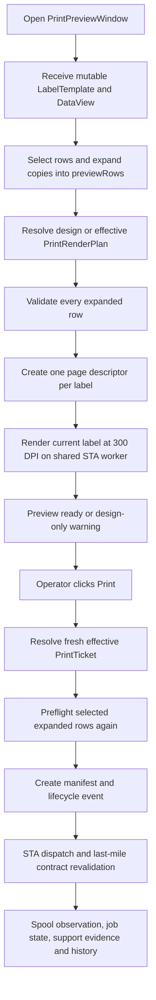
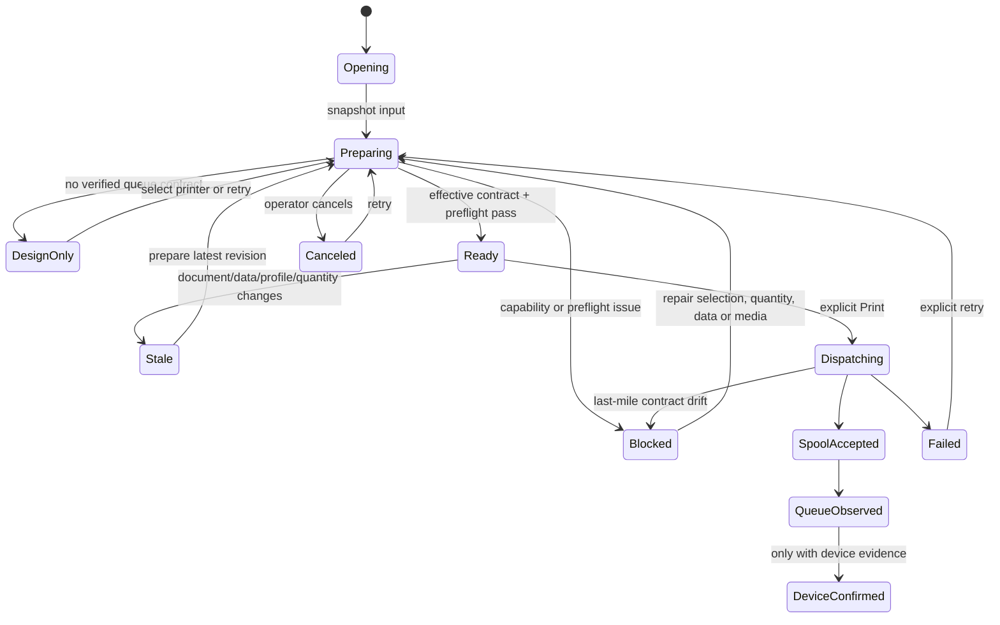
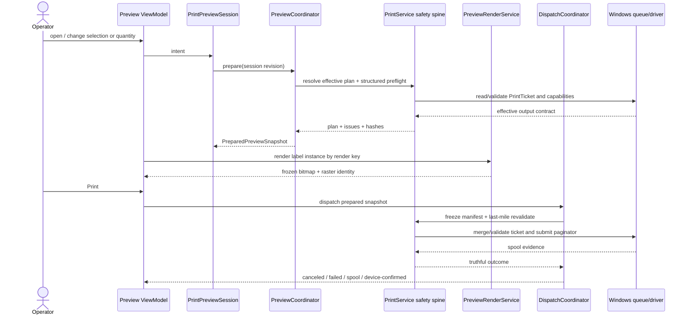

# Kiến trúc Print Preview theo NiceLabel

> Reference status (2026-09-15): competitor research, not a full implementation
> requirement or parity backlog. Apply [reference policy](REFERENCE_POLICY.md)
> and [core standard](CORE_SOFTWARE_STANDARD.md) to select ANLAbel core behavior.

**Ngày nghiên cứu:** 2026-09-14  
**Nguồn chính:** `ug-NiceLabel_2019_PowerForms_User_Guide-en.md`, chương 5 `Printing`  
**Phạm vi:** kiến trúc preview, dữ liệu, quantity, preflight và handoff sang dispatch. Tài liệu này chưa thay đổi runtime UI/code.

## Kết luận

Print Preview không nên được hiểu là một cửa sổ chỉ hiển thị bitmap của một tem. NiceLabel dùng một **printing form** rất rộng; ANLAbel chỉ lấy phần cốt lõi cần cho sản xuất:

1. chọn printer và các giá trị do driver cung cấp;
2. chọn dòng Excel và copies sẽ in;
3. xem trước đúng label instance và dữ liệu barcode;
4. preflight rồi tạo một print job bất biến để dispatch.

ANLAbel đã có nền tin cậy tốt: preview và print dùng chung renderer/compiled scene, effective PrintTicket được resolve trên STA, preflight chạy theo dòng, raster worker có cancellation và cache giới hạn, dispatch revalidate output contract trước khi spool. Tuy nhiên `PrintPreviewWindow` hiện vừa giữ UI state, vừa mutate `LabelTemplate`, vừa expand copies, vừa preflight, tạo manifest, dispatch và ghi audit. Kiến trúc đích phải giữ nguyên các safety contract hiện có nhưng tách chúng thành một `PrintPreviewSession` bất biến và các service có một trách nhiệm.

## Phạm vi sản phẩm đã chốt

ANLAbel **không đặt mục tiêu sao chép đầy đủ NiceLabel PowerForms**. Tài liệu NiceLabel chỉ được dùng để học các boundary và hành vi cơ bản đã được kiểm chứng trong sản phẩm in tem. Tính năng làm tăng đáng kể độ phức tạp nhưng không phục vụ trực tiếp quy trình in tem từ Excel sẽ không được ưu tiên.

Luồng sản phẩm chính:

```text
Thiết kế một mẫu tem
  → liên kết/import Excel
  → map cột vào Text/Barcode
  → chọn dòng và số bản in
  → preview đúng dữ liệu và đúng khổ tem
  → preflight
  → in qua đúng printer/driver
  → ghi nhận kết quả trung thực
```

### Tính năng cơ bản cần tập trung

1. Thiết kế tem ổn định với Text, TextBox, Image, Shape và các barcode cần thiết.
2. Import/link Excel, đọc đúng sheet/header/Unicode, map field và phát hiện cột thiếu hoặc dữ liệu stale.
3. Chọn một hoặc nhiều dòng Excel, tìm/lọc dòng và đặt số copies cho từng dòng.
4. Chọn đúng Windows printer queue, DPI, stock/media và orientation; không tự dùng default printer hoặc tự đổi khổ tem.
5. Preview từng **label instance** đúng như pipeline sẽ in, với trạng thái design-only/blocked/ready rõ ràng.
6. Preflight barcode, text overflow, binding, image, DPI, media và geometry trước khi tạo job.
7. Dispatch bất biến, chống drift giữa preview và print, không gửi trùng do double-click/retry ngầm.
8. Log/history đủ để biết template, dòng dữ liệu, copies, printer và kết quả; `SpoolAccepted` không được gọi là tem đã in vật lý.
9. Barcode phải ưu tiên khả năng quét ổn định: module/X-dimension theo DPI thật, quiet zone, check digit, HRI và dữ liệu hợp lệ.

### Tính năng NiceLabel phức tạp không ưu tiên

- custom PowerForms/printing-form designer;
- prompted-variable workflow phức tạp;
- nhiều label trên một sheet, labels-across/labels-down và skipped first-page slots;
- `Number of physical pages`, unlimited-data mode và nhiều label sets;
- Store/Recall printer memory optimization;
- scripting, action graph và form event automation;
- database connectors ngoài Excel/CSV khi chưa có nhu cầu sản xuất cụ thể;
- cloud collaboration, remote deployment hoặc một hệ thống MES/WMS tích hợp đầy đủ;
- tự động chứng nhận chất lượng vật lý khi chưa có printer/scanner/verifier evidence.

Các khái niệm trên có thể được ghi nhận để tránh khóa kiến trúc, nhưng không được làm phình model/UI hoặc trì hoãn độ tin cậy của luồng Excel + barcode + thermal printing. Mặc định sản phẩm hiện tại là **một label cho mỗi feed/page**, selection theo dòng Excel và copies theo dòng.

### Tiêu chí ưu tiên

Khi phải chọn giữa thêm tính năng và làm chắc luồng hiện có, thứ tự là:

1. không in sai dữ liệu;
2. barcode quét được ổn định;
3. đúng printer, DPI và khổ media;
4. preview/print cùng một snapshot;
5. không in trùng hoặc báo thành công sai;
6. thao tác đơn giản cho operator;
7. sau cùng mới xét tính năng nâng cao.

## Hành vi rút ra từ NiceLabel

Chương 5 mô tả Print pane/default printing form với các capability sau:

- Preview là một phần của printing form, không phải một editor canvas thứ hai.
- Printer list lấy từ các printer đang có; speed và darkness phụ thuộc driver đang chọn.
- Dữ liệu có thể là prompted variables hoặc record từ database; operator được lọc và chọn record trước khi in.
- Quantity phân biệt rõ:
  - number of labels;
  - number of physical pages khi một page chứa nhiều label;
  - identical copies per label;
  - number of label sets;
  - number of skipped label slots trên page đầu;
  - copies riêng theo từng database record.
- Thứ tự copy/set là có semantic. Ví dụ NiceLabel mô tả `A, A; B, B; C, C`, sau đó lặp lại toàn bộ chuỗi theo số set.
- Preview minh họa cả page/roll với nhiều label và các slot đầu bị bỏ qua, không chỉ một label độc lập.
- Thay đổi speed/darkness lúc in là session override; cấu hình lưu lâu dài vào label là một thao tác khác.

Ảnh nguồn liên quan:

- `images/fig_p206_01_print_pane_default_printing_form.png`: printer, quantity, data-entry và preview cùng một printing form.
- `images/fig_p207_01_print_pane_default_printing_form.png`: physical page có skipped slots và nhiều label.
- `images/fig_p208_01_print_pane_default_printing_form.png`: identical copies được compose thành chuỗi label trên page.

## Hiện trạng ANLAbel

### Session settings implementation (2026-09-15)

`PrintPreviewWindow` tạo một deep snapshot của `LabelTemplate` ngay khi mở. Label size, print method, calibration và Printer Setup trong preview chỉ mutate snapshot của phiên in; đóng/cancel preview không ghi ngược vào document đang mở. Action `Save current print settings to label` là commit seam duy nhất, copy label geometry và toàn bộ `PrinterProfile` về document; editor Save vẫn là owner của persistence ra đĩa. Print/preview tiếp tục dùng cùng session snapshot và cùng effective output-contract pipeline.

### Luồng đang chạy



### Điểm đang làm đúng và phải giữ

- `LabelVisualRenderer` và compiled scene là nguồn render chung cho preview/print.
- `PrintRenderPlan` mang document hash, scene hash, resource fingerprints, effective output contract và ticket-verification state.
- Nếu không resolve được queue, preview hạ xuống design-only và thêm issue; không giả vờ production-ready.
- Một preview operation mới cancel operation cũ; stale result không được ghi đè state mới.
- Raster chạy trên một STA worker dùng lại, pending queue tối đa một request và LRU cache chỉ giữ tám ảnh.
- Excel source được kiểm tra stale trước preparation và trước durable dispatch.
- Dispatch tạo snapshot, preflight lại và revalidate effective ticket ngay trước `PrintDocument`.
- `SpoolAccepted` không được coi là physical completion.
- Text/TextBox designer/preview/print parity tiếp tục dùng contract hiện tại và không nằm trong phạm vi refactor này.

### Khoảng trống kiến trúc

| Mức | Khoảng trống | Hệ quả |
| --- | --- | --- |
| P0 | `PrintPreviewWindow` giữ trực tiếp mutable `LabelTemplate`; các binding Label Setup, Print Method và Calibration ghi vào document sống. | Đóng preview có thể vẫn để lại thay đổi; session override và persisted document setting không có boundary rõ. |
| P1 | `Pages.Count` và `PageStatusText` đang dùng lẫn từ label/page. | Với scope một label mỗi feed, render vẫn đúng nhưng operator và log cần gọi chính xác là label instance. Multi-label physical pages không nằm trong scope hiện tại. |
| P0 | Copies được flatten thành các row giống nhau trước preflight/render. | Mất identity của source row/copy và làm audit/reprint chính xác khó hơn dù scope chỉ một label mỗi feed. |
| P0 | Ready state được suy ra từ nhiều bool/issue (`_isPreviewBusy`, `_previewPlanIssue`, `_preflightResult`) thay vì một trust state. | UI dễ hiển thị “Preflight passed” cạnh một design-only/unverified plan; action gating khó kiểm chứng. |
| P1 | `PrintPreviewWindow.xaml.cs` sở hữu setup, filtering, quantity, render, preflight, manifest, dispatch, state store và logging. | Khó test unit, khó thay đổi UI và có nguy cơ tạo thêm đường dispatch ngoài ý muốn. |
| P1 | Input data vẫn có thể bắt đầu từ `DataView`/mutable template reference rồi mới materialize trong refresh. | Session không có một identity duy nhất ngay từ lúc mở; khó giải thích preview đang đại diện snapshot nào. |
| P1 | Preview plan cache được nhận diện chủ yếu bằng printer name và document hash. | Không hiển thị rõ tuổi capability/ticket, media identity hoặc lý do plan bị invalidate. Dispatch vẫn an toàn nhờ revalidation nhưng preview trust khó hiểu. |
| P1 | Label Setup và Calibration nằm trong preview nhưng persistence semantics chưa rõ. | Operator không biết thay đổi chỉ áp dụng job hiện tại hay đã sửa template/profile dùng lần sau. |
| Deferred | Chưa có prompted variables hoặc custom printing-form composition. | Không phải khoảng trống của scope Excel + barcode hiện tại; chỉ xem lại khi có yêu cầu sản xuất cụ thể. |

## Kiến trúc đích

### 1. Snapshot đầu vào

Khi mở preview, composition root tạo đúng một input bất biến:

```text
PrintPreviewSessionInput
  DocumentSnapshot        revision/hash, không phải Observable model
  DataSnapshot            schema, records, source identity/hash
  PrinterBindingSnapshot  queue/profile/media/capability identity
  PrintIntentDraft        record selection + quantity + session overrides
  ReprintAuthorization?   approved manifest/job identity nếu là reprint
```

Không truyền `DataView`, `PrintQueue` hoặc live `LabelTemplate` vào preview coordinator. UI chỉ phát intent. Nếu operator muốn lưu thay đổi vào template, preview gửi một explicit document command về editor; `Close` mặc định bỏ session override.

### 2. Quantity tối giản cho Excel

Tách ba model nhỏ:

```text
RecordSelection
  stable record IDs / source row references

QuantityPlan
  identicalCopiesPerLabel
  perRecordCopies

LabelInstance
  recordId + sourceRowNumber + copyOrdinal
```

`PrintSequenceBuilder` tạo deterministic sequence. Trong scope hiện tại, mỗi `LabelInstance` tương ứng một feed/page preview:

```text
PreviewPageDescriptor
  labelNumber
  labelWidth/Height
  LabelInstance identity
```

Không triển khai `labelsAcross`, skipped slots, label sets hoặc sheet composition trong giai đoạn này. Boundary `PreviewPageDescriptor` vẫn được giữ nhỏ để sau này có thể mở rộng nếu xuất hiện nhu cầu sản xuất thực, nhưng UI/model hiện tại không hiển thị các option chưa được hỗ trợ.

### 3. Prepared preview snapshot

Output của coordinator phải là một value object duy nhất:

```text
PreparedPreviewSnapshot
  SessionRevision
  InputFingerprint
  TrustLevel
  EffectiveOutputContract?
  PrintSequence
  PreviewPages metadata
  PreflightReport
  PreparedManifestCandidate
  CreatedAt / capability observedAt
```

Trust level không suy ra từ màu UI:

| Trust level | Ý nghĩa | Print |
| --- | --- | --- |
| `DesignOnly` | Render từ document/data, chưa có effective queue contract. | Disabled. |
| `EffectiveUnverified` | Có driver result nhưng ticket hoặc imageable area thiếu evidence. | Fail-closed hoặc explicit policy riêng; không gọi là Ready. |
| `EffectiveBlocked` | Queue/media/data/preflight mismatch. | Disabled. |
| `EffectiveReady` | Snapshot có queue, ticket/media/DPI contract và preflight hợp lệ. | Enabled. |
| `Stale` | Document/data/profile/capability khác fingerprint đã prepare. | Disabled và prepare lại. |

Preview bitmap chỉ là projection của `PreparedPreviewSnapshot`; bitmap không phải print source và không phải evidence vật lý.

### 4. Các service và owner

| Component | Trách nhiệm | Không được làm |
| --- | --- | --- |
| `PrintPreviewSession` | Giữ draft state, revision và intent; phát state transition. | Không gọi WPF control hoặc Windows printer API. |
| `PrintPreviewCoordinator` | Snapshot → sequence → effective plan → preflight → prepared snapshot. | Không dispatch hoặc ghi document. |
| `PrintSequenceBuilder` | Record và copies thành ordered `LabelInstance`. | Không render và không flatten mất source-row/copy identity. |
| `PreviewPlanProvider` | Trả design/effective plan với trust evidence; dùng printer capability/media architecture hiện tại. | Không tự chọn Windows default hoặc software stock giả làm capability. |
| `PreviewPageSource` | Virtual metadata và mapping preview page → label instance. | Không materialize bitmap cho toàn bộ batch. |
| `PreviewRenderService` | Render page được yêu cầu, cancel/coalesce và cache theo fingerprint. | Không mutate session/document. |
| `PrintPreflightService` | Trả structured issues gắn node/record/label instance. | Không hiện MessageBox hoặc tự bỏ dòng. |
| `PrintDispatchCoordinator` | Nhận prepared snapshot, freeze job, revalidate contract, persist lifecycle rồi gọi đúng một backend. | Không rebuild quantity khác với preview. |
| WPF ViewModel | Map state/commands/progress cho UI. | Không chứa policy, driver math, manifest construction hoặc logging orchestration. |

`PrintService` hiện tại tiếp tục là safety spine trong giai đoạn chuyển đổi. Không tạo service dispatch song song; các boundary mới ban đầu bọc và gọi lại đúng đường `PrintService` hiện có.

### 5. Cache identity

Cache key không chỉ là page index:

```text
PreviewRenderKey = hash(
  documentHash,
  sceneHash,
  outputContractHash-or-design-plan-hash,
  dataSnapshotHash,
  previewPageDescriptorHash,
  rasterPolicyVersion)
```

Giữ LRU capacity 8, newest-request-wins và pixel budget như hiện tại. Mỗi preview page là một label instance; renderer tiếp tục dựng vector scene rồi raster theo nhu cầu.

## State machine đích



Mỗi transition mang `sessionRevision`. Async result có revision cũ bị bỏ, không cần suy luận từ nhiều cờ rời rạc.

## Luồng chuẩn từ Preview đến Print



## UI information architecture đề xuất

Khi thiết kế Figma/WPF tiếp theo, bám mô hình NiceLabel nhưng dùng ngôn ngữ evidence của ANLAbel:

1. **Print configuration:** queue, media/page source, driver settings/session overrides.
2. **Quantity:** selected Excel rows và copies per row; không đưa page/set/unlimited vào UI.
3. **Data:** record selection, search/filter và per-record copies.
4. **Label preview:** một label instance, source-row/copy identity, navigation và zoom.
5. **Readiness:** một status duy nhất `Design only / Checking / Blocked / Ready / Stale` với issue navigation.
6. **Actions:** `Close`, `Prepare again` khi stale/blocked và một `Print` owner duy nhất.

Không đặt Width/Height document dưới TwoWay binding trực tiếp trong printing form. Nếu cần chỉnh tại đây, dùng draft field với hai action rõ: `Use for this job` và `Save to label`.

## Lộ trình triển khai

### Phase A — pure contracts, không đổi UI

1. Thêm `PrintIntent`, `QuantityPlan`, `LabelInstance`, `PreviewPageDescriptor` và `PreviewTrustLevel` trong Core/Printing.
2. Thêm `PrintSequenceBuilder` deterministic cho selected Excel rows + copies với unit tests.
3. Giữ default compatibility: một label mỗi feed/page và copies hiện tại.

### Phase B — session snapshot và coordinator

4. Tạo immutable `PrintPreviewSessionInput` từ template/data/profile hiện tại.
5. Tạo `PrintPreviewCoordinator` bọc `PrintService`; không tạo renderer/dispatch path thứ hai.
6. Đổi cache identity từ page index sang render fingerprint, giữ worker/LRU/pixel budget hiện tại.

### Phase C — tách WPF state

7. Tạo `PrintPreviewViewModel`; chuyển selection/filter/copies/progress/trust state khỏi code-behind.
8. Loại legacy refresh methods sau khi regression chứng minh đường async mới hoàn toàn sở hữu refresh.
9. Thay live TwoWay template edits bằng `PreviewSettingsDraft`; explicit commit mới ghi document/profile.

### Phase D — luồng sản xuất Excel + barcode

10. Chuẩn hóa selection/filter/copies theo stable source-row/copy identity.
11. Làm issue navigation map chính xác về record/copy đang preview và giữ một-label-per-feed.
12. Thiết kế Figma state-specific cho workflow cơ bản rồi triển khai WPF và UIA IDs.

### Phase E — dispatch handoff và evidence

13. Dispatch nhận đúng prepared snapshot/sequence đã preview; last-mile revalidation chỉ xác nhận hoặc block, không đổi job âm thầm.
14. Manifest/log lưu record/copy identity và trust evidence.
15. Chạy matrix máy in thật và kiểm tra row/copy ordering, barcode scan và duplicate recovery.

## Regression gates

- Preview đóng hoặc cancel không mutate document/profile nếu operator chưa chọn `Save to label`.
- Cùng input fingerprint tạo cùng print sequence, preview page descriptors và manifest candidate.
- `A,B,C`, copies `2` tạo đúng `[A1,A2,B1,B2,C1,C2]` với stable source-row/copy identity.
- Preview navigation, manifest và history gọi đúng label instance; không gọi lẫn là physical sheet page.
- Design-only/effective-unverified/mismatch/stale không enable Print.
- Async revision cũ không thay plan, issues, metadata hoặc bitmap của revision mới.
- Preview và dispatch dùng cùng document/data/sequence/output-contract fingerprints.
- Last-mile queue/media/DPI/ticket drift block trước spool; không tự rebuild một job khác.
- Cache vẫn giới hạn tám bitmap, một pending request và pixel budget hiện tại.
- Row selection/filter/copies không sửa source Excel.
- `SpoolAccepted` vẫn không đánh dấu physical completion hoặc printed-row state.
- Toàn bộ Text/TextBox protected regression gates tiếp tục pass.

## Quan hệ với tài liệu cũ

- Tài liệu này mở rộng `docs/NICELABEL_PRINTER_MEDIA_ARCHITECTURE.md`: preview dùng capability/media snapshot nhưng không sở hữu discovery hoặc driver policy.
- `docs/print-preview-reliability-plan.md` vẫn là lịch sử các reliability gate đã hoàn thành. Mục cũ nói không đọc driver đã được kiến trúc printer/media ngày 2026-09-14 thay thế bằng queue-only discovery + lazy WPF/Win32 capability service.
- `docs/PRINT_PREVIEW_CALIBRATION_UI_DECISION_PACKET.md` vẫn đúng về non-claim, cancellation, calibration và action ownership. Khuyến nghị “giữ PrintPreviewWindow làm host” được hiểu là giữ host trong giai đoạn migration, không giữ giant code-behind làm domain owner lâu dài.

## Ngoài phạm vi nghiên cứu này

- Không thay Text/TextBox contract hoặc renderer semantics.
- Không tuyên bố tương thích printer/driver nếu chưa có hardware evidence.
- Không thiết kế custom PowerForms engine hoàn chỉnh.
- Không triển khai multi-label sheet, skipped slots, label sets hoặc unlimited-data mode nếu chưa có yêu cầu sản xuất cụ thể.
- Không tự động retry print hoặc coi queue acceptance là tem đã in vật lý.
